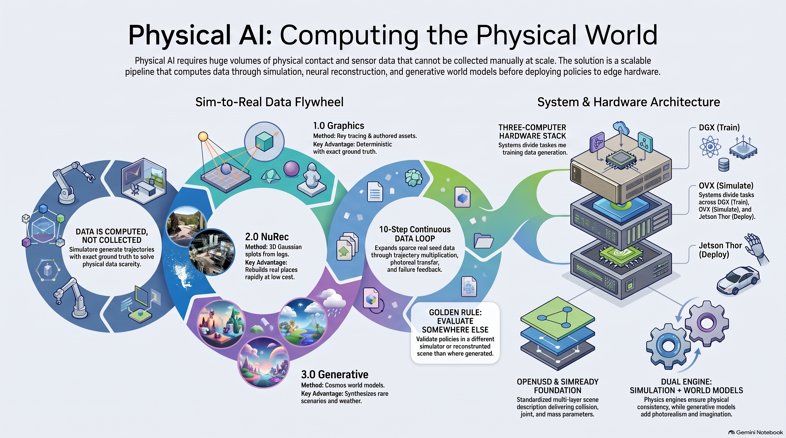
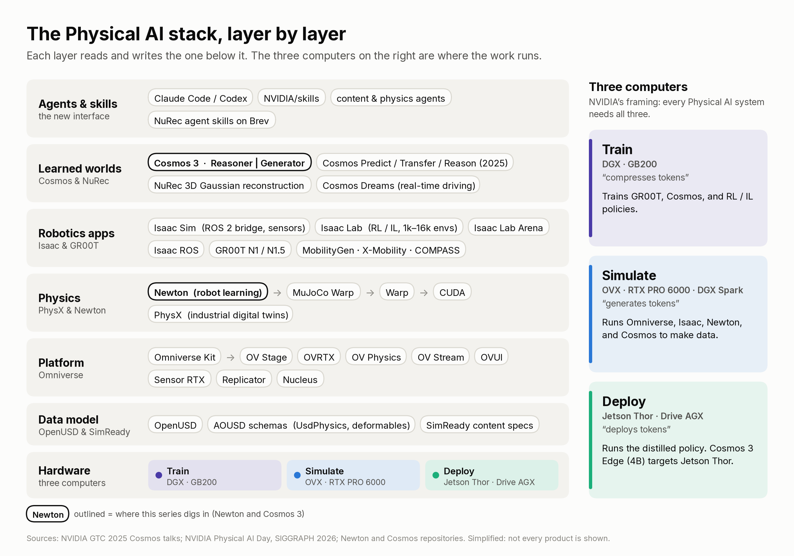
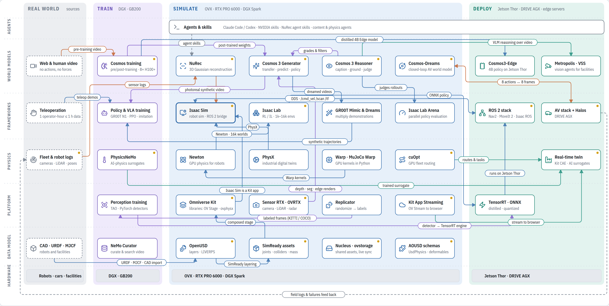
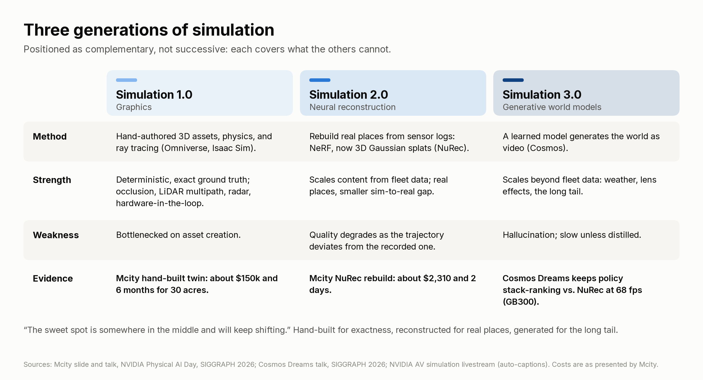
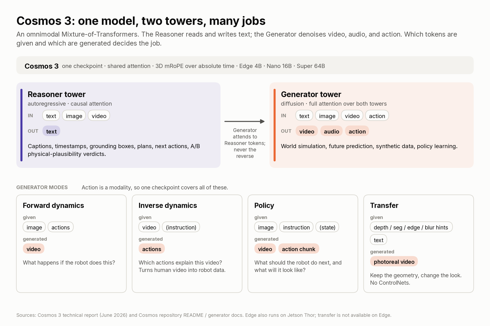
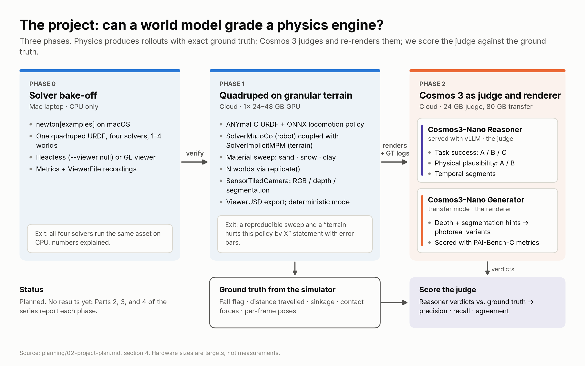

# Physical AI Playbook: Newton, Isaac, Omniverse, Cosmos & GR00T

Teams building robots and autonomous machines hit the same wall: there is never enough data. Teleoperation yields at most one hour of data per operator-hour, and resets eat much of that. Internet video is endless but carries no contact, friction, or force. Simulators scale with compute, yet physics that is "close enough" for games breaks robot policies, and renders that look synthetic don't transfer to real cameras. Generative world models look real but hallucinate, and even a good pipeline fails if the policy can't fit the robot's onboard computer.

---

---

## What this repository demonstrates

### Decision intelligence: Physics vs Reconstruction vs World Models vs Robot Brains
**Rule of thumb**:
- Use **Physics simulation (Newton / Isaac)** → when contact, forces, and exact ground truth matter
- Use **Neural reconstruction (NuRec)** → when you need a real place in simulation, fast
- Use **World models (Cosmos)** → when you need visual diversity, rare scenarios, or an automatic judge
- Use **Robot foundation models (GR00T / VLAs)** → when one policy must generalize across tasks, then distill it to the edge

The stack, layer by layer, is mapped in `context/00-physical-ai-landscape.md`. Applications (humanoids, AVs, smart spaces, factories, edge) are in `context/02-applications-and-ecosystem.md`.

The system map places 36 components by stack layer (rows) and by where they run (real world, train, simulate, deploy), with 31 labeled data flows. The interactive version (`guide/physical-ai-system-map.html`) shows each component's source slide on click.

---
## 1) OpenUSD & SimReady
**What:** OpenUSD is the scene description every tool in the stack reads and writes. **SimReady** is the content spec that makes a USD asset usable by a robot, not just a renderer.

**Why it matters**
- Graphics assets are hollow shells: no joints, no colliders, no mass.
- One robot asset must serve rendering, physics, sensors, ROS, and control without forking files.

**How**
- Layers hold *opinions*; the stage composes them by **LIVERPS** strength, strongest first: Local, Inherits, VariantSets, Relocates, References, Payload, Specializes. Through OpenUSD v24.11 the order was LIVRPS.
- Isaac Sim 6 documents files such as `base.usda`, `geometries.usd`, `instances.usda`, `materials.usda`, `physics.usd`, and a composed `asset.usd` or `interface.usda`.

**Key knobs / gotchas**
- `defaultPrim`, `upAxis` (Z for robotics), references vs payloads, `instanceable`
- Collision proxies: convex hull (fast) vs SDF (tight tolerances, soft bodies)
- Adding a referenced asset as a sublayer and editing it edits the original file.

---

## 2) Omniverse (platform + synthetic data)
**What:** NVIDIA's OpenUSD platform for RTX rendering, sensor simulation, synthetic data, and streaming. Apps are built from the Kit App Template. NVIDIA deprecated the Omniverse Launcher on 1 October 2025. Nucleus still stores shared assets.

**Why it matters**
- Perception models need labeled data at a scale no annotation team can produce.
- One scene must drive cameras, LiDAR, and radar with exact ground truth.

**How**
- Build apps from the **Kit App Template** (the Omniverse Launcher is deprecated).
- **Replicator:** randomize pose / color / texture / lighting → write KITTI or COCO labels → fine-tune a detector.

**Key knobs / gotchas**
- Randomizers, `num_frames`, resolution, writer format
- Add extensions to the `.kit` file **before** building.
- Distractor sets and texture randomization matter more than frame count.

---

## 3) Newton (GPU physics for robot learning)
**What:** Open-source GPU physics engine built on NVIDIA Warp, with MuJoCo Warp as its main rigid-body backend. A Linux Foundation project started by NVIDIA, Google DeepMind, and Disney Research. Version 1.0 reached general availability on 16 March 2026 at GTC 2026; Isaac Lab 3.0 integrates it as a physics backend.

**Why it matters**
- RL needs thousands of parallel environments. Robotics needs pluggable physics: cables, cloth, sand, tactile contact.

**How**
- `ModelBuilder` → `finalize()` → `State` / `Control` / `Contacts` → `CollisionPipeline.collide()` → `solver.step()` → swap states.
- Pick a solver: `SolverMuJoCo` (robots), `SolverXPBD` (cheap rigid), `SolverVBD` (cloth, cables, soft bodies), `SolverImplicitMPM` (sand, snow), `SolverKamino` (closed loops), or couple two.

**Key knobs / gotchas**
- Substeps per frame (a loop count in your script, not an engine parameter) → stability vs speed
- `world_count` in `replicate()` → parallel environments vs GPU memory
- `use_mujoco_contacts` → MuJoCo's contacts vs Newton's SDF / hydroelastic contacts
- Quaternions are XYZW, Z is up; maximal-coordinate solvers (XPBD, SemiImplicit, VBD) need `newton.eval_fk` after `finalize()`.
- macOS is CPU-only; APIs change monthly, so pin the version.

---

## 4) Isaac Sim + ROS 2 (software-in-the-loop)
**What:** Robot simulator on Omniverse: URDF/MJCF import, sensors, OmniGraph, and a ROS 2 bridge.

**Why it matters**
- Test the full software stack (Nav2, MoveIt 2, perception) before touching hardware.
- The sim publishes `/scan`, `/odom`, `/tf`, and camera topics exactly like a real robot.

**How**
- Import URDF → set joint drives → fix the articulation root → build an Action Graph: `On Playback Tick` → `ROS2 Subscribe Twist` → `Differential Controller` → `Articulation Controller`.
- Isaac Sim is the body and senses; a ROS 2 container is the brain; both share one DDS domain.

**Key knobs / gotchas**
- Articulation root on the top-level robot prim ("no robot prim found" otherwise)
- Wheels use velocity drives (stiffness 0, high damping); steering uses position drives.
- `frame_id`, `ROS_DOMAIN_ID`, sim-time stamps
- Nav2 bring-up order: map server → AMCL → planner → controller.

---

## 5) Isaac Lab (robot learning at scale)
**What:** GPU-parallel RL / imitation-learning framework on Isaac Sim, with PhysX or Newton underneath.

**Why it matters**
- Thousands of environments on one GPU turn months of robot time into hours.
- Ready-made tasks for quadrupeds, humanoids, and arms to start from.

**How**
- `train.py --task <ID> --num_envs N --headless` → checkpoints → `play.py --checkpoint ...`
- Custom task = scene + actions + observations + rewards + terminations (manager-based config).

**Key knobs / gotchas**
- `--num_envs` → throughput vs VRAM
- Reward shaping: dense approach / progress terms + sparse success bonus
- Domain randomization: mass, friction, pushes, sensor noise
- Use a second physics engine as a litmus test (sim-to-sim) before sim-to-real.

---

## 6) NuRec (neural reconstruction)
**What:** Turn recorded sensor logs into 3D Gaussian-splat scenes you can re-drive from new viewpoints.

**Why it matters**
- Hand-built digital twins are slow. Mcity is a 32-acre University of Michigan facility. A 2026 member-meeting talk described a year and a couple hundred thousand dollars the older way, versus about a week of GPU time with NuRec.
- Real places carry a smaller sim-to-real gap than authored ones.

**How**
- Logs (cameras, LiDAR, poses) → reconstruction → USDZ scene → real-time rendering for cameras and LiDAR. Instant NuRec previews a 10–20 s clip in about 1.5 s, against about 75 min of per-scene optimization for full NuRec (arXiv 2607.14203).
- **Fixer** repairs off-trajectory artifacts; **Asset Harvester** lifts objects out of reconstructions for reuse; **Harmonizer** relights inserts.

**Key knobs / gotchas**
- Sensor calibration and time sync dominate results.
- Quality drops as you move away from the recorded trajectory.

---

## 7) Cosmos 3 (world foundation models)
**What:** NVIDIA's open world models. **Cosmos 3** (arXiv 2606.02800; technical report 22 June 2026) unifies a **Reasoner** (vision + text → text) and a **Generator** (video, audio, action). The Generator is rectified flow: masked velocity loss, with a separate noise level per modality. Nano is 16B and Super is 64B, press dateline 31 May 2026. Edge is 4B and was released later, at SIGGRAPH on 20 July 2026. Nano and Super are initialized from Qwen3-VL; Edge is trained from scratch. Edge, Nano, and Super sit on dense 2B, 8B, and 32B transformers. Predict 2.5 (arXiv 2511.00062) is the previous flow-matching model: it predicts velocity ε − x on Wan2.1 latents (4×8×8, then 1×2×2). Predict1's diffusion family is 7B and 14B on Cosmos-Tokenize1, with a separate autoregressive family at 4B and 12B.

**Why it matters**
- Sim renders don't look real: in the Cosmos Predict 2.5 paper, Transfer augmentation took a real-robot policy from 1/30 to 24/30 successes, against 5/30 for classic image augmentation.
- Simulated and generated data both need an automatic critic.

**How**
- **Transfer:** depth / segmentation / edge video from the simulator + a prompt → photoreal video with geometry and labels preserved.
- **Reasoner:** captions, timestamps, 2D grounding, next action, physical-plausibility verdicts.
- **Action modes:** forward dynamics (actions → video), inverse dynamics (video → actions), policy (image + instruction → video + actions). Figure 3 lengths: autonomous vehicle 9D, single arm 10D, humanoid 29D, egocentric human 57D. Each pose is 9D (3D translation and 6D rotation).

**Key knobs / gotchas**
- Hint type (`edge` / `depth` / `seg`) and `control_guidance` → how tightly geometry is held
- `guidance_scale`, `num_inference_steps`, `num_frames`, resolution tier → quality vs latency
- Nano Reasoner benchmark on an H100 80GB (50 in / 100 out / 1 fps video): 143 ms to first token, 115 tokens/s. The full Nano checkpoint is about 15.75B parameters, on the order of 31.5 GB in BF16. The repo recommends an RTX PRO 6000, H100, or B200 for the Generator. Shipped fine-tuning recipes are 8× H100 configurations.
- World models hallucinate. Keep a validation step, and label which Cosmos generation a claim is about.

---

## 8) Robot foundation models & humanoids (GR00T)
**What:** Generalist robot policies (vision-language-action models) that map camera images, language, and proprioception to motor actions. **GR00T N1** (released 18 March 2025 as GR00T-N1-2B) has 2.2B parameters, 1.34B of them in Eagle-2. In the paper, System 2 runs at 10 Hz on an L40 and the diffusion transformer outputs actions at 120 Hz.

**Why it matters**
- GR00T N1 Table 7 lists 3,288.8 hours of real-robot data, 2,517.0 hours of human video, 1,742.6 hours of simulation, and 827.3 hours of neural trajectories, for 8,375.7 hours total. Neural trajectories expand 88.4 hours of in-house teleoperation to 827.3 hours.
- One model across tasks and embodiments, adapted with small embodiment-specific encoders.

**How**
- Data pyramid: real teleop (top) → simulation (middle) → human video (bottom). DexMimicGen generated about 21,000 demos from 60 human source demos, and its generated data produced a 90% real-world can-sorting policy versus 0% from the human demos alone (arXiv 2410.24185).
- GR00T Dreams: post-train Cosmos on robot data, prompt new tasks, filter with a reasoner, recover actions with inverse dynamics.
- The GR00T N1 paper's teleoperation (data collection) uses mink whole-body IK at 20 Hz; at runtime System 1 emits actions at 120 Hz. HOVER (arXiv 2410.21229) is a separate whole-body controller.

**Key knobs / gotchas**
- Real/synthetic mix and sampling weights
- Action representation: discrete tokens vs diffusion ("the jury is still out")
- Benchmarks move fast: on the RoboLab-120 overall leaderboard, Cosmos3-Nano-Policy-DROID scores 36.8%, π0.5 28.0%, and GR00T N1.6 7.2%. By September 2026, Black Forest Labs' 7B FLUX 3 Action reported 42.92%, above Cosmos 3 Nano.

---

## 9) Autonomous vehicles & safety
**What:** End-to-end AV stacks trained and tested with the same three computers: DGX trains, Omniverse + Cosmos simulate, DRIVE AGX drives.

**Why it matters**
- Rare events have to be found in fleet data, varied, and generated.

**How**
- Simulation 1.0 (graphics) → 2.0 (NuRec) → 3.0 (generative). OmniDreams and FlashDreams are NVIDIA’s 2026 line of action-conditioned driving world models.
- Scenario V&V (Foretellix): find coverage holes in fleet data, then fill them with augmented or synthetic drives.
- **Halos:** NVIDIA's AV safety system combining classical and end-to-end AI models across DGX, Omniverse/Cosmos, and DRIVE AGX. Halos OS sits on DriveOS, described as conforming with ISO 26262 ASIL D.

**Key knobs / gotchas**
- Condition Cosmos on what must stay true (HD map, boxes, lane lines); leave free what may vary (weather, lighting).
- Certification standards (ISO 26262, SOTIF) are outside this repo's sources; don't imply coverage.

---

## 10) Physical AI agents: smart spaces & industrial twins
**What:** Vision-language agents that watch cameras and digital twins (Metropolis, Video Search and Summarization), plus real-time engineering twins and fleet optimization (cuOpt, Mega).

**Why it matters**
- Factories and cities see the robot from the outside: free pallet space, people near humanoids, zone violations.

**How**
- Perceive (multi-camera 3D tracking) → specialist agents (spatial VLM, safety, metrics) → an LLM orchestrator → answers scored on both final response and trajectory.
- Real-time CAE twins replace slow solvers with AI surrogates trained on trusted CFD (PhysicsNeMo + Warp + Kit CAE).
- cuOpt assigns and routes forklift fleets inside Isaac Sim.

**Key knobs / gotchas**
- Break agents into small tools so you can drop tools as VLMs improve.
- 3D-VLM steps (segmentation, depth) are per-image, not real-time.

---

## 11) Edge deployment (Jetson Thor)
**What:** The third computer: the robot's onboard module. **Jetson AGX Thor** offers up to 2,070 TFLOPS of sparse FP4 (7.5× AGX Orin), 128 GB at 273 GB/s, and 40–130 W (NVIDIA product page and 25 August 2025 developer blog). Dense FP4 is 1,035 TFLOPS.

**Why it matters**
- The edge sets model size. GR00T N1's released checkpoint is 2.2B parameters.
- Cosmos 3 changed the 2025 rule that world models stay in the data center: the 4B Cosmos3-Edge (2B Nemotron-based reasoner) generates 32 actions per inference at 15 Hz on Jetson Thor, at 640×360.

**How**
- Distill: teacher → small student. Cosmos 3 ships 4-step Super variants with a stated 17–25× speedup; Predict 2.5's 4-step rCM distillation kept PAI-Bench text-to-world nearly flat (0.768 → 0.764).
- Export to ONNX / TensorRT; keep real-time control loops on the robot.

**Key knobs / gotchas**
- Precision (FP8 / FP4), MIG partitioning, power budget
- A safety island is documented on IGX Thor. Holoscan Sensor Bridge is described as contributing to SIL 2. Thor’s power range is 40–130 W.

---

## 12) Evaluation (evaluate somewhere else)
**What:** Closed-loop evaluation in a different simulator, a reconstructed scene, or the real robot, not just the one that produced the data.

**Why it matters**
- A policy that only works in its training simulator has proven only that it can exploit that simulator. X-Mobility (arXiv 2410.17491), trained on Isaac Sim synthetic data, transferred zero-shot to a real Nova Carter; this repo's own sim-to-sim check runs a PhysX-trained ANYmal policy in Newton.

**How**
- Isaac Lab Arena and partner benchmarks for massively parallel trials; RoboArena for real-world pairwise ranking.
- A cheaper simulator is valid if it ranks policies the same way as a trusted one.

**Key knobs / gotchas**
- Open-loop metrics don't predict closed-loop behavior.
- A learned judge must itself be scored against ground truth (this repo's Phase 2).

---

## Hands-On Project

**Sand, Solvers, and World Models:** a quadruped walks on deformable terrain in Newton; Cosmos 3 renders and judges it.

| Phase | What | Hardware | Status |
|---|---|---|---|
| 0 | Solver bake-off: one quadruped, six Newton solver paths | CPU | **Done** on Linux CPU; macOS re-run pending |
| 1 | ANYmal on rigid ground vs MPM sand / snow / clay; speed, falls, sinkage | GPU for the full sweep | CPU smoke test passes; full sweep is GPU code, not executed |
| 2 | Cosmos 3 Nano: Reasoner as critic vs ground truth; Transfer for photoreal variants | GPU or a hosted model API | Protocol and client ready (dry-run tested); live model not executed |

### Phase 0 results (measured, CPU only)

A quadruped drops from 0.7 m and settles under joint drives: 100 fps × 10 substeps (dt = 1 ms), 4 s, one world, 4-core 2.1 GHz Xeon, Newton main (`1.7.0.dev0`, ahead of the 1.6.0 release).

| Solver path | Settle height | Settle time | ms per 10 ms frame (median) |
|---|---|---|---|
| MuJoCo (MuJoCo C, `use_mujoco_cpu=True`) | 0.459 m | 0.58 s | 5.7 |
| SemiImplicit | 0.432 m | 1.85 s (still oscillating) | 8.8 |
| XPBD | 0.460 m | 1.05 s | 14.1 |
| Featherstone | 0.449 m | 0.65 s | 17.8 |
| VBD (`rigid_compliant_alm=True`) | 0.458 m | 1.02 s | 22.8 |
| MuJoCo (mujoco_warp on the Warp CPU device) | 0.459 m | 0.58 s | 57.0 |

---

## Repository Highlights

- **Stack map:** `context/00-physical-ai-landscape.md`
- **Applications (humanoids, AV, smart spaces, factories, edge, evaluation):** `context/02-applications-and-ecosystem.md`
- **Fact-check of these docs (46 claims):** `context/03-fact-check.md`
- **Glossary:** `context/01-glossary.md`
- **Source notes (talks, tutorials, papers, repos):** `context/sources/`
- **Learning guide (23 chapters, HTML):** `guide/physical-ai-field-manual.html`
- **Interactive system map (36 components, 31 flows):** `guide/physical-ai-system-map.html`
- **Workflow atlas (11 workflows, screenshots → code):** `workflows/`
- **Project code (`ssw` package, results, reports):** `project/`
- **Plans:** `planning/01-project-options.md`, `02-project-plan.md`, `03-environment-and-compute.md`, `04-roadmap.md`
- **How it is built (subagents, worktrees, hooks, session handoff):** `planning/05-agentic-workflow.md`
- **Blog:** `BLOG_POST.md` (playbook), `blog/02-blog-draft.md` (long-form)

---

## References

- [Newton](https://github.com/newton-physics/newton) and [Newton documentation](https://newton-physics.github.io/newton/latest/guide/overview.html)
- [NVIDIA Warp](https://github.com/NVIDIA/warp) and [MuJoCo Warp](https://github.com/google-deepmind/mujoco_warp)
- [NVIDIA Cosmos](https://github.com/NVIDIA/cosmos), [Cosmos 3 models](https://huggingface.co/collections/nvidia/cosmos3)
- [Cosmos 3: Omnimodal World Models for Physical AI](https://research.nvidia.com/labs/cosmos-lab/cosmos3/technical-report.pdf) (technical report)
- [World Simulation with Video Foundation Models for Physical AI](https://arxiv.org/abs/2511.00062) (Cosmos Predict 2.5 / Transfer 2.5)
- Daviet, *Mixed Material Point Methods for Stiff Elastoplasticity*, SIGGRAPH 2026
- Chen et al., [Divide and Truncate](https://arxiv.org/abs/2604.15513)
- [Isaac Lab](https://github.com/isaac-sim/IsaacLab) and Isaac Sim documentation
- [OpenUSD](https://openusd.org/) and the NVIDIA Learn OpenUSD curriculum
- NVIDIA Physical AI Day, SIGGRAPH 2026 (session recordings)
- NVIDIA GTC 2025 sessions on Cosmos, GR00T, humanoids, AV simulation, Metropolis agents, and smart cities
- Isaac Sim & Isaac Lab Complete Tutorial Series; NVIDIA Omniverse Tutorials (YouTube)

---
**Pankaj Somkuwar**  
AI Engineer | AI Product Manager | AI Solutions Architect  

- LinkedIn: https://www.linkedin.com/in/pankaj-somkuwar/  
- GitHub: https://github.com/Pankaj-Leo  
- Website: https://www.pankajsomkuwarai.com  
- Email: pankaj.som1610@gmail.com  
