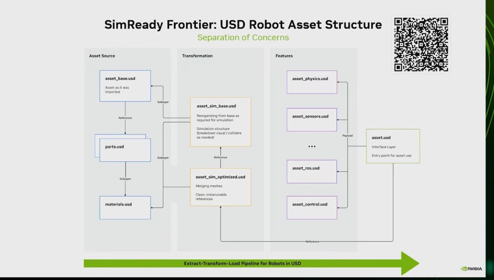
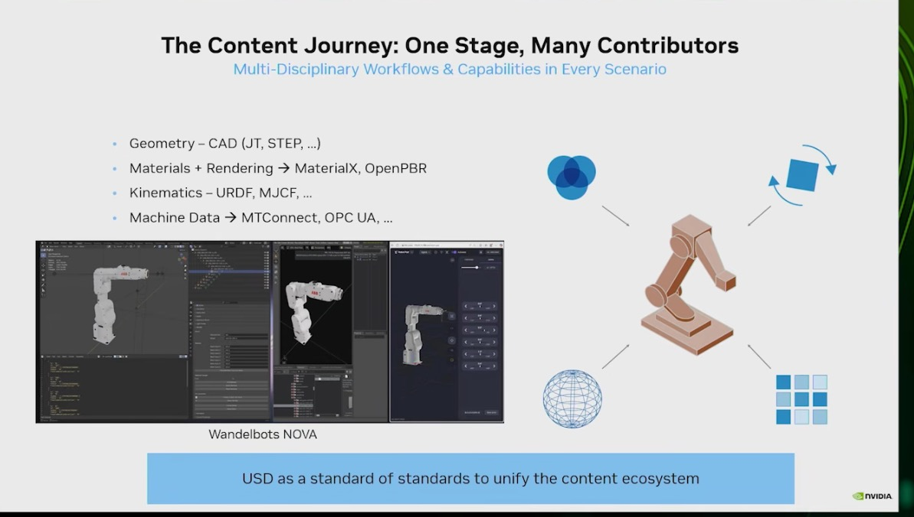
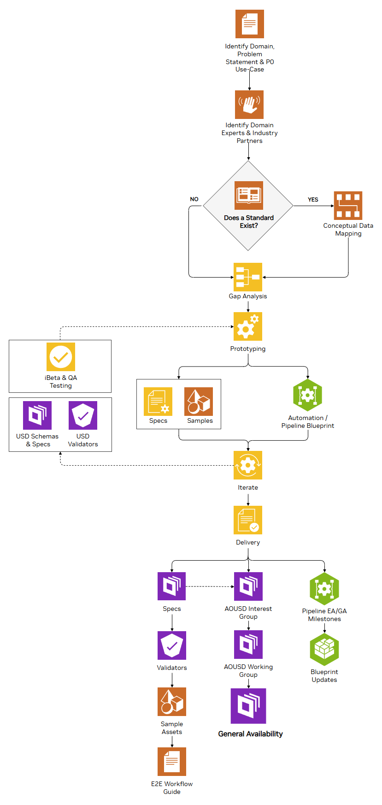
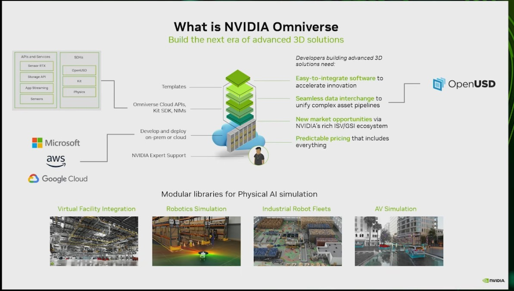

# 01 — OpenUSD SimReady robot asset

> Rebuilds the "SimReady Frontier: USD Robot Asset Structure" slide as working `pxr` code: a URDF quadruped becomes
> a layered USD asset (source, transformation and feature layers behind one interface file), is checked by a
> validator, and is loaded and stepped by Newton on CPU. OpenUSD and SimReady are the data layer under every
> Omniverse, Isaac and Newton workflow in this atlas.

## Source evidence

| Evidence | What it shows |
|---|---|
|  | "SimReady Frontier: USD Robot Asset Structure — Separation of Concerns". Three columns: Asset Source (`asset_base.usd` references `parts.usd`, which sublayers `materials.usd`), Transformation (`asset_sim_base.usd` sublayers the base and the materials; `asset_sim_optimized.usd` references it and merges meshes into clean instanceable references), Features (`asset_physics`, `asset_sensors`, `asset_ros`, `asset_control` …) reached by payload from `asset.usd`, the interface layer and entry point, which also references the optimized asset. Footer: "Extract-Transform-Load Pipeline for Robots in USD". Omniverse/OpenUSD deck (Deck A). |
|  | "The Content Journey: One Stage, Many Contributors": geometry from CAD (JT, STEP), materials (MaterialX, OpenPBR), kinematics (URDF, MJCF), machine data (MTConnect, OPC UA) meet in one stage; "USD as a standard of standards". Deck A. |
|  | SimReady playbook process: identify domain and partners, "Does a standard exist?", conceptual data mapping, gap analysis, prototyping (specs, samples, automation blueprint), iterate with USD schemas, specs and validators, delivery. SIGGRAPH 2026 SimReady talk material. |
|  | "What is NVIDIA Omniverse": APIs and SDKs (OpenUSD, Kit, Physics) and modular libraries for robotics, factory and AV simulation; OpenUSD named for "seamless data interchange". Deck A. |

Transcripts used (file names, and which steps each covers):
- `NVIDIA OMNIVERSE TUTORIALS/NVIDIA Open USD Path Module 3 — Composition Basics.txt`: LIVERPS strength order (01:37, 19:16-19:56), references vs payloads (21:43-22:21, "references will be stronger than payloads"), variant vs local opinion with a red/black/pink cube (25:02-30:49), internal references and `defaultPrim` (48:10-49:33).
- `NVIDIA OMNIVERSE TUTORIALS/NVIDIA Open USD Path Module 4 — Beyond The Basics.txt`: sublayer order, first listed is strongest (30:57-31:11); `active` is an opinion (44:39); model kinds (48:11-48:59).
- `NVIDIA OMNIVERSE TUTORIALS/NCP-OpenUSD Development certification Course (1.1 - Composition - Local Opinions - Sublayering).txt`: local opinions inside sublayers, the root layer as the strongest opinion, flattening (00:57-17:28).
- `NVIDIA OMNIVERSE TUTORIALS/NCP-OpenUSD Development certification Course (1.2 - Composition -Inheritance).txt`: class prims, inherits, instancing, local beats inherits (12:08, 28:58).
- `NVIDIA OMNIVERSE TUTORIALS/Omniverse Basic Training   01 (USDComposer, Layers, Variants, Components).txt`: geometry and looks sublayers (11:22-14:10), a content file brought into the component by payload (23:07-26:47), "painted"/"steel" variants and local edits overriding them (28:08-31:04), a sublayer whose orientation did not match until the world axis was set to Z (11:22-11:53).
- `NVIDIA OMNIVERSE TUTORIALS/Omniverse Basic Training 02  (openUSD for digital twins - USDExplorer).txt`: payloads to load parts of a twin on demand (05:49), variant sets (08:56-12:20).
- `NVIDIA OMNIVERSE TUTORIALS/Omniverse Basic Training 04 (Import Robot from URDF File and Assets Library).txt`: URDF visual vs collision geometry (01:05), hiding collision visuals (07:01-07:14), the importer putting the articulation root on the chassis link and moving it to the robot prim (08:27-08:56), self-collision off (09:57).
- `NVIDIA OMNIVERSE TUTORIALS/How to Install USDVIEW and Python Environment with USD-Core.txt`: `usd-core` in a Python venv, `usdview` to inspect files (03:15-10:35).
- `NVIDIA Physical AI | SIGGRAPH 2026/Building SimReady 3D Worlds for Physical AI  Physical AI Day at SIGGRAPH 2026.txt`: no one-size-fits-all SimReady asset (05:02, 10:11), joint and limit validation (06:46-07:11), collision proxies (07:22-08:48), a "report card" that tests the asset in the target simulator "like Isaac Sim or Newton" (12:27-12:51).
- `NVIDIA Physical AI | SIGGRAPH 2026/OpenUSD for AI Agents and 3D Graphics Pipelines  Physical AI Day at SIGGRAPH 2026.txt`: SimReady as a standard for enriching 3D content (05:31, 08:12), the CAD-to-SimReady agent skill (13:10).

## What the workflow does

The slide is an extract-transform-load pipeline. Each concern lives in its own layer, so the CAD team, the
simulation team and the controls team edit different files of one asset, and a user opens a single file.

```
           asset.usda  (interface: kind=component, assetInfo, the only file users open)
             | reference                         | payload (x4, physics strongest)
             v                                   v
   asset_sim_optimized.usda          asset_physics / asset_sensors / asset_ros / asset_control.usda
     instanceable visuals                (overs on the same prim paths; they only add opinions)
             | reference
             v
   asset_sim_base.usda  --sublayer-->  asset_base.usda  --reference-->  parts.usda  --sublayer-->  materials.usda
     colliders split from visuals,       as imported:                  one mesh per unique
     purposes, material bindings         13 link Xforms, visuals       shape (3 parts)
             '------------------sublayer------------------------------------------------------>  materials.usda
```

1. **Extract** (`asset_base`, `parts`, `materials`). `build_asset.py` parses the URDF with `xml.etree`, computes
   each link's pose at zero joint angles, and writes one Xform per link. Visual geometry is a reference into
   `parts.usda`, which holds one triangulated mesh per *unique* shape. The 13 links share 3 shapes: body, hip
   housing, leg segment. Materials (UsdPreviewSurface) live in their own layer under `/quadruped/Looks`.
2. **Transform** (`asset_sim_base`, `asset_sim_optimized`). The sim base sublayers the import and adds what a
   simulator needs and an importer does not provide: a separate `collisions` scope per link with analytic
   UsdGeom Cylinder proxies (`purpose = guide`), `purpose = render` on visuals, and material bindings. The
   optimized layer references the sim base and marks every visual instanceable, so USD composes 13 visual prims
   from 3 shared prototypes.
3. **Load** (feature payloads and the interface). Physics (UsdPhysics: ArticulationRootAPI on the robot prim,
   RigidBodyAPI and MassAPI per link from the URDF inertials, CollisionAPI on the proxies, revolute joints with
   limits and angular drives, a physics material), sensors (a `UsdGeom.Camera` and an IMU frame), ROS (topic and
   frame names) and control (standing-pose drive targets, initial joint state, policy I/O contract) are four
   layers of `over`s. `asset.usda` reaches them by payload, so a viewer can open the asset without physics or ROS,
   and a simulator loads everything.
4. **Validate** (`validate.py`). The SimReady talk's "report card": 13 named checks on the composed stage (stage
   metadata, per-layer unit agreement, payload resolution and effect, one articulation root above every body,
   joint limits, joint body targets, mass, colliders, collider visibility).
5. **Test in the target simulator** (`load_in_newton.py`). `newton.ModelBuilder().add_usd("asset.usda")`, a
   ground plane, `SolverXPBD`, 1 s at 100 Hz x 10 substeps on CPU, compared against the same robot loaded straight
   from the URDF with identical solver settings.

`composition_demo.py` reproduces the LIVERPS exercises from the tutorials in five in-memory stages and records,
for each step, which layer supplied the winning opinion (`Usd.Attribute.GetPropertyStack`).

## Code

| File | Purpose | Runs on | Status |
|---|---|---|---|
| `build_asset.py` | URDF to the 10-layer asset of the slide | CPU, `usd-core` | executed here |
| `validate.py` | 13-check SimReady report card, JSON output, exit code | CPU, `usd-core` | executed here |
| `load_in_newton.py` | `add_usd` + 1 s XPBD on CPU, compared with the URDF path | CPU, Newton 1.7.0.dev0 | executed here |
| `composition_demo.py` | LIVERPS: local > variant > reference, sublayer order, local > inherits, reference > payload, unloaded payloads | CPU, `usd-core` | executed here |
| `run_all.py` | Runs the four steps, writes `results/` and `sample/` | CPU | executed here |
| `sample/asset_physics.usda` | The generated UsdPhysics feature layer (19 KB), for reading without running | — | generated here |
| `results/*.json` | Build summary, validation report, Newton comparison, composition results, run metadata | — | generated here |
| `tests/test_simready.py` | Build in a temp dir, validator passes, 4 injected faults are caught, LIVERPS, Newton load | CPU | executed here |

Generated layers go to `out/`, which is git-ignored.

## Run it (GPU box)

No GPU is needed. Pinned versions as run here: Python 3.11, `usd-core` 0.26.8 (`pxr`), Newton 1.7.0.dev0
(editable from `newton-main/`), Warp 1.17.0.

```bash
source .venv/bin/activate
cd physical-ai-project/workflows/01-openusd-simready
python build_asset.py --out out/            # writes the 10 layers
python validate.py out/asset.usda --json out/validation.json
python load_in_newton.py out/asset.usda     # 1 s on CPU, USD vs URDF
python composition_demo.py --write out/composition
python run_all.py                           # all of the above, refreshes results/ and sample/
usdview out/asset.usda                      # optional, needs the full OpenUSD build (see the USDVIEW tutorial)
```

On a GPU box the same `asset.usda` can be opened in Isaac Sim 5.x (File > Open). That was not executed here.

## Source step → code map

| Source step (transcript or screenshot) | Code location |
|---|---|
| Slide: `asset_base.usd` "asset as it was imported", references `parts.usd` | `build_asset.py: write_base()` |
| Slide: `parts.usd` sublayers `materials.usd` | `build_asset.py: write_parts()`, `write_materials()` |
| Slide: `asset_sim_base.usd` "breakdown visual / colliders as needed", sublayers base and materials | `build_asset.py: write_sim_base()`, `collider_prim()` |
| Slide: `asset_sim_optimized.usd` "clean, instanceable references", references the sim base | `build_asset.py: write_sim_optimized()` |
| Slide: `asset_physics/sensors/ros/control.usd` by payload from `asset.usd` | `build_asset.py: write_physics()`, `write_sensors()`, `write_ros()`, `write_control()` |
| Slide: `asset.usd` "Interface Layer, entry point for asset use" | `build_asset.py: write_interface()` |
| Playbook: "Gap analysis" (URDF lacks position limits) | `build_asset.py: JOINT_LIMITS_DEG`, `joint_limits_deg()` |
| Playbook: "USD Schemas & Specs", "USD Validators" | `validate.py: validate()` |
| SimReady talk 12:27-12:51: report card that tests the asset in Isaac Sim or Newton | `validate.py` + `load_in_newton.py` |
| Basic Training 04, 08:27-08:56: articulation root belongs on the robot prim, not the chassis | `write_physics()` applies it to `/quadruped`; `validate.py: single_articulation`; `tests: test_validator_catches_second_articulation_root` |
| Basic Training 04, 07:01-07:14: hide collision geometry, keep it for physics | `collider_prim()` sets `purpose = guide`; `validate.py: colliders_not_visible` |
| Basic Training 01, 11:22-11:53: a sublayer with the wrong orientation | `validate.py: layer_units_agree`; `tests: test_validator_catches_unit_mismatch` |
| Module 3, 25:02-30:49: red reference, black variant, pink local opinion | `composition_demo.py: case_reference_variant_local()` |
| Module 4, 30:57-31:11 and NCP 1.1: first sublayer is strongest | `composition_demo.py: case_sublayer_order()` |
| NCP 1.2, 28:58: local opinion beats inherits | `composition_demo.py: case_local_vs_inherit()` |
| Module 3, 19:41-19:56: references beat payloads | `composition_demo.py: case_reference_vs_payload()` |
| Module 3, 21:43-22:21 and Basic Training 01, 31:41: payloads load on demand | `composition_demo.py: case_payload_unloaded()`; `validate.py: payloads_effective` |

## Gotchas from the sources

- **The importer may put the articulation root on the wrong prim.** In Basic Training 04 (08:27-08:56) the URDF
  importer created it on the chassis link; the presenter removed it and applied it to the robot prim. Two roots,
  or a root below some bodies, is the first thing the validator checks.
- **A referenced layer with a different up axis or unit silently rotates or scales the asset.** Basic Training 01
  (11:22-11:53) hit this with a geometry sublayer. USD does not convert units across composition arcs, so
  `validate.py` compares every used layer's `upAxis` and `metersPerUnit` with the stage.
- **References beat payloads (LIVERPS).** Module 3 (19:56). In this layout the feature layers arrive by payload
  and the geometry by reference, so a feature layer cannot override anything the optimized asset authors. Our
  feature layers only add opinions (`over`s on new properties), which is the intended use.
- **Variants lose to local opinions.** Module 3 (29:50) and Basic Training 01 (29:27-30:01): a local edit keeps
  winning after you switch variants. `composition_demo.py` records the winning layer for each step.
- **Collision geometry should be cheap and hidden.** SimReady talk (07:22-08:48): proxies built from the render
  mesh make RL scenes slow. Here colliders are analytic cylinders with `purpose = guide`. Visual meshes carry no
  CollisionAPI (validator check `colliders_not_visible`).
- **Joints need real limits.** SimReady talk (06:46-07:11): "if a drawer can only go out so far, it has to match".
  The example URDF has only effort and velocity limits. Newton's URDF importer then leaves the joints unlimited
  (±1e10 rad in `results/newton_load.json`), so the gap-fill values in `JOINT_LIMITS_DEG` are our choice, not a
  datasheet. Change them for a real robot.
- **Found while building: joint order differs between importers.** Newton's USD import walks the tree depth-first
  (LF, LH, RF, RH legs); the URDF lists LF, RF, LH, RH. Each joint gets the right value by name, but a policy that
  indexes joints by position would be wrong. The control layer records `ssw:control:jointOrder`, and
  `load_in_newton.py` compares by name.
- **Found while building: there is no UsdPhysics joint-state schema in OpenUSD 0.26.** The initial pose is authored
  as `newton:angular:position` (degrees), which Newton reads, with a UserWarning asking for a supported
  alternative. Isaac Sim assets use PhysX's `state:angular:physics:position` instead.
- **Found while building: anonymous layers are freed when Python drops them.** An unloaded payload is not held by
  the stage, so `stage.Load()` later fails to open it. `composition_demo.py` keeps the layers alive.

## What we verified here

Executed in the cloud container (4 CPU cores, no GPU), 2026-10-03, with the versions in
`results/run_metadata.json`:

- `build_asset.py` wrote all 10 layers (0.6 KB to 19 KB each). 13 links and 12 joints; 13 instanced visuals
  compose from **3 prototypes** (`results/build_summary.json`).
- `validate.py` passed **13 of 13 checks** (`results/validation_report.json`). Payloads matter: 13 rigid bodies
  with payloads loaded, 0 with `LoadNone`. The tests inject 4 faults and the validator flags each one: a deleted
  payload file, a centimetre layer, a second articulation root, a removed joint limit.
- Newton loaded `asset.usda` with `add_usd`: 13 bodies, 18 DOFs (6 free-base + 12 revolute), 30.702 kg, the same
  as the URDF path. After 1 s of XPBD at 100 Hz x 10 substeps on CPU, the base height is **0.4585 m (USD) vs
  0.4587 m (URDF)**. The maximum joint-angle difference is 0.0 rad at 4-decimal rounding. Median 13.1 ms vs
  12.6 ms per frame on CPU (`results/newton_load.json`). The USD model has 26 shapes (13 visual meshes and 13
  colliders); the URDF model has 13.
- `composition_demo.py`: all 5 LIVERPS cases resolved as the tutorials predict (`results/composition_demo.json`).
- `pytest 01-openusd-simready`: 8 tests pass.

Not done here: opening the asset in Isaac Sim or `usdview`, any GPU run, real CAD meshes (the visuals are
triangulated copies of the URDF collision cylinders, because this URDF has no visual meshes), and "merging
meshes" from the slide (one shape per link, nothing to merge).
