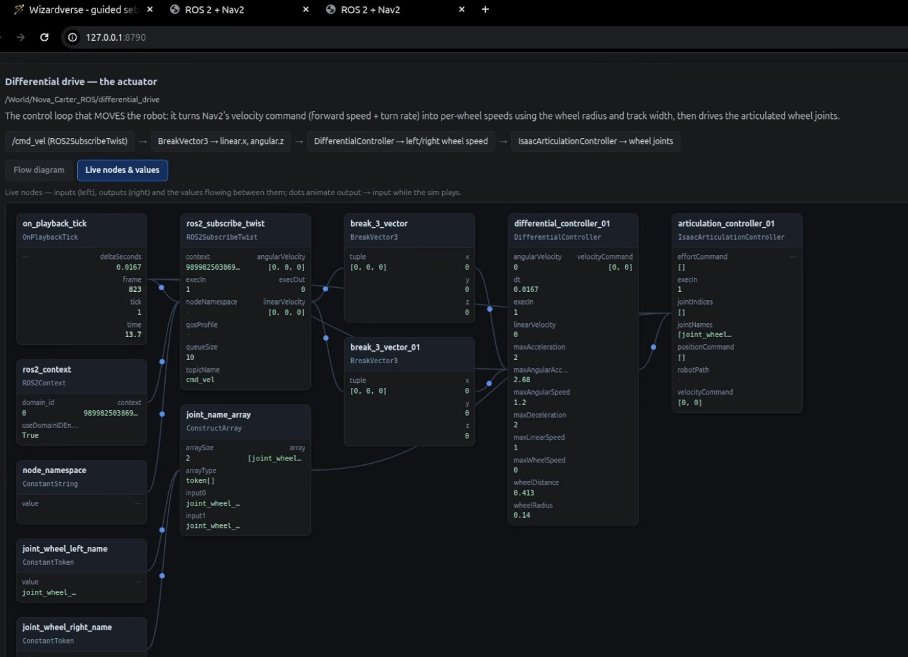
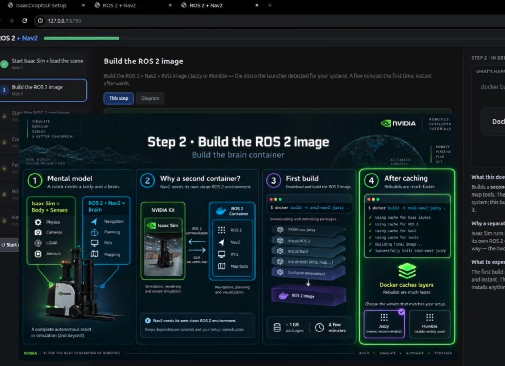
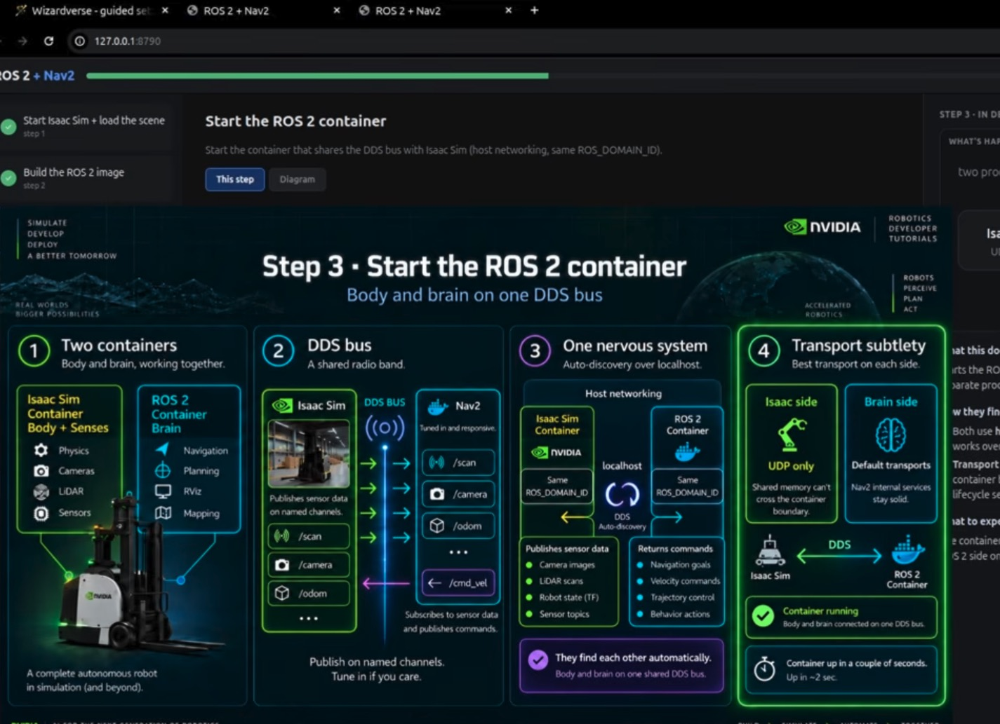
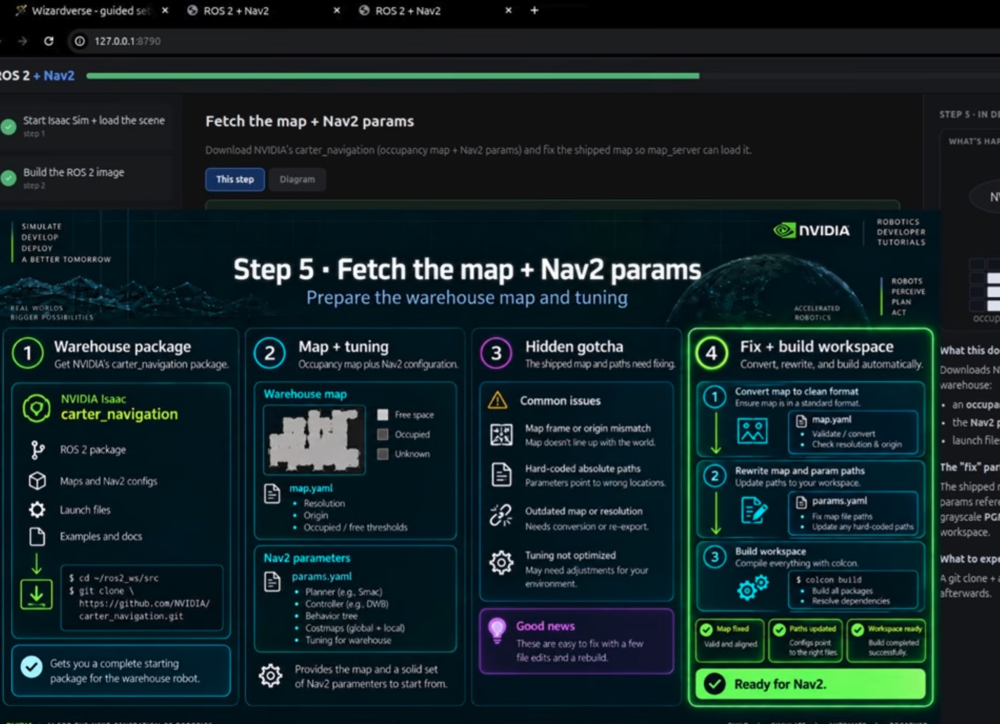
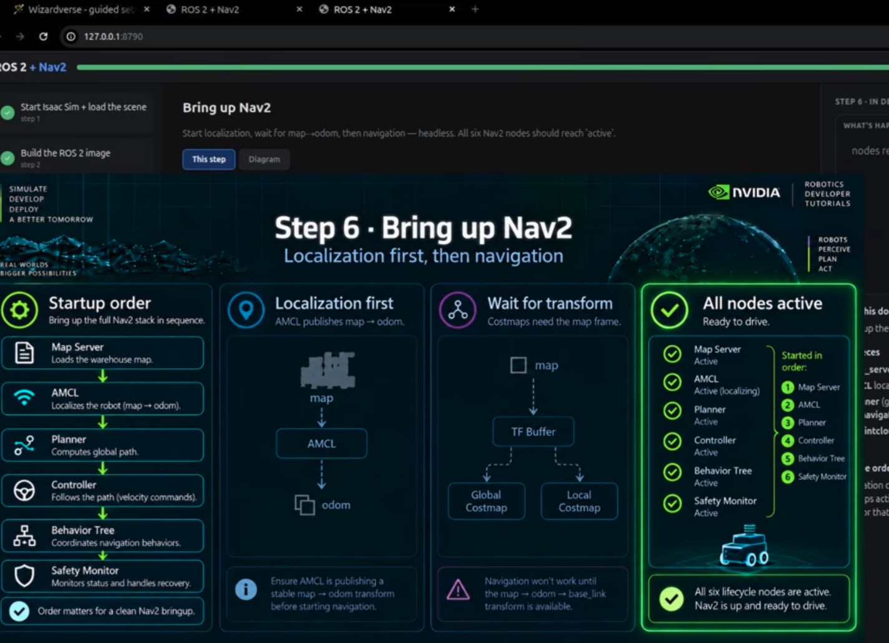
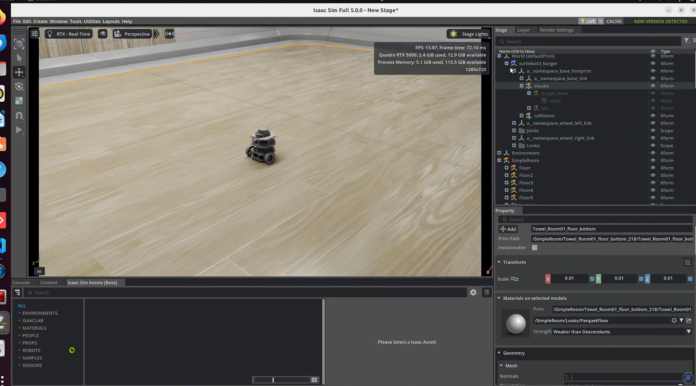

# 02 — Isaac Sim + ROS 2 Nav2: software in the loop

> Isaac Sim simulates the robot's body and sensors; a ROS 2 Jazzy container running Nav2 is its brain. Both meet on one
> DDS bus. Reproduced from the "ROS 2 + Nav2" wizard (Wizardverse) and Isaac Sim tutorials #5, #6, #10, #11 and #15.
> Physical AI layer: simulation-validated robot software, before any hardware.

## Source evidence

| Evidence | What it shows |
|---|---|
|  | Live OmniGraph inspector, ROS 2 + Nav2 wizard. Graph `/World/Nova_Carter_ROS/differential_drive` with 11 nodes and their values: `ROS2SubscribeTwist` on `cmd_vel` (queueSize 10), `ROS2Context` (domain_id 0, useDomainIDEnvVar True), two `BreakVector3`, `ConstructArray` of two `ConstantToken` wheel joints, `DifferentialController` (wheelRadius 0.14, wheelDistance 0.413, maxLinearSpeed 1, maxAngularSpeed 1.2, maxAcceleration 2, maxDeceleration 2, maxAngularAcceleration 2.68, dt 0.0167), `IsaacArticulationController`. |
|  | Wizard step 2, "Build the ROS 2 image". Isaac Sim = body + senses, ROS 2 + Nav2 = brain. `docker build -t ros2-nav2:jazzy .` with layers FROM ros:jazzy, Nav2, RViz and map tools. Jazzy (recommended) or Humble. |
|  | Wizard step 3, "Start the ROS 2 container". Host networking, same `ROS_DOMAIN_ID`, DDS auto-discovery over localhost. Isaac side "UDP only: shared memory can't cross the container boundary"; brain side keeps default transports. |
|  | Wizard step 5, "Fetch the map + Nav2 params". NVIDIA `carter_navigation` package (map.yaml with resolution, origin and thresholds; params.yaml with planner (e.g. Smac), controller (e.g. DWB), behavior tree, costmaps). "Hidden gotcha": frame/origin mismatch, hard-coded absolute paths, outdated map. |
|  | Wizard step 6, "Bring up Nav2". Order: Map Server → AMCL (map → odom) → Planner → Controller → Behavior Tree → Safety Monitor. "Navigation won't work until the map → odom → base_link transform is available." |
|  | Isaac Sim Full 5.0.0 with an imported TurtleBot3 Burger in a Simple Room (Isaac Sim tutorial series). |

Transcripts used:
- `NVIDIA OMNIVERSE TUTORIALS/My wizard 3 is live! It's called ROS 2 + Nav2.txt` and the short `Wizard #3 ROS2 + Nav2 + Rviz.txt`: the two-container design, the domain ID, the ~6 GB image, the step 4 topic check (clock, LiDAR, `cmd_vel`), the step 5 fetch and its failing downloads, the step 6 order and the reason for it, goals from RViz or the UI.
- `NVIDIA OMNIVERSE TUTORIALS/Omniverse B.T. 07 (Software-in-the-Loop ...).txt`: SIL definition; the Nova Carter Twist graph by hand (wheel radius 0.14, joints `joint_wheel_left/right`, target `chassis_link`); `ros2 topic pub /cmd_vel`.
- `NVIDIA Isaac Sim & Isaac Lab – Complete Tutorial Series/`: #5 (URDF import, velocity drives, Occupancy Map tool), #6 Part 1 (the differential-drive graph and the articulation-root fix), #10 Parts 1–4 (camera, IMU, 2D and 3D LiDAR graphs), #11 (odometry and TF), #15 (Actor SDG walking humans).

## What the workflow does

The robot software under test (Nav2) runs unmodified in its own container. Isaac Sim stands in for the robot and the
warehouse. The only contract between them is a set of ROS 2 topics on one DDS domain:

```
Isaac Sim 5.0.0 container (body)                         ROS 2 Jazzy container (brain)
  graph               publishes / subscribes                Nav2 node            uses
  ros_clock           /clock                    ────►       every node           /clock (use_sim_time)
  ros_odometry        /odom, /tf odom→base_link ────►       amcl                 /scan, /tf → map→odom
  ros_tf              /tf base_link→sensors     ────►       planner_server       global costmap (map)
  ros_lidar_2d        /scan                     ────►       controller_server    local costmap → cmd_vel_nav
  ros_lidar_3d        /point_cloud              ────►       behavior_server      cmd_vel_nav
  ros_camera          /rgb, /camera_info        ────►       bt_navigator         goals from RViz
  ros_imu             /imu                      ────►       collision_monitor    cmd_vel_nav → /cmd_vel
  differential_drive  /cmd_vel → wheel joints   ◄────
                 one DDS bus: host network, same ROS_DOMAIN_ID
```

Each Isaac Sim graph is ticked by `On Playback Tick` and talks to ROS through a `ROS2 Context`. The drive graph turns a
Twist into two wheel speeds with the wheel radius and track width, then an Articulation Controller applies them to the
wheel joints, which must be velocity drives. Every message carries simulation time, and `/clock` lets Nav2 run on that
same clock (`use_sim_time: true`).

Nav2 starts in two phases. Localization comes first: map server and AMCL. AMCL needs `/scan`, `/odom`, the
`odom → base_link → sim_lidar` transforms and an initial pose before it publishes `map → odom`. Only then does the
navigation phase start: planner, controller, behaviors, BT navigator, collision monitor. The wizard explains why: the
costmaps need the `map` frame, and if it is missing they "sit there waiting for the map frame and then give up".
`bringup.launch.py` enforces the order with a TF wait between the two phases.

## Code

| File | Purpose | Runs on | Status |
|---|---|---|---|
| `ogspec.py` | Action graphs as data: node catalog (ports, evidence), validator, `og.Controller.edit` applier | CPU (data), Isaac Sim (`apply`) | data executed here; `apply` not executed: needs GPU |
| `graph_spec.py` | The eight SIL graphs for Nova Carter (screenshot values) and TurtleBot3 (tutorial #6 values); topic, frame and TF helpers | CPU | executed here (tests) |
| `build_graphs.py` | Isaac Sim 5.0.0 standalone script: warehouse + robot, articulation-root fix, wheel-drive check, sensor prims, all graphs; `--mode sample` loads NVIDIA's sample instead | Isaac Sim 5.0.0, RTX GPU | not executed: needs GPU (compiles, lint clean, imports on CPU) |
| `docker-compose.yml` | `isaac-sim` + `nav2` services, host network, one `ROS_DOMAIN_ID` anchor | Docker + NVIDIA runtime | not executed (parsed and checked by tests) |
| `dds/fastdds_udp_only.xml` | Fast DDS profile for the Isaac side: UDPv4 only | Isaac container | not executed (parsed by tests) |
| `nav2/Dockerfile` | The `ros2-nav2:jazzy` brain image | Docker | not executed |
| `nav2/nav2_params.yaml` | AMCL, Smac 2D planner, DWB controller, behaviors, BT navigator, collision monitor, costmaps, two lifecycle managers | ROS 2 Jazzy | not executed (parsed and cross-checked by tests) |
| `nav2/bringup.launch.py` | Localization phase, wait for `map → odom`, navigation phase; cmd_vel routed through the collision monitor | ROS 2 Jazzy | not executed (compiles) |
| `nav2/wait_for_transform.py` | Blocks until a TF exists, on sim time | ROS 2 Jazzy | not executed |
| `nav2/fix_map_yaml.py` | Step 5 fix: validate map YAML, rewrite the image path for the container | CPU | executed here (tests) |
| `nav2/fetch_carter_navigation.sh` | Step 5 fetch of NVIDIA's map and params, then the fix | host or container with git | not executed |
| `nav2/verify_topics.py` | Step 4 topic check against `graph_spec.published_topics` | ROS 2 (CPU part tested) | comparison executed here; `ros2 topic list` not run |
| `actor_sdg/people.yaml` | Tutorial #15 Actor SDG config: warehouse with NavMesh, 7 walking people | Isaac Sim 6.1.0 GUI | not executed (parsed by tests) |
| `tests/test_graph_spec.py`, `tests/test_configs.py` | Screenshot values, wiring, TF tree, compose/DDS/Nav2 cross-checks, map fixer | CPU | executed here |

### Not confirmed by the sources

No source in this repo shows an extension-qualified OmniGraph type id. The short names and ports of the nine node types
in the inspector screenshot are confirmed; everything else below is Isaac Sim 5.x naming that must be checked in the
graph editor (each carries a `# verify:` comment in the code):

- Type ids: `omni.graph.action.OnPlaybackTick`, `omni.graph.nodes.{BreakVector3, ConstructArray, ConstantToken,
  ConstantString}`, `isaacsim.ros2.bridge.{ROS2Context, ROS2SubscribeTwist, ROS2PublishClock, ROS2PublishOdometry,
  ROS2PublishRawTransformTree, ROS2PublishTransformTree, ROS2PublishLaserScan, ROS2RtxLidarHelper, ROS2CameraHelper,
  ROS2CameraInfoHelper, ROS2PublishImu, ROS2QoSProfile}`, `isaacsim.core.nodes.{IsaacArticulationController,
  IsaacReadSimulationTime, IsaacComputeOdometry, OgnIsaacRunOneSimulationFrame, IsaacCreateRenderProduct}`,
  `isaacsim.robot.wheeled_robots.DifferentialController`, `isaacsim.sensors.physx.IsaacReadLidarBeams`,
  `isaacsim.sensors.physics.IsaacReadIMU`.
- Port names not in the screenshot (spoken in tutorials, normalized): the outputs of Isaac Read Lidar Beams, Isaac Read
  IMU (`angVel`, `linAcc`, `orientation`, `sensorTime`), Isaac Compute Odometry, and the inputs of the publishers.
- Kit commands and APIs: `RangeSensorCreateLidar`, `IsaacSensorCreateRtxLidar` (config `Example_Rotary`),
  `IsaacSensorCreateImuSensor`, `isaacsim.storage.native.get_assets_root_path`, relationship inputs set as
  `usdrt.Sdf.Path` lists, `ConstructArray` extra inputs created as dynamic attributes.
- Asset paths: Nova Carter, TurtleBot3, `warehouse_with_forklifts.usd`, the ROS 2 navigation sample scene.
- Container details: `LD_LIBRARY_PATH` of the bundled Jazzy libraries in the 5.0.0 image; the `carter_navigation`
  location (the wizard shows `github.com/NVIDIA/carter_navigation.git`; the script defaults to NVIDIA's
  IsaacSim-ros_workspaces repo).
- `actor_sdg/people.yaml`: only the two fields the tutorial names (scene USD, number of characters) are sourced; the
  surrounding schema is reconstructed.

## Run it (GPU box)

Pinned: Isaac Sim **5.0.0** (container `nvcr.io/nvidia/isaac-sim:5.0.0`, bundled Python 3.11), ROS 2 **Jazzy** on Ubuntu
24.04 (`ros:jazzy` image, Nav2 from apt), Docker with the NVIDIA Container Toolkit, an RTX GPU and the driver listed on
the Isaac Sim 5.0.0 system-requirements page (tutorial #1: check it first). Isaac Lab is not used. The walking-humans
step was shown on Isaac Sim **6.1.0** (tutorial #15); the wizard itself ran Isaac Sim 6.0.1. Neither is tested here.

```bash
# 0. Host: driver, Docker, NVIDIA Container Toolkit (tutorial #2), then
docker pull nvcr.io/nvidia/isaac-sim:5.0.0
mkdir -p ~/docker/isaac-sim/{cache/kit,cache/ov,cache/glcache,cache/computecache,logs}
cd physical-ai-project/workflows/02-isaac-sim-ros2-nav2
export ROS_DOMAIN_ID=0                 # both services read this; change it to run a second brain

# 1. Map (wizard step 5). Pick one:
#  a) NVIDIA's sample scene + NVIDIA's map and params:
bash nav2/fetch_carter_navigation.sh
export ISAAC_MODE=sample NAV2_PARAMS=/ws/nav2/maps/<nvidia params file>.yaml   # its topics, not ours
#  b) Our graphs in the tutorial #15 warehouse: open the scene in the Isaac Sim GUI, Tools > Robotics > Occupancy Map,
#     origin Z at LiDAR height (tutorial #5 used -0.57), Calculate, save PNG + YAML, then
python3 nav2/fix_map_yaml.py my_map.yaml --out-dir nav2/maps && export ISAAC_MODE=build MAP=/ws/nav2/maps/my_map.yaml
#     and set amcl.initial_pose in nav2/nav2_params.yaml to the robot's spawn pose.

# 2. Body (wizard step 1). Wait until it reports Play.
docker compose up -d isaac-sim && docker compose logs -f isaac-sim

# 3. Brain image (step 2), then the topic check (step 4)
docker compose build nav2
docker compose run --rm nav2 python3 /ws/nav2/verify_topics.py

# 4. Nav2 in order (step 6); then check all lifecycle nodes are active
docker compose up -d nav2
docker compose exec nav2 bash -lc 'for n in map_server amcl planner_server controller_server behavior_server bt_navigator collision_monitor; do ros2 lifecycle get /$n; done'

# 5. Drive (step 7): RViz "Nav2 Goal", or from the CLI
xhost +local:
docker compose exec nav2 rviz2 -d /opt/ros/jazzy/share/nav2_bringup/rviz/nav2_default_view.rviz
docker compose exec nav2 ros2 action send_goal /navigate_to_pose nav2_msgs/action/NavigateToPose \
  "{pose: {header: {frame_id: map}, pose: {position: {x: 2.0, y: 1.0}, orientation: {w: 1.0}}}}"

# Smoke test of the drive graph alone (tutorial #6, B.T. 07): publish, then publish zeros to stop
docker compose exec nav2 ros2 topic pub --once /cmd_vel geometry_msgs/msg/Twist "{linear: {x: 0.2}}"

# 6. Walking humans (tutorial #15, GUI): Window > Extensions > enable Actor SDG + Actor SDG UI;
#    Tools > Action and Event Data Generation > Actor SDG > load actor_sdg/people.yaml > Set Up Simulation > Play.
```

## Source step → code map

| Source step (transcript or screenshot) | Code location |
|---|---|
| "Start Isaac Sim + load the scene", Nova Carter sample warehouse, Play (wizard step 1; Wizard #3 talk) | `build_graphs.py: main()` (`--mode sample` or `--mode build`), `docker-compose.yml: isaac-sim` |
| "Build the ROS 2 image", `docker build -t ros2-nav2:jazzy .`, Jazzy or Humble (wizard step 2 screenshot) | `nav2/Dockerfile`, `docker-compose.yml: nav2.image` |
| "Host networking, same ROS_DOMAIN_ID"; "UDP only" on the Isaac side (wizard step 3 screenshot) | `docker-compose.yml: x-ros-env, network_mode`, `dds/fastdds_udp_only.xml` |
| Isaac Sim picks domain ID 0 by default; several domains = several brains (Wizard #3 talk) | `graph_spec.py` (`ROS2Context` values), `docker-compose.yml: ROS_DOMAIN_ID` |
| Step 4: check lidar, clock, command velocity among 100+ topics (Wizard #3 talk) | `nav2/verify_topics.py`, `graph_spec.published_topics()` |
| Step 5: fetch `carter_navigation` map + params; downloads failed on relative names; wizard patches (talk, step 5 screenshot) | `nav2/fetch_carter_navigation.sh`, `nav2/fix_map_yaml.py` |
| Step 6: map server → AMCL → wait for map → odom → planner → controller → behavior tree → safety monitor (talk, step 6 screenshot) | `nav2/nav2_params.yaml: lifecycle_manager_*`, `nav2/bringup.launch.py`, `nav2/wait_for_transform.py` |
| "Behavior tree ... with collisions" / "Safety Monitor" (talk, step 6 screenshot) | `nav2/nav2_params.yaml: collision_monitor`, remap `cmd_vel → cmd_vel_nav` in `bringup.launch.py` |
| Live inspector: differential drive nodes and values (screenshot) | `graph_spec.differential_drive_graph()` |
| Twist graph by hand: tick, ROS2 Context, Subscribe Twist, 2× Break 3-Vector, Differential Controller, Constant Tokens → Make Array → Articulation Controller (tutorial #6 Part 1; B.T. 07) | `graph_spec.differential_drive_graph()` |
| "No robot prim found" → articulation root on the top-level robot prim (tutorial #6 Part 1) | `build_graphs.ensure_articulation_root()`, `PROFILES["turtlebot3"].articulation_root` |
| Wheel joints use velocity drives: stiffness 0, high damping (tutorials #5, #7) | `build_graphs.check_wheel_drives()` |
| TurtleBot3: wheel radius 0.033 m, wheel distance 0.160 m, max 0.22 m/s (tutorial #6 Part 1) | `graph_spec.PROFILES["turtlebot3"]` |
| Camera wizard: Run One Simulation Frame → Create Render Product → Camera Helper (rgb) + Camera Info Helper (tutorial #10.1) | `graph_spec.camera_graph()` |
| IMU graph: Read IMU → Publish IMU, Read Simulation Time → timeStamp, "do not connect sensor time", optional QoS (tutorial #10.2) | `graph_spec.imu_graph()` |
| 2D LiDAR: Read Lidar Beams → Publish Laser Scan, skip vertical FOV/resolution, topic `scan`, frame `sim_lidar` (tutorial #10.3) | `graph_spec.lidar2d_graph()`, `build_graphs.create_sensors()` |
| 3D LiDAR is a render product; RTX Lidar Helper, PointCloud2, topic `point_cloud`, same frame (tutorial #10.4) | `graph_spec.lidar3d_graph()` |
| Odometry Publisher wizard: Publish Odometry + Raw TF odom → base_link (tutorial #11) | `graph_spec.odometry_graph()` |
| TF Publisher wizard: Publish Transform Tree, parent link → sensor links (tutorial #11) | `graph_spec.tf_graph()`, `graph_spec.tf_edges()` |
| Occupancy Map tool, origin Z at sensor height (tutorial #5) | README step 1b, `nav2/fix_map_yaml.py` |
| Walking humans: Actor SDG YAML (scene USD, number of people 1 → 7), NavMesh, LiDAR `enableSemantics` (tutorial #15) | `actor_sdg/people.yaml`, `create_sensors(... enable_semantics=True)` |
| RViz "Nav2 Goal"; goals by x, y, yaw from the UI (Wizard #3 talk) | README step 5 |

## Gotchas from the sources

- Articulation root must sit on a prim that contains every joint. The URDF import put it on `base_footprint` and
  `base_link` failed too; the top-level robot prim worked. Symptom: "no robot prim found" (tutorial #6 Part 1).
- NVIDIA's `Tools > Robotics > OmniGraph Controllers > Differential Controller` wizard is not ROS-based and is
  incomplete; build the graph yourself (tutorial #6 Part 1).
- Per robot, change joint names, target prim, wheel radius, wheel distance and max speed. Carter drove at the wrong
  speed when these stayed at TurtleBot3 values (tutorial #6 Part 2).
- Same `ROS_DOMAIN_ID` in both containers, or they never see each other (Wizard #3 talk; step 3 screenshot).
- Shared-memory DDS transport cannot cross the container boundary; use UDP on the Isaac side (step 3 screenshot).
- Start Nav2 in order and wait for `map → odom`; costmaps without the map frame wait and then give up (Wizard #3 talk;
  step 6 screenshot).
- NVIDIA's shipped map and params need fixing: relative names broke downloads; absolute paths and origin mismatches
  are listed on the step 5 screenshot (Wizard #3 talk; step 5 screenshot).
- Use simulation time for sensor stamps; do not wire the IMU's `sensorTime` (tutorial #10.2).
- RViz's Fixed Frame dropdown is empty until TF is published; type `sim_lidar` by hand or publish TF first
  (tutorials #10.3, #11).
- RTX LiDAR is a render product; reparented sensors need zero translate **and** rotate, or the 2D and 3D scans do not
  line up (tutorial #10.4).
- The occupancy map grid must sit at the LiDAR's height (tutorial #5).
- In the live viewport stream, "echo" mode sends less data and gives Isaac Sim more frames per second; headless avoids
  the cost (Wizard #3 talk).
- Our addition, not from a source: the tutorial #11 Odometry wizard also publishes `world → odom`. With AMCL
  publishing `map → odom`, `odom` would have two parents, so `graph_spec.odometry_graph` leaves it out
  (`test_no_world_to_odom_transform`).

## What we verified here

Ran in the cloud container (CPU only, Python 3.11, no Isaac Sim, no ROS 2, no Docker):

- `ruff check` and `ruff format --check`: clean. `check_workflows.py`: every `.py` file compiles.
- `pytest 02-isaac-sim-ros2-nav2`: 28 tests pass. They check that all 16 graphs (8 per robot) are wired to defined
  nodes and ports; that the drive graph matches the screenshot node for node and value for value; that the TF frames
  form one tree from `map` down to each sensor; that the compose services share `ROS_DOMAIN_ID`, RMW and host
  networking; that the DDS profile is UDP only; that every Nav2 node uses sim time, starts in the wizard's order, and
  uses frames, topics and velocity limits consistent with the graphs; that `fix_map_yaml.py` rewrites a hard-coded
  image path; and that `people.yaml` parses and points at the same warehouse as `build_graphs.py`.

Not run: anything inside Isaac Sim (`build_graphs.py`, `ogspec.apply`), the containers, Nav2, RViz, the map fetch, and
Actor SDG. Whether Nav2 reaches all-active and drives the robot is untested.
