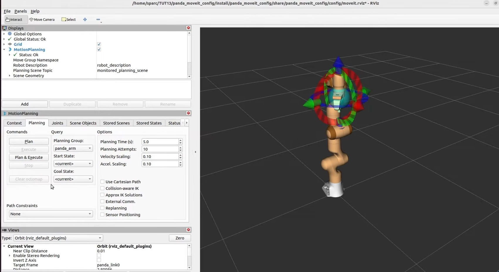
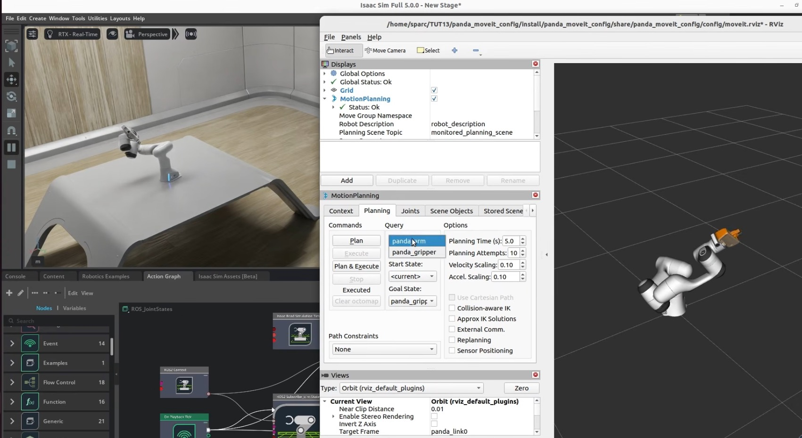

# 03 — MoveIt 2 drives a Franka Panda in Isaac Sim

> MoveIt 2 plans arm motions in RViz; Isaac Sim executes them on a simulated Franka Panda, connected by two ROS 2 joint
> topics. Reproduced from Isaac Sim tutorial #13. Physical AI layer: classical motion planning validated in
> simulation, the baseline that learned manipulation policies are measured against.

## Source evidence

| Evidence | What it shows |
|---|---|
|  | RViz 2 with `/home/sparc/TUT13/panda_moveit_config/.../config/moveit.rviz`. MotionPlanning display (Status Ok, Robot Description `robot_description`, Planning Scene Topic `monitored_planning_scene`), Planning tab: group `panda_arm`, planning time 5.0 s, 10 attempts, velocity and acceleration scaling 0.10; target frame `panda_link0`; Panda with the interactive marker. Isaac Sim tutorial #13. |
|  | Isaac Sim Full 5.0.0 with the Panda on a table and the same RViz window: planning group dropdown `panda_arm` / `panda_gripper`, status "Executed". The Action Graph tab shows graph `ROS_JointStates` with ROS2 Context, On Playback Tick, Isaac Read Simulation Time and ROS2 Subscribe JointState nodes. Isaac Sim tutorial #13. |

Transcripts used:
- `NVIDIA Isaac Sim & Isaac Lab – Complete Tutorial Series/Tutorial #13 – Control Any Robotic Arm in Isaac Sim Using
  MoveIt (Motion Planning & ROS2).txt`: Part A (Setup Assistant steps, the Plan & Execute failure and the
  `moveit_controllers.yaml` fix), Part B (Franka MoveIt sample graph, topics `isaac_joint_commands` /
  `isaac_joint_states`, the four-line `panda.ros2_control.xacro` patch), Part C (own scene with the Joint States
  wizard; direct control from a Python script).

## What the workflow does

MoveIt never talks to Isaac Sim directly. It talks to ros2_control, and ros2_control talks to a hardware interface.
The Setup Assistant generates a package whose hardware is `mock_components/GenericSystem`, a fake that echoes
commands back as states. The tutorial swaps that one plugin for a topic-based system:

```
RViz MotionPlanning ─► move_group ─► panda_arm_controller (JointTrajectoryController, FollowJointTrajectory action)
                                   │
                         ros2_control: topic_based_ros2_control/TopicBasedSystem
                         writes /isaac_joint_commands   reads /isaac_joint_states
                                   │                               ▲
Isaac Sim graph ROS_JointStates:   ▼                               │
  ROS2 Subscribe JointState ─► Articulation Controller (Franka)    │
  ROS2 Publish JointState (Franka, sim time) ──────────────────────┘
```

Each tick, Isaac Sim publishes the arm's measured joint positions and velocities and applies the latest commanded
targets through the articulation's joint drives. MoveIt plans and times a trajectory, the trajectory controller
streams it as joint commands, and the loop closes through physics. The gripper follows the same path through a
`GripperActionController`.

Two config bugs stand between the generated package and a working loop. MoveIt's controller manager needs
`action_ns: follow_joint_trajectory` and `default: true` on the arm controller, otherwise Plan & Execute reports
"failed". The hardware plugin must be the topic-based one, on the same topic names as the Isaac graph.

## Code

| File | Purpose | Runs on | Status |
|---|---|---|---|
| `ogspec.py` | Action graphs as data + `og.Controller.edit` applier (identical copy of workflow 02's) | CPU / Isaac Sim | data executed here; `apply` not executed: needs GPU |
| `moveit_graph_spec.py` | The `ROS_JointStates` graph: publish on `isaac_joint_states`, subscribe on `isaac_joint_commands`, Articulation Controller on `/World/Franka` | CPU | executed here (tests) |
| `build_joint_states_graph.py` | Isaac Sim 5.0.0 script: Simple Room + Franka asset + the graph (tutorial #13 Part C) | Isaac Sim 5.0.0, RTX GPU | not executed: needs GPU (compiles, imports on CPU) |
| `send_joint_command.py` | Publishes a JointState pose to `/isaac_joint_commands` without MoveIt (tutorial #13's Python option) | ROS 2 Humble | not executed |
| `moveit_config/config/moveit_controllers.generated.yaml` | What the Setup Assistant writes (reconstructed): arm controller without `action_ns` / `default` | MoveIt 2 | parsed by tests |
| `moveit_config/config/moveit_controllers.yaml` | Fixed file | MoveIt 2 | parsed by tests |
| `moveit_config/config/ros2_controllers.yaml` | Arm trajectory controller; gripper `position_controllers/GripperActionController` | ros2_control | parsed by tests |
| `moveit_config/config/panda.ros2_control.generated.xacro` / `panda.ros2_control.xacro` | Mock hardware vs topic-based hardware on the Isaac topics | ros2_control | parsed as XML by tests |
| `patches/*.patch`, `make_patches.py` | The two fixes as unified diffs, regenerated and checked on CPU | CPU | executed here |
| `tests/test_moveit.py` | Graph wiring, both fixes, topic names agree across Isaac graph and xacro | CPU | executed here |

### Not confirmed by the sources

- The four xacro lines. The tutorial says "add four lines", given only in the video description, and that the topic
  names must match Isaac Sim's. The patch here (plugin `topic_based_ros2_control/TopicBasedSystem`, params
  `joint_commands_topic`, `joint_states_topic`, mock plugin commented out) is our inference, and it does add four
  lines.
- The `*.generated.*` files reconstruct MoveIt Setup Assistant (Humble) output; diff them against your generated
  package before applying the patches. Whether only `panda_finger_joint1` appears in the ros2_control block (the
  second finger is a mimic joint) is not shown; if only one finger moves in Isaac Sim, add `panda_finger_joint2`.
- Type ids `isaacsim.ros2.bridge.ROS2PublishJointState`, `isaacsim.ros2.bridge.ROS2SubscribeJointState` and the other
  ids in `ogspec.CATALOG`; the graph path `/Graph/ROS_JointStates`; the Franka asset path
  `/Isaac/Robots/FrankaRobotics/FrankaPanda/franka.usd`; port names of the two JointState nodes.
- The `ready` pose in `send_joint_command.py` is the standard Panda ready pose from MoveIt's examples, not a value from
  the tutorial (which set its poses with sliders).

## Run it (GPU box)

Pinned: Isaac Sim **5.0.0** workstation install (screenshot title "Isaac Sim Full 5.0.0"), ROS 2 **Humble** (tutorial
#13), MoveIt 2 for Humble built from source per the MoveIt docs (the tutorial builds the workspace "until colcon
build"), `topic_based_ros2_control` built from source in the same workspace (verify the repo and branch for Humble),
Python 3.10 (Humble) on the ROS side, Isaac Sim's bundled Python 3.11 on the sim side. Same `ROS_DOMAIN_ID` in every
terminal.

```bash
# --- ROS 2 side (Humble) ---
source /opt/ros/humble/setup.bash && source ~/ws_moveit/install/setup.bash
ros2 launch moveit_setup_assistant setup_assistant.launch.py
#   Create New -> load src/moveit_resources/panda_description/urdf/panda.urdf (if it segfaults, close and reload)
#   Self-Collisions: Generate Collision Matrix
#   Virtual Joints: panda_virtual_joint, child panda_link0, parent panda_world, fixed
#   Planning Groups: panda_arm (KDL, RRTConnect, panda_joint1..7); panda_gripper (no solver; panda_hand_joint,
#                    panda_finger_joint1/2)
#   Robot Poses: panda_home, panda_ready (panda_arm); panda_gripper_open, panda_gripper_close (panda_gripper)
#   End Effector: group panda_gripper, parent link panda_link8, parent group panda_arm
#   ROS 2 Controllers: Auto Add, gripper -> position_controllers/GripperActionController
#   MoveIt Controllers: Auto Add, gripper -> GripperCommand
#   Generate into ~/TUT13/panda_moveit_config
cd ~/TUT13/panda_moveit_config
patch -p1 < <atlas>/03-moveit2-panda/patches/moveit_controllers.yaml.patch
patch -p1 < <atlas>/03-moveit2-panda/patches/panda.ros2_control.xacro.patch
colcon build && source install/setup.bash

# --- Isaac Sim side (5.0.0) ---
cd ~/isaacsim && ./python.sh <atlas>/03-moveit2-panda/build_joint_states_graph.py --play
#   or GUI: Window > Examples > Robotics Examples > ROS2 > MoveIt > Franka MoveIt > Load, then Play

# --- Close the loop ---
ros2 topic echo --once /isaac_joint_states        # Isaac is publishing
ros2 launch panda_moveit_config demo.launch.py    # RViz: goal state panda_ready -> Plan & Execute
python3 <atlas>/03-moveit2-panda/send_joint_command.py --pose ready   # optional: drive without MoveIt
```

## Source step → code map

| Source step (transcript or screenshot) | Code location |
|---|---|
| Setup Assistant: virtual joint, groups `panda_arm` (KDL, RRTConnect) and `panda_gripper`, poses, end effector `panda_link8` (tutorial #13 Part A) | README "Run it" (GUI steps); `moveit_graph_spec.ARM_JOINTS`, `GRIPPER_JOINTS` |
| ROS 2 controllers: gripper `position_controllers/GripperActionController` (tutorial #13 Part A) | `moveit_config/config/ros2_controllers.yaml` |
| MoveIt controllers: gripper `GripperCommand` (tutorial #13 Part A) | `moveit_config/config/moveit_controllers.yaml` |
| Plan & Execute "failed"; add `action_ns` and `default` under the arm controller (tutorial #13 Part A) | `patches/moveit_controllers.yaml.patch`, `test_generated_controllers_reproduce_the_bug`, `test_fixed_controllers_have_action_ns_and_default` |
| Franka MoveIt sample graph: tick, ROS2 Context, Subscribe JointState on `isaac_joint_commands` → Articulation Controller (target `Franka`), Publish JointState on `isaac_joint_states` (tutorial #13 Part B; `moveit-isaac-sim-panda.jpg`) | `moveit_graph_spec.joint_states_graph()` |
| Add four lines to `panda.ros2_control.xacro`; topic names must match Isaac's (tutorial #13 Part B) | `patches/panda.ros2_control.xacro.patch`, `test_xacro_patch_switches_to_topic_based_hardware`, `test_xacro_patch_adds_four_lines` |
| Own scene: Simple Room, Franka from Isaac assets, `ROS 2 OmniGraphs > Joint States` with publisher + subscriber (tutorial #13 Part C) | `build_joint_states_graph.py` |
| "Control it using a Python script by publishing joint command messages" (tutorial #13 Part B) | `send_joint_command.py` |
| RViz MotionPlanning: planning time 5.0, 10 attempts, scaling 0.10 (`moveit-rviz-panda.jpg`) | defaults of the generated `moveit.rviz`; nothing to change |

## Gotchas from the sources

- The Setup Assistant sometimes segfaults on URDF load; close it and reload (tutorial #13).
- The generated `moveit_controllers.yaml` lacks `action_ns` and `default` for the arm controller, so Plan & Execute
  fails until you add them (tutorial #13).
- The xacro topic names must equal the Isaac graph's topic names; the tutorial says to confirm them before building
  (tutorial #13). The tests check `/isaac_joint_commands` and `/isaac_joint_states` on both sides.
- The Articulation Controller's target prim must be the articulation root (`Franka`) (tutorial #13; same rule as
  tutorial #6).
- Importing `panda.urdf` into Isaac Sim reports the robot is already in Isaac assets; use the asset (tutorial #13
  Part C).
- Rebuild and re-source the MoveIt package after every config edit (tutorial #13).

## What we verified here

Ran in the cloud container (CPU only, Python 3.11, no Isaac Sim, no ROS 2):

- `ruff check` and `ruff format --check`: clean. `check_workflows.py`: every `.py` file compiles.
- `pytest 03-moveit2-panda`: 11 tests pass. They check that the `ROS_JointStates` graph is wired to defined nodes and
  ports and uses the tutorial's topics and target prim; that the generated controllers file reproduces the missing
  `action_ns` / `default` and the fixed one has them; that the gripper controller types match the tutorial; that the
  patched xacro is valid XML with the topic-based plugin on the same topics as the graph; that the committed patches
  equal a fresh diff and add exactly four lines to the xacro; and that `ogspec.py` is identical to workflow 02's.

Not run: MoveIt, ros2_control, RViz, Isaac Sim, the scripts that need them, and the patches against a real generated
package. Whether the arm moves is untested.
