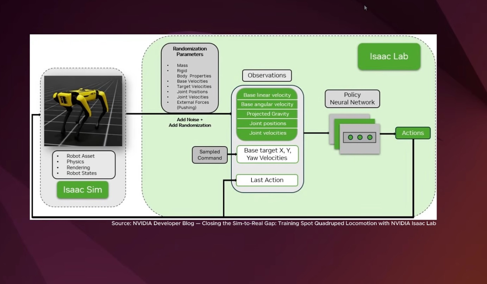

# 04 — Isaac Lab RL: train, play, export, and test in a second simulator

> Rebuilds the Isaac Lab reinforcement-learning workflow from the Isaac Sim & Isaac Lab tutorial series (#3 install,
> #12 train and evaluate, #14 custom humanoid task), then adds the step the tutorials leave out: export the policy to
> ONNX and run it in Newton. This is the robot-learning part of Physical AI.

## Source evidence

| Evidence | What it shows |
|---|---|
|  | The Isaac Lab training loop for Spot: Isaac Sim provides robot asset, physics, rendering and states; Isaac Lab adds noise and randomization (mass, rigid-body properties, base and joint state, external pushes), builds observations (base linear and angular velocity, projected gravity, joint positions and velocities, a sampled X/Y/yaw velocity command, the last action), and a policy network outputs actions. Source: NVIDIA Developer Blog, "Closing the Sim-to-Real Gap: Training Spot Quadruped Locomotion with NVIDIA Isaac Lab". |

Transcripts used (in `NVIDIA Isaac Sim & Isaac Lab – Complete Tutorial Series/`):
- `Tutorial #3 – Install Isaac Lab  Step-by-Step Setup with Conda and Isaac Sim Pip Package.txt`: conda env, PyTorch,
  Isaac Sim pip package, clone and install Isaac Lab, verify with a quadruped run.
- `Tutorial #12 – Training Humanoid Robots in Isaac Lab  RL Workflow, Training & Evaluation.txt`: folder layout, task
  IDs in `__init__.py`, `train.py`, checkpoints every 50 iterations, `--headless`, G1 at 10,000 envs, `play.py`.
- `Tutorial #14 – Custom Humanoid Task Training in Isaac Lab  Reinforcement Learning.txt`: `isaaclab.sh --new`, task
  anatomy (register, env, actions, observations, rewards), training at 4 envs, the missing-checkpoint gotcha.

Digests: `context/sources/02-isaac-sim-isaac-lab-tutorials.md` (Tutorials #3, #12, #14; Recipe C) and
`context/02-applications-and-ecosystem.md` §1.6.

## What the workflow does

Isaac Lab turns a robot and a task into a vectorized Gym environment. Thousands of copies of the scene run on one GPU
in PhysX; every policy step, managers compute observations, apply actions, compute rewards, check terminations, and
fire events. rsl_rl's PPO collects 24 steps from every environment, updates the actor and critic, and repeats.

A manager-based task is a set of config classes, which is why tutorial #12 says a new robot means a new project
folder "like this":

```
gym.register(id, entry_point=ManagerBasedRLEnv, kwargs={env_cfg, rsl_rl_cfg})     <- __init__.py
  env cfg
    scene        robot (articulation), table, object, ground, light
    actions      joint position targets for the left arm
    observations arm joint pos/vel, wrist pos, object pos, target, last action (+ noise)
    commands     target position for the object, resampled each episode
    rewards      reach (dense) + progress (dense) + at-goal (sparse) + small penalties
    terminations time-out, object dropped, object out of reach
    events       startup: object mass and friction; reset: object pose, arm joints, arm gains
  PPO runner cfg  rollout length, network sizes, learning rate, save every 50 iterations
```

The custom task here is tutorial #14's "push donut": a Unitree G1 with a fixed pelvis pushes a puck across a table to a
commanded spot with its left arm. The reward follows the tutorial's three steps. The tutorial says RL algorithms "do not
understand high-level goals, like push the object. We need to convert that objective into numerical rewards" (09:16).

After training, `play.py` loads a checkpoint, runs it with the GUI, and exports `policy.onnx`. That file is what moves
between simulators. `sim_to_sim.md` runs an exported ANYmal C velocity policy in Newton, the second simulator NVIDIA's
own talks recommend as a check before hardware.

## Code

| File | Purpose | Runs on | Status |
|---|---|---|---|
| `install_isaaclab.sh` | Tutorial #3 install, pinned: conda env, torch, `isaacsim==5.0.0`, Isaac Lab `v2.2.0` | Ubuntu 22.04, RTX GPU | not executed: needs GPU (`bash -n` passes) |
| `train.sh` | `train.py --task … --num_envs … [--headless]` for Spot, G1, ANYmal C and the custom task | Isaac Lab, RTX GPU | not executed: needs GPU (`bash -n` passes) |
| `play.sh` | `play.py --task … --num_envs 5 --checkpoint …`; refuses the custom task without a checkpoint | Isaac Lab, RTX GPU | not executed: needs GPU (`bash -n` passes) |
| `export_onnx.sh` | `play.py --headless --video` to trigger the ONNX export, copy it, check widths | Isaac Lab, RTX GPU | not executed: needs GPU (`bash -n` passes) |
| `source/atlas_rl_tasks/` | External task package in the `isaaclab.sh --new` layout; `pip install -e` | Isaac Lab | not executed: needs GPU (compiles; static tests pass) |
| `…/push_object/__init__.py` | `gym.register` for `Atlas-PushObject-G1-v0` and `…-Play-v0` | CPU or GPU | imported here (gymnasium absent, so registration is skipped) |
| `…/push_object/push_object_env_cfg.py` | Scene, actions, observations, commands, rewards, terminations, events | Isaac Lab | not executed: needs GPU |
| `…/push_object/agents/rsl_rl_ppo_cfg.py` | rsl_rl PPO runner cfg, `save_interval = 50` | Isaac Lab | not executed: needs GPU |
| `…/push_object/mdp/math_terms.py` | Reward, termination and frame math as array-API functions (numpy or torch) | CPU or GPU | executed here (numpy) |
| `…/push_object/mdp/{observations,rewards,terminations}.py` | Isaac Lab wrappers that fetch tensors and call `math_terms` | Isaac Lab | not executed: needs GPU |
| `scripts/run_custom_task.py` | Registers the package, then runs Isaac Lab's own `train.py` / `play.py` unchanged | Isaac Lab | not executed: needs GPU |
| `scripts/check_onnx_policy.py` | ONNX I/O names, widths, one forward pass | CPU (`onnx`, `onnxruntime`) | not executed (packages not installed here) |
| `scripts/sim2sim_map.py` | Joint-order maps, 48-wide observation layout, action-to-target mapping | CPU | executed here |
| `scripts/newton_sim2sim.py` | Runs an ANYmal C ONNX policy in Newton's example scene, reports distance, drift, falls | CPU or GPU | executed here with the shipped policy |
| `sim_to_sim.md` | How an exported policy moves to Newton; what must match | docs | — |
| `results/newton_sim2sim_shipped_policy_cpu.json` | Metrics from the CPU run above | — | measured here |
| `tests/` | 4 files, 30 tests (math, mappings, Newton kernel cross-check, static task checks) | CPU | executed here |

## Run it (GPU box)

Pinned versions. The tutorials use Isaac Sim 5.0.0 for #1–#14; they do not state an Isaac Lab tag, CUDA, or driver
version, so those pins are marked to verify.

| Component | Version |
|---|---|
| OS / GPU | Ubuntu 22.04 x86_64, NVIDIA RTX GPU, driver from the Isaac Sim 5.0.0 requirements page |
| Python | 3.11 (conda env `env_isaaclab`) |
| Isaac Sim | 5.0.0, pip package `isaacsim[all,extscache]==5.0.0` |
| Isaac Lab | `v2.2.0` (verify: the tag paired with Isaac Sim 5.0) |
| PyTorch | 2.7.0 + cu128 (verify against the Isaac Lab v2.2 install page) |
| RL library | rsl_rl (`rsl-rl-lib` as pinned by `./isaaclab.sh --install`) |
| Newton (sim-to-sim) | 1.7.0.dev0 from `newton-main/`, Warp 1.17, warp_nn |

```bash
# 0. Install (tutorial #3)
bash install_isaaclab.sh                       # creates env_isaaclab, installs Isaac Sim 5.0.0 pip + Isaac Lab v2.2.0
conda activate env_isaaclab
export ISAACLAB_PATH=$HOME/IsaacLab

# 1. Built-in tasks (tutorial #12)
bash train.sh spot                             # Isaac-Velocity-Flat-Spot-v0, 512 envs, GUI
bash train.sh g1                               # Isaac-Velocity-Rough-G1-v0, 10000 envs, --headless, 500 iterations
bash play.sh g1                                # 5 envs; picks the latest checkpoint

# 2. Custom task (tutorial #14)
cd physical-ai-project/workflows/04-isaac-lab-rl
$ISAACLAB_PATH/isaaclab.sh -p -m pip install -e source/atlas_rl_tasks
bash train.sh push-debug                       # 4 envs with the GUI: check the scene and that rewards move
bash train.sh push                             # 4096 envs, --headless
bash play.sh push $ISAACLAB_PATH/logs/rsl_rl/atlas_push_object_g1/<run>/model_1500.pt

# 3. Export and sim-to-sim (sim_to_sim.md)
bash train.sh anymal                           # Isaac-Velocity-Flat-Anymal-C-v0
bash export_onnx.sh anymal logs/rsl_rl/anymal_c_flat/<run>/model_<iter>.pt
python scripts/newton_sim2sim.py --policy artifacts/anymal_c_flat_policy.onnx --frames 150
```

The underlying commands, as the tutorials type them from `~/IsaacLab`:

```bash
python scripts/reinforcement_learning/rsl_rl/train.py --task Isaac-Velocity-Rough-G1-v0 --num_envs 10000 --headless
python scripts/reinforcement_learning/rsl_rl/play.py  --task Isaac-Velocity-Rough-G1-v0 --num_envs 5 --checkpoint logs/rsl_rl/<experiment>/<run>/model_100.pt
```

For the custom task, `scripts/run_custom_task.py train|play` forwards the same flags to those same two scripts after
registering `Atlas-PushObject-G1-v0`. Tutorial #14 copies `train.py` and `play.py` into the task repo instead; both work.

## Source step → code map

| Source step (transcript or screenshot) | Code location |
|---|---|
| "create the environment for Isaac Lab", `env_isaaclab` (#3, 02:03–02:22) | `install_isaaclab.sh` step 2 |
| "First install PyTorch… Then install the Isaac Sim pip package… not the full Isaac Sim installation" (#3, 02:32–02:57) | `install_isaaclab.sh` steps 4–5 |
| "clone the Isaac Lab repository… install it into the same environment" (#3, 03:24–04:01) | `install_isaaclab.sh` step 6 |
| "remove the headless tag so that the simulation opens with a GUI… a four-legged robot model will start training" (#3, 04:01–04:39) | `install_isaaclab.sh` step 7 |
| "go to scripts, then reinforcement_learning, then RSL_RL" (#12, 00:46–00:56) | `train.sh`, `play.sh` (`scripts/reinforcement_learning/rsl_rl/`) |
| "manager_based then locomotion then velocity… config folder… project files for different robots" (#12, 01:07–01:46) | `source/atlas_rl_tasks/…/push_object/` (one folder per task) |
| "One important thing here is the task ID… Copy this task ID" (#12, 02:41–02:50) | `push_object/__init__.py: TASK_ID` |
| "specify the number of environments… smaller number… my system is not very powerful" (#12, 03:13–03:27) | `train.sh push-debug` (4 envs) |
| "the model is saved after every 50 iterations" (#12, 04:41) | `agents/rsl_rl_ppo_cfg.py: save_interval = 50` |
| "add the headless option… slightly faster" (#12, 05:06–05:19) | `train.sh g1`, `train.sh push` |
| G1 rough task, "increasing the number of environments to 10,000", 500 iterations (#12, 05:29–06:04) | `train.sh g1` |
| "replace train with play… number of environments to five… specify the checkpoint argument" (#12, 06:13–06:51) | `play.sh` |
| `isaaclab.sh --new`: External, task name, manager-based, rsl_rl (#14, 05:15–06:07) | package layout under `source/atlas_rl_tasks/` |
| "install the task package into the Isaac Lab Python environment" (#14, 07:43–08:03) | `source/atlas_rl_tasks/pyproject.toml`; `isaaclab.sh -p -m pip install -e` |
| "register the task and connect Isaac Lab to our environment configuration and PPO configuration" (#14, 08:15–08:26) | `push_object/__init__.py` |
| "robot configuration, the object USD file, the table position, the initial object position, and the target push distance" (#14, 08:29–08:40) | `push_object_env_cfg.py` constants, `PushObjectSceneCfg`, `CommandsCfg` |
| "adding the table, the object, and the robot with the appropriate physics properties" (#14, 08:40–08:49) | `PushObjectSceneCfg` |
| "the policy controls the seven joints of the robot's left arm" (#14, 08:49–09:03) | `ActionsCfg.left_arm`, `LEFT_ARM_JOINTS` |
| "arm joint positions, joint velocities, wrist position, and object position" (#14, 09:03–09:16) | `ObservationsCfg.PolicyCfg`, `mdp/observations.py` |
| "reward the robot for moving its wrist closer to the object" (#14, 09:31–09:36) | `RewardsCfg.reach`, `math_terms.reach_reward` |
| "reward every small movement that pushes the object toward the target" (#14, 09:36–09:43) | `RewardsCfg.progress`, `mdp.ObjectGoalProgress`, `math_terms.progress_step` |
| "a larger reward when the object successfully reaches the target position" (#14, 09:43–09:49) | `RewardsCfg.success`, `math_terms.success_bonus` |
| "set the number of environments to four" (#14, 10:26–10:32) | `train.sh push-debug` |
| "the robot is not moving because we forgot to specify the checkpoint" (#14, 12:10–12:21) | `play.sh` and `run_custom_task.py` refuse to play without `--checkpoint` |
| Diagram: "Randomization Parameters: Mass, Rigid Body Properties… Add Noise + Add Randomization" | `EventCfg` (mass, friction, gains, reset poses), `Unoise` on observations |
| Diagram: observation blocks, "Sampled Command", "Last Action" | `sim2sim_map.VELOCITY_OBS_LAYOUT`; `ObservationsCfg` (`target`, `last_action`) |
| Diagram: "Policy Neural Network → Actions" | `rsl_rl_ppo_cfg.py` (actor 256-128-64, ELU); `export_onnx.sh` |

## Gotchas from the sources

- `play.py` on a custom task without `--checkpoint` loads but the robot does not move; pass the checkpoint path
  (tutorial #14, 12:10). `play.sh` enforces it.
- Built-in tasks pick the latest checkpoint by default; use `--checkpoint` for a specific iteration (tutorial #12, 06:31).
- A weak GPU means fewer environments: the author uses small counts with the GUI and 10,000 only when headless
  (tutorials #12 and #14). Debug a new task at 4 envs with the GUI, then scale.
- `--headless` is faster for long runs (tutorial #12, 05:06); remove it to watch training (tutorial #3, 04:16).
- Isaac Lab runs inside the Isaac Sim pip environment; keep the conda env active while cloning and installing
  (tutorial #3, 00:51 and 03:40).
- Pure RL for manipulation is hard: the pick-mug policy grasps but does not lift; "training a robot using only
  reinforcement learning is usually challenging and requires careful reward design and sufficient training time"
  (tutorial #14, 12:29 and 13:11).
- The articulation root belongs on the robot's top-level prim; if you swap `G1_MINIMAL_CFG` for your own USD, check
  this first (series-wide gotcha, digest 02 §2.6).
- Not from the tutorials, from writing this task:
  - Do not end training episodes on success while every step pays a positive reward; the policy learns to avoid the
    goal. The at-goal bonus here pays per step instead, and `mdp.object_reached_goal` is left for evaluation.
  - Isaac Lab scales each reward by `weight × step_dt`, so weights are per second. Here a 0.15 m push pays 1.5 in
    progress, hovering at the object pays at most 1 per second, and holding the goal pays 5 per second.
  - Isaac Lab quaternions are (w, x, y, z); Newton's are (x, y, z, w). Joint orders differ too. See `sim_to_sim.md`.

## What we verified here

Ran in the cloud container (CPU only, Python 3.11, numpy 2.4.6, Newton 1.7.0.dev0, Warp 1.17.0):

- `pytest 04-isaac-lab-rl`: 30 tests pass.
  - `test_math_terms.py` (11): reach, progress (including clipping, fresh resets, and that per-step progress sums to
    the net distance), success, terminations, and quaternion frame transforms against rotation matrices.
  - `test_sim2sim_map.py` (7): the Isaac Lab ↔ Newton index maps derived from joint names equal the arrays hard-coded
    in Newton's `example_robot_anymal_c_walk.py`; the URDF order matches the cached ANYmal C asset; observation and
    action mapping for a known state.
  - `test_sim2sim_newton_kernels.py` (5): the numpy observation and target builders match Newton's Warp kernels on the
    Warp CPU device for random states; the shipped PhysX-trained policy runs through warp_nn on CPU (48 in, 12 out).
  - `test_task_static.py` (7): the env cfg has every manager tutorial #14 names, entry points resolve to defined
    classes, `save_interval = 50`, the package imports without Isaac Lab, TOML files parse, shell scripts pass `bash -n`.
- `python scripts/newton_sim2sim.py --frames 150`: the shipped policy walked 2.714 m in 3.0 s on the Warp CPU device
  without falling (`results/newton_sim2sim_shipped_policy_cpu.json`), the same distance `ssw.terrain` logged.
- `ruff check`, `ruff format --check`, and `check_workflows.py` pass.

Not executed: anything that imports Isaac Sim or Isaac Lab (installation, training, play, ONNX export, the env cfg, the
`mdp` wrappers, the torch path of `math_terms`), and `check_onnx_policy.py` (no `onnx` package here). No policy was
trained, so there is no success rate or reward curve for the push task.
