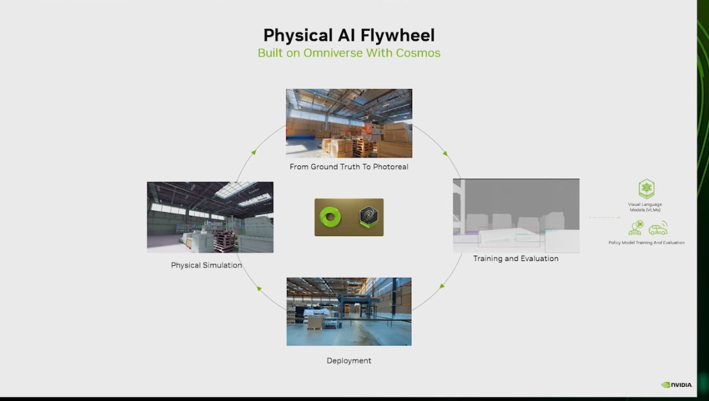

# 05 — Replicator synthetic data to a pallet-jack detector

> Rebuilds Omniverse Basic Training 05 (generate synthetic data with Replicator) and 06 (fine-tune and validate a
> DetectNet_v2 detector with TAO): randomized warehouse renders with KITTI labels, a 14% hold-out, a TAO fine-tune, and
> an open torchvision alternative. This is the perception and synthetic-data part of Physical AI.

## Source evidence

| Evidence | What it shows |
|---|---|
|  | "Physical AI Flywheel, Built on Omniverse With Cosmos": physical simulation of a warehouse, "From Ground Truth To Photoreal", training and evaluation, deployment. Omniverse/OpenUSD deck (Deck A). Context only: this slide is the main evidence for folder 07; it shows where this folder's dataset goes next (`cosmos_augment.md`). |

No screenshot in the collection shows the Replicator or TAO steps themselves; the transcripts are the evidence.

Transcripts used (in `NVIDIA OMNIVERSE TUTORIALS/`):
- `Omniverse Basic Training 05 (Generate Synthetic data).txt`: perception tasks, domain randomization, the NVIDIA SDG
  repo, the `generate_data` launcher, a walk through the Replicator script, the KITTI output.
- `Omniverse Basic Training 06 (Fine-Tunning and validating an AI perception model using TAO toolkit).txt`: WSL,
  Docker and NGC setup, KITTI to TFRecords, the DetectNet_v2 spec, training, evaluation on a 14% hold-out, inference
  on real photos.

Digests: `context/sources/03-omniverse-openusd-tutorials.md` §19, §20, B3; `context/02-applications-and-ecosystem.md` §5.

## What the workflow does

Real labelled images of a specific object in a specific warehouse are scarce. The tutorial's answer: render thousands
of labelled frames, fine-tune a pretrained detector on them, and check it on real photos.

```
warehouse USD + 3 pallet-jack USDs + distractors + textures
   │  Replicator, per frame: camera pose, pallet-jack colour and pose, floor/wall texture, lights
   ▼
KittiWriter  ->  <set>/Camera/{rgb, object_detection (KITTI), depth, semantic/instance segmentation}
   │  3 runs: distractors warehouse | additional | none, 2,000 frames each at 960x544
   ▼
kitti_tools.py  stats, class balance, 14% hold-out per set
   ▼
TAO: dataset_convert (KITTI -> TFRecords) -> train DetectNet_v2 ResNet-18 -> evaluate -> inference on real photos
   or torchvision Faster R-CNN (train_torchvision.py), scored with the same AP@0.5
   ▼
(cosmos_augment.md) Cosmos Transfer: ground truth -> photoreal variants of the training split
```

Domain randomization is the core idea. The tutorial names three levers: the object itself (colour, texture, size),
lighting and camera viewpoint, and the background (walls, floor) (Basic Training 05, 11:33–12:15). Distractor sets
teach the model what a pallet jack is not. Only pallet jacks carry a semantic label, so only they get boxes. A
pretrained detector is fine-tuned instead of trained from scratch because, as the tutorial puts it, pretrained models
"have not been trained in our specific environment", and fine-tuning "will save a lot of time and resources"
(09:08–09:45).

## Code

| File | Purpose | Runs on | Status |
|---|---|---|---|
| `replicator_pallet_jack.py` | Replicator script: stage, labelled pallet jacks, distractors, camera/colour/pose/texture/light randomizers, KittiWriter | Isaac Sim 5.0, RTX GPU | not executed: needs GPU (helpers tested on CPU) |
| `generate_data.sh` | Three runs, one per distractor set, 2,000 frames at 960x544; then stats and split | Isaac Sim 5.0 | not executed: needs GPU (`bash -n` passes) |
| `kitti_tools.py` | KITTI parsing, pairing, statistics, class-balance report, 14% per-set split, IoU, AP | CPU | executed here |
| `tao/detectnet_v2_tfrecords_kitti.txt` | `dataset_convert` spec, `val_split: 14` | TAO 5.x container | not executed: needs GPU |
| `tao/detectnet_v2_train_resnet18_kitti.txt` | DetectNet_v2 ResNet-18 training spec, class `palletjack`, 960x544 | TAO 5.x container | not executed: needs GPU |
| `tao/detectnet_v2_inference_kitti.txt` | Inference spec with KITTI dump | TAO 5.x container | not executed: needs GPU |
| `tao/run_tao.sh` | Mounts, NGC login, pretrained download, convert, train, evaluate, inference | Docker + TAO 5.x | not executed: needs GPU and NGC key (`bash -n` passes) |
| `train_torchvision.py` | Faster R-CNN MobileNetV3-FPN fine-tune on the same split, AP@0.5 | PyTorch, GPU | not executed: needs GPU (helpers tested on CPU) |
| `cosmos_augment.md` | How Cosmos Transfer would augment these frames; links to folder 07 | docs | — |
| `tests/` | 2 files, 23 tests | CPU | executed here |

## Run it (GPU box)

| Component | Version |
|---|---|
| OS / GPU | Ubuntu 22.04 x86_64, NVIDIA RTX GPU (the tutorial ran Windows 11 + WSL2; Ubuntu avoids its relaunch problem) |
| Isaac Sim | 5.0.0 workstation install, run scripts with `./python.sh` (Python 3.11). The tutorial used 4.5 with docs written for 4.2 |
| TAO | TAO Toolkit 5.x launcher (`pip install nvidia-tao`) in a Python 3.10 conda env, Docker, NVIDIA Container Toolkit, NGC API key |
| Open alternative | Python 3.11, torch 2.7.0, torchvision 0.22.0 (CUDA 12.8 wheels), Pillow |

```bash
cd physical-ai-project/workflows/05-replicator-sdg

# 1. Synthetic data (Basic Training 05): 3 x 2,000 frames
ISAAC_SIM_PATH=~/isaacsim OUT=$PWD/data bash generate_data.sh

# 2. Check the dataset and split off 14% per distractor set (CPU)
python3 kitti_tools.py stats --root data
python3 kitti_tools.py split --root data --val 0.14 --out data/splits

# 3a. TAO fine-tune (Basic Training 06)
conda create -n tao python=3.10 -y && conda activate tao && pip install nvidia-tao
export LOCAL_PROJECT_DIR=$PWD NGC_API_KEY=<your key>
mkdir -p real_images   # put real pallet-jack photos here for step 6
bash tao/run_tao.sh

# 3b. Or the open alternative
python train_torchvision.py --root data --epochs 10 --out runs/frcnn_mbv3
```

## Source step → code map

| Source step (transcript or screenshot) | Code location |
|---|---|
| Three randomization levers: object, lighting and camera viewpoint, background (BT05, 11:33–12:15) | `replicator_pallet_jack.py: main()` trigger block |
| "download this repository… synthetic data generation… in kitty format" (BT05, 12:30–13:39) | `replicator_pallet_jack.py` (rebuilt), `KittiWriter` |
| Launcher: `ISAAC_SIM_PATH`, three output folders, script path, `python … --height 544 --width 960 --num_frames 2000 --distractors warehouse --data_dir` (BT05, 16:56–20:46) | `generate_data.sh` |
| "three different sets… normal ones… additional distractors… without any distractor" (BT05, 20:50–21:33) | `DISTRACTOR_SETS`, `run_plan`, `distractor_paths` |
| "height and width… This is for the resolution" (BT05, 25:19–25:37) | `parse_args` |
| Launch the simulation, open the stage, assets "from these addresses" (BT05, 26:10–26:40) | `main()` steps 2–3, `ENV_URL`, `PALLETJACKS`, `*_DISTRACTORS` |
| "labeling… to identify what is a pallet jack" (BT05, 26:47–27:03; 28:22–28:30) | `rep.create.from_usd(..., semantics=[("class", "palletjack")])`, `strip_semantics_except` |
| "three different types of pallet jacks" (BT05, 28:36–28:46) | `PALLETJACKS` |
| "camera… always looking at the center… randomizing the position" (BT05, 28:53–29:10) | `with camera: rep.modify.pose(position=…, look_at=(0, 0, 0))` |
| "different colors for our pallet jacks" (BT05, 29:10–29:17) | `rep.randomizer.color` |
| "randomizing the position… not changing the size the scale" (BT05, 29:23–29:36) | `with jack_group: rep.modify.pose(position, rotation)` |
| "randomizing the floor and the wall" (BT05, 29:48–30:01) | `rep.randomizer.texture` on `SM_Floor`, `SM_Wall` |
| "writing the registry… kitty format" (BT05, 30:01–30:15) | `rep.WriterRegistry.get("KittiWriter")` |
| Output: `Camera` with depth, instance segmentation, object detection, RGB (BT05, 33:07–34:41) | `kitti_tools.pair_dataset` layout |
| "detect net version two… based on residual networks" (BT05, 39:37–39:58) | `tao/detectnet_v2_train_resnet18_kitti.txt` |
| Set `LOCAL_PROJECT_DIR`; "Is the dollar missing" (BT06, 09:60–12:07) | `tao/run_tao.sh` guard |
| Container toolkit, NGC personal key, `docker login` with `$oauthtoken` (BT06, 15:57–22:15) | `tao/run_tao.sh` header and login |
| Download the pretrained model (BT06, 23:06–25:13) | `run_tao.sh` step 1 |
| Convert KITTI to TFRecords, per folder (BT06, 25:34–28:52) | `tao/detectnet_v2_tfrecords_kitti.txt`, `run_tao.sh` step 2 |
| Training spec sections, left at defaults (BT06, 30:36–32:46) | `tao/detectnet_v2_train_resnet18_kitti.txt` |
| Train on one GPU, "1 hour and 45 minutes" (BT06, 33:48–35:28) | `run_tao.sh` train |
| "14% of the samples reserved for this evaluation… they need to be different samples" (BT06, 39:59–40:20) | `val_split: 14`; `kitti_tools.train_val_split`, `split_by_group` |
| "only one class… average precision is the same as the mean average precision" (BT06, 37:35–37:46) | `kitti_tools.average_precision` |
| Inference on synthetic and real photos (BT06, 40:51–43:29) | `tao/detectnet_v2_inference_kitti.txt`, `run_tao.sh` step 6 |

## Gotchas from the sources

- Windows: after the first run Isaac Sim closes and the batch file does not continue, so the author split the
  launcher into three files; "in Ubuntu executing this is working fine" (BT05, 21:51–23:12).
- `--height`/`--width` are the render resolution, not the randomization area; the author corrected himself
  (BT05, 25:19–25:37). For DetectNet_v2 both must be multiples of 16; 960x544 is.
- Pallet-jack scale stays fixed; only position and rotation are randomized (BT05, 29:30–29:36).
- More frames, better model: "the more that you do, the more accurate will be your model" (BT05, 34:48).
- The notebook lost `LOCAL_PROJECT_DIR` between cells; re-set and echo it with `$` before each step (BT06, 10:55–12:07
  and 23:22–25:01).
- Generate the NGC API key with NGC catalog access and save it immediately; it cannot be shown again. The author's
  demo key expired in 24 hours (BT06, 18:47–19:26).
- The notebook's links to the spec documentation were broken; use the TAO documentation (BT06, 31:27–31:39).
- Docker warnings in the TAO logs were harmless (BT06, 36:43–36:56).
- Validation samples must not be training samples (BT06, 40:09–40:20). `split_by_group` also keeps all three
  distractor sets in the hold-out.
- Not from the tutorials: the warehouse USD carries its own semantic labels; strip them before writing or the KITTI
  files fill with racks and floors (`strip_semantics_except`).

Reported by the tutorial, not reproduced here (auto-captions, so hedge in public text): training took 1 h 45 min on one
consumer GPU (captioned "GeForce 1390"/"390", likely an RTX 3090), mAP above 81%, inference under 5 ms per image,
about 18 samples/s, with similar mAP on the hold-out (BT06, 35:23–38:21 and 39:39–40:43).

## What we verified here

Ran in the cloud container (CPU only, Python 3.11, numpy 2.4.6, `pxr` from the venv):

- `pytest 05-replicator-sdg`: 23 tests pass.
  - `test_kitti_tools.py` (16): parsing and round-trip of 15- and 16-field lines, malformed-line errors with file and
    line, pairing on a generated `<set>/Camera/{rgb,object_detection}` tree, statistics (empty frames, degenerate,
    out-of-frame and sub-20-px boxes), the class-balance report, a deterministic 14% split (280 of 2,000), per-set
    splitting (14/7/7 of 100/50/50), IoU, AP@0.5 on hand-checked cases, and the CLI.
  - `test_sdg_static.py` (7): the Replicator script imports without Isaac Sim and its defaults equal the tutorial's
    command; the run plan is 3 × 2,000 frames in the layout `kitti_tools` reads; `strip_semantics_except` on an
    in-memory USD stage with both label layouts; the three TAO specs agree on 14%, class name and 960x544; the
    torchvision helpers; `bash -n` on both shell scripts (it caught a quoting bug in `run_tao.sh`, fixed).
- `ruff check`, `ruff format --check`, and `check_workflows.py` pass.

Not executed: Replicator rendering, TAO conversion, training, evaluation and inference, and torchvision training. No
dataset was generated and no detector was trained, so this folder has no AP of its own.
