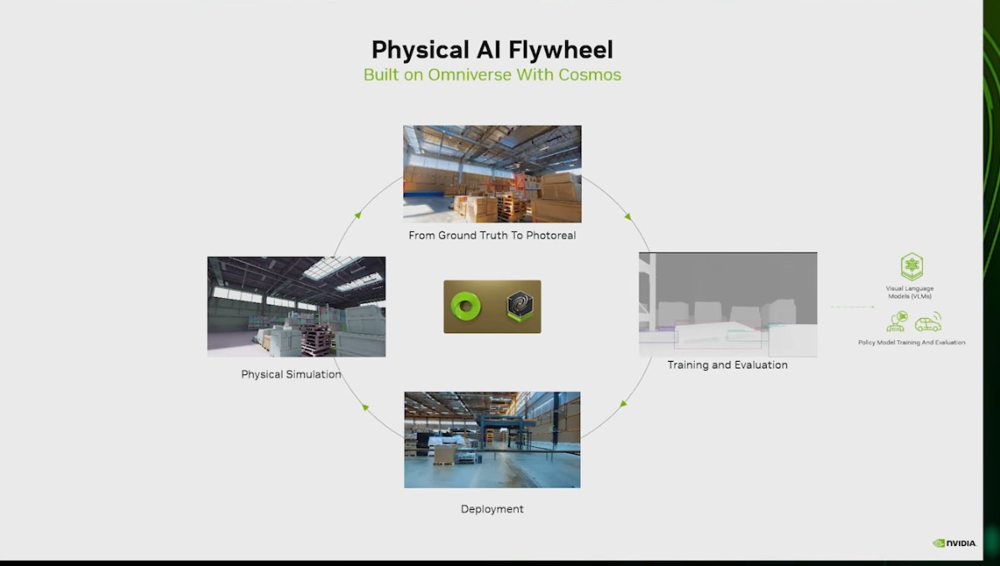

# Cosmos Transfer augmentation of the Replicator frames

Replicator randomizes what it can parameterize: colour, pose, textures, lights, camera. It cannot make a render look
like a phone photo of a real warehouse. A world model conditioned on the simulator's ground truth can. NVIDIA's flywheel
slide labels this step "From Ground Truth To Photoreal".

*Physical AI flywheel, Omniverse/OpenUSD deck (Deck A). The primary evidence for folder 07.*

The Cosmos work lives in folder `07-cosmos-world-models` of this atlas and in
`physical-ai-project/project/src/ssw/transfer.py`, which already builds Cosmos 3 transfer requests (Cosmos3-Nano,
depth and segmentation controls, settings from the Cosmos cookbook). This page covers only what changes when the
input is this folder's pallet-jack dataset.

## Generation labels

| Generation | What the sources say about Transfer | Source |
|---|---|---|
| Cosmos Transfer, 2025 talks (Transfer 1 era) | A general multi-control model (segmentation, depth, edge…) built from about ten single-control ControlNets with per-modality weights, as described in an AV talk; X-Mobility trained on a 1:1 mix of MobilityGen and Cosmos Transfer data avoided a transparent box on a real Carter every time, where the baseline collided every time | `context/02-applications-and-ecosystem.md` §2.3 and §5 ([NextGenAV], [SDG-Live], both auto-captioned) |
| Cosmos Transfer 2.5 (paper Feb 2026) | 2B ControlNet-style variant, 3.5× smaller than Transfer 1; real-robot augmentation took a 100-demo Diffusion Policy from 1/30 to 24/30 successes (image-augmentation baseline 5/30) | `context/00-physical-ai-landscape.md`, paper [06] |
| Cosmos 3 (May 2026) | Transfer is a mode of the one omni model; this repo targets Cosmos3-Nano | `project/src/ssw/transfer.py`, Cosmos 3 cookbook |

None of these results are for pallet-jack detection. They are reasons to try, not predictions.

## What the Replicator output already provides

`replicator_pallet_jack.py` writes, per frame, the RGB image, depth (distance to camera), semantic and instance
segmentation, and the KITTI boxes (Basic Training 05, 33:07–34:28). Depth and segmentation are the control signals
Transfer uses; an edge map can be computed from the RGB frame.

## Three changes the pallet-jack data needs

1. **Stills vs video.** The tutorial's camera jumps to a random pose every frame, so consecutive frames are unrelated.
   Transfer generates video. Either feed single frames if the model you deploy accepts image input (verify on the
   model card), or add a second Replicator mode that moves the camera along smooth paths and writes short clips
   (for example 121 frames at 30 fps, the length `ssw.transfer` uses).
2. **Labels must survive.** The KITTI boxes stay valid only where the generated image keeps the pallet jack where the
   controls put it. Weight the segmentation control high (the cookbook values in `ssw.transfer` are 1.5 for depth and
   2.0 for segmentation) and filter: run the detector trained on pure synthetic data over each generated frame and
   keep frames whose detections match the KITTI boxes at IoU ≥ 0.5 (`kitti_tools.average_precision` and `iou` do the
   matching).
3. **Hold-out first.** Augment only the 86% training split from `kitti_tools.py split`. Validating on augmented
   copies of training frames leaks.

## Experiment to run on a GPU box

| Arm | Training data | Report |
|---|---|---|
| A | 6,000 Replicator frames (3 × 2,000) | AP@0.5 on the 14% synthetic hold-out and on real photos |
| B | A + Cosmos-augmented copies of the training split | same |
| C | Real photos only (if any are labelled) | same |

Real-photo AP is the number that matters; the tutorial judged real photos only by eye (Basic Training 06, 43:12–43:29).
Not executed: needs GPUs (Isaac Sim for the clips, an 80 GB GPU for the Cosmos3-Nano generator per decision D-3).
