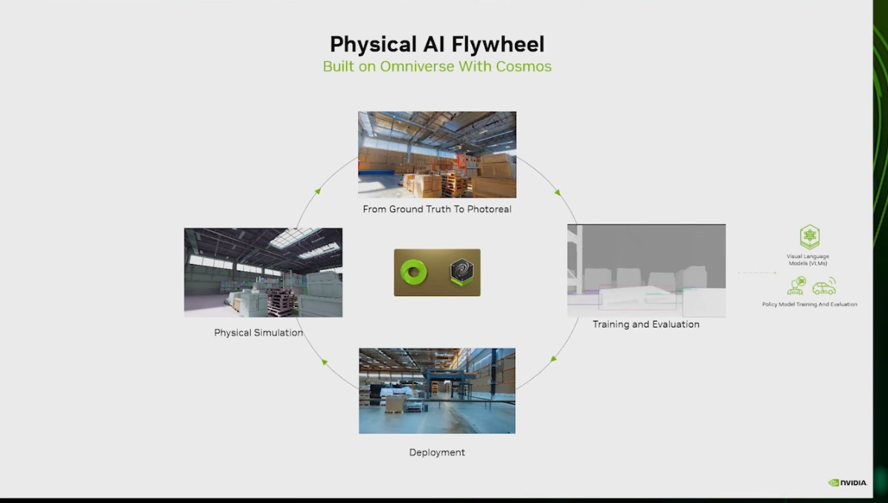
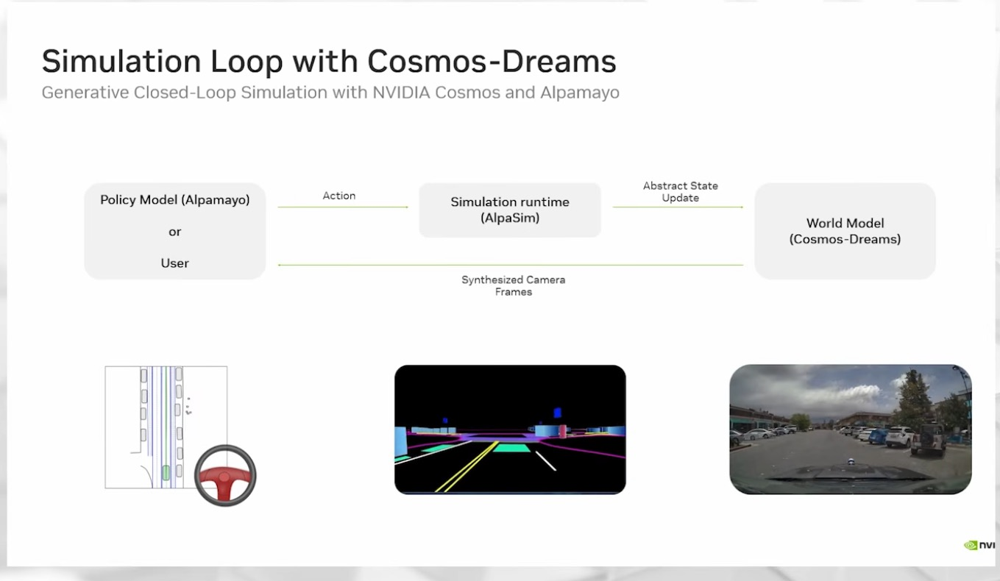
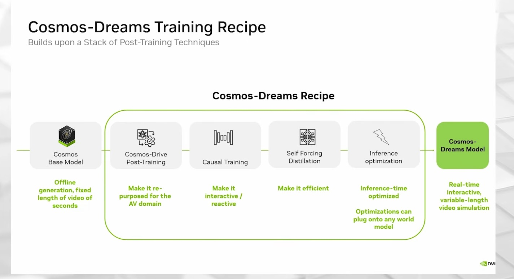
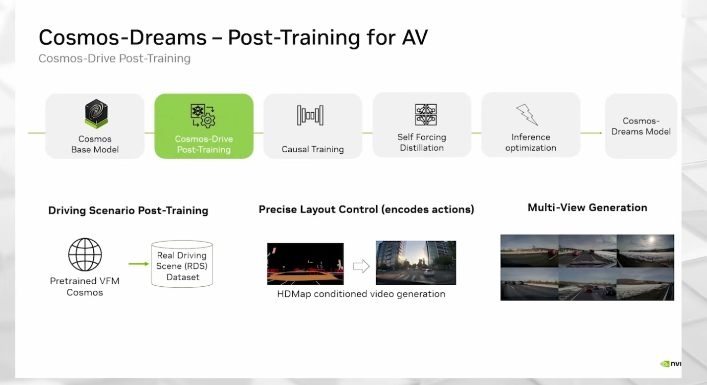
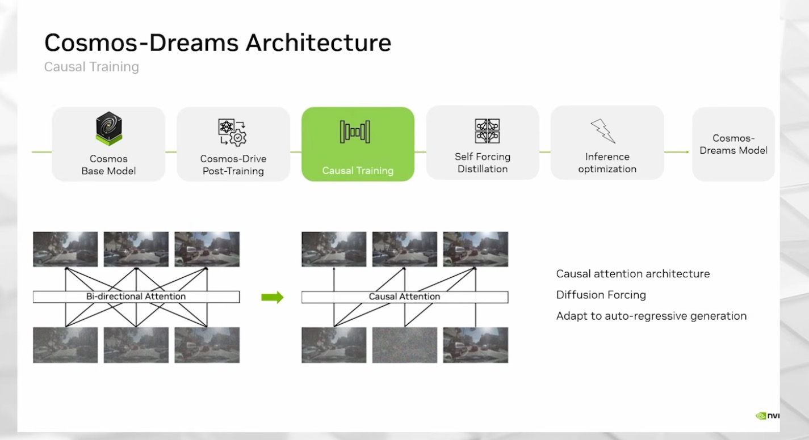
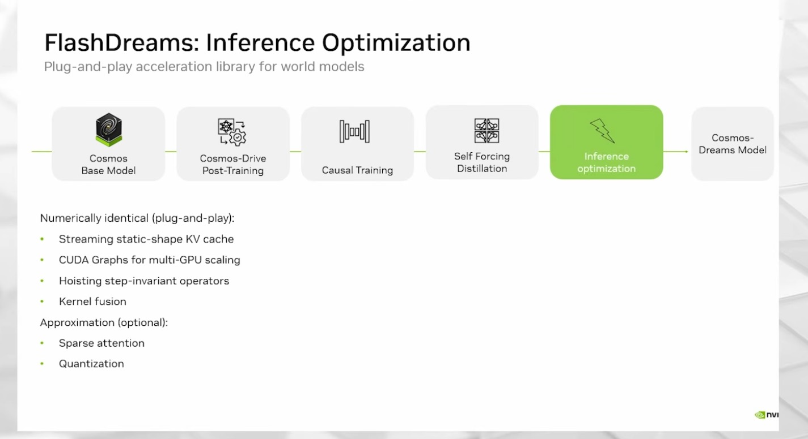
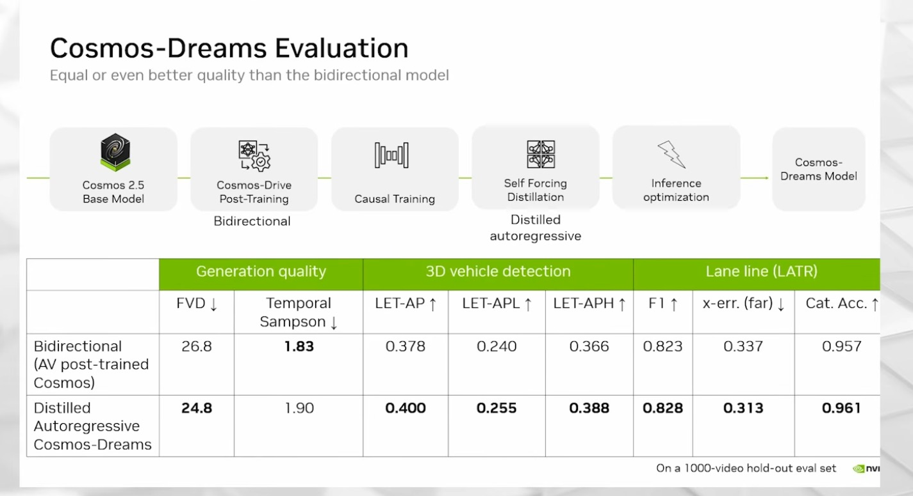
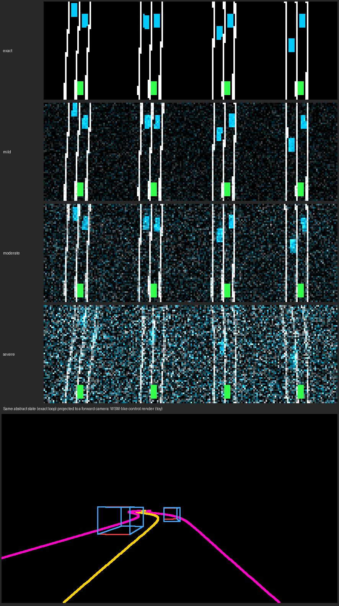

# 07 — Cosmos world models: transfer requests, a Reasoner incident agent, and the Cosmos-Dreams loop

> Reproduces three Cosmos workflows from the Cosmos 3 cookbook and the SIGGRAPH 2026 talks: sim renders turned into
> photoreal variants by the Generator (transfer), the Reasoner used as a video agent that writes an incident log,
> and the closed-loop generative simulation pattern behind Cosmos-Dreams, rebuilt as a CPU toy.

**Cosmos generations in this folder.** Requests, prompts, and sampling settings are **Cosmos 3** (cookbook snapshot in
`cosmos-main/`, release May 2026). **Cosmos-Dreams** is built on a **Cosmos 2.5** base model (evaluation slide; the talk
says a Cosmos 3 version was in progress). The "Simulation 3.0" example on the AV slide is **Cosmos-Transfer1** (Cosmos 1).
The Metropolis agent talk (GTC 2025) predates Cosmos 3 and used other models. Nothing here ran a Cosmos model.

## Source evidence

| Evidence | What it shows |
|---|---|
|  | Deck A (Omniverse/OpenUSD): the Physical AI flywheel. Physical simulation, then "From Ground Truth To Photoreal" with Cosmos, then training and evaluation (VLMs, policy models), then deployment. Transfer and the Reasoner are the two Cosmos steps of that loop. |
|  | SIGGRAPH 2026 AV talk: "Simulation Loop with Cosmos-Dreams". Policy (Alpamayo) or user, Action, Simulation runtime (AlpaSim), Abstract State Update, World Model (Cosmos-Dreams), Synthesized Camera Frames back to the policy. Below: a top-down map with a steering wheel, an HD-map-and-boxes render on black, a photoreal dashcam frame. |
|  | Same talk: the recipe. Cosmos base model ("offline generation, fixed length of video of seconds"), Cosmos-Drive post-training ("re-purposed for the AV domain"), causal training ("interactive / reactive"), self-forcing distillation ("efficient"), inference optimization ("can plug onto any world model"), giving "real-time interactive, variable-length video simulation". |
|  | Same talk: AV post-training on the Real Driving Scene (RDS) dataset, "Precise Layout Control (encodes actions)" as HD-map-conditioned generation, and six-camera multi-view generation. |
|  | Same talk: bidirectional attention replaced by causal attention, "Diffusion Forcing", "Adapt to auto-regressive generation"; one frame shown as noise while it is denoised. |
|  | Same talk: FlashDreams. Numerically identical: streaming static-shape KV cache, CUDA Graphs for multi-GPU scaling, hoisting step-invariant operators, kernel fusion. Approximations (optional): sparse attention, quantization. |
|  | Same talk: evaluation on "a 1000-video hold-out eval set". Base model labeled "Cosmos 2.5". Distilled autoregressive Cosmos-Dreams vs the bidirectional AV post-trained model: FVD 24.8 vs 26.8, Temporal Sampson 1.90 vs 1.83, LET-AP 0.400 vs 0.378, lane F1 0.828 vs 0.823. |

Transcripts used (file names, and which steps each covers):

- `NVIDIA Physical AI | SIGGRAPH 2026/AV Simulation with NuRec, Cosmos-Dreams, & 3D Gaussian Splatting  Physical AI Day at SIGGRAPH 2026.txt`:
  Cosmos-Dreams intro and Cosmos 2.5 base (21:37–23:22), real-time claims (23:38–23:51, 32:31–32:50), the loop and
  its inputs (24:22–26:17), recipe stages (26:20–27:50), AV post-training (27:59–29:02), causal mask (29:06–29:53),
  self-forcing distillation (29:57–30:40), FlashDreams (30:44–32:28), results and editing (32:54–36:11), comparison
  with NuRec and the ranking check (36:53–38:14). Captions render the name as "Cosmos Streams" or "Omni Streams";
  "Arctic X2000 Pro" and "RTX 6000 Pro" both appear for the same consumer-class GPU.
- `NVIDIA Physical AI | SIGGRAPH 2026/World Models The Frontier of Physical AI  Physical AI Day at SIGGRAPH 2026.txt`:
  Cosmos 3 as one model with an autoregressive tower and a diffusion tower (09:00–14:50), Edge 4B / Nano 16B /
  Super 64B (14:50–16:47), reasoning over video with timestamped segments (16:47–18:30), transfer from depth or
  segmentation (13:11–13:30), forward dynamics, inverse dynamics, and policy (29:57–31:38).
- `Agentic_AI_for_Physical_Operat_transcript_en-us.txt` (GTC 2025, Metropolis): warehouse challenges (02:14–03:13),
  safety bubbles, proximity and zone violations (05:15–06:04), perceive / reason / act / learn (08:59–10:56), the
  orchestrator (16:26–17:30), data flywheel with Cosmos (19:41–21:03), final-response and trajectory evaluation
  (22:27–23:44), "dropping some tools" as VLMs improve (24:04–24:42), the 3D VLM path is on demand, not real time
  (28:36–29:19).
- `NVIDIA_Cosmos_World_Foundation_transcript_en-us.txt` (GTC 2025, Cosmos 1 era): reconstruction "can only reconstruct
  what it sees", Gen3C novel views (22:09–23:21). Used only for the gotcha about the older generation.

Repo sources: `cosmos-main/cookbooks/cosmos3/reasoner/reasoner_prompt_guide.md` (prompts, sampling, coordinates),
`cosmos-main/cookbooks/cosmos3/generator/transfer/` (README, `specs/*.json`, notebooks), `cosmos-main/README.md`
(limitations), and the digests `context/sources/08-cosmos-repo-deep-dive.md` §6 and §8, `06-papers-and-pdfs.md` §1.9
(the Cosmos 2.5 paper's world scenario map), `05b-screenshots-batch2.md` #43–#49.

## What the workflow does

Three workflows share one model family.

**1. Transfer: from simulator ground truth to photoreal video (Cosmos 3 Generator).** A simulator renders a rollout
twice: once as control signals (depth, segmentation) and once as nothing else. Cosmos 3 transfer keeps the geometry and
motion of the controls and invents the appearance described by a structured JSON caption. Swap only the `lighting`,
`background_setting`, and `aesthetics` fields and the same rollout becomes a desert test, a snowfield, or a muddy
construction site. That is the "From Ground Truth To Photoreal" step of the flywheel slide. For AV, the cookbook's
control is the **world scenario map (`wsm`)**: an HD-map-and-cuboids render from the vehicle camera. The Cosmos 2.5
paper describes it as "HD-map lanes, poles, lights + colour/heading-coded cuboids"; the cookbook sample frame shows
lane lines, crosswalks, road edges, and vehicle boxes on black. The Cosmos 3 cookbook has no separate "HD map + boxes"
hint, so `wsm` is the closest supported control.

**2. Reasoner: a video agent with a log (Cosmos 3 Reasoner).** The Reasoner is a VLM served over an OpenAI-compatible
API. `reasoner_prompts.py` collects the cookbook's prompts for robot, AV, and warehouse video (task success,
physical plausibility, timestamped segments, timestamp queries, 2D grounding in 0–1000 coordinates, next action) and
parses each answer format. `incident_agent.py` turns those prompts into the Metropolis pattern: perceive (timeline),
reason (hazard questions with `<think>`), act (localize in time, cut a keyframe, ground with boxes), and keep a log
that can be scored against labels.

```
clip ─► event timeline ─► hazard? (A/B/C, <think>) ─► "When is <event>?" ─► keyframe ─► "Locate <target>" ─► incident
                                     │ B or unparseable = abstain                      0–1000 box ─► pixels ─┘
```

**3. Closed-loop generative simulation (Cosmos-Dreams pattern).** A policy drives, a lightweight runtime keeps the
true state, and a world model renders what the cameras would see:

```
 Policy ──next 8 frames of actions──► Runtime (AlpaSim) ──abstract state: HD map + agent boxes──► World model
   ▲                                                                                               │
   └───────────────────────────── next 8 synthesized camera frames ◄──────────────────────────────┘
        world model inputs: text prompt, first RGB frame, KV-cached history, abstract next state
```

The talk explains why each piece exists. Eight frames per step (two latent frames) keeps the model reactive. A causal
attention mask lets each frame attend only to the past, so generation can continue for minutes. Self-forcing DMD
distillation cuts a 35-step teacher to a 2-step student. A fixed-size ("static-shape") KV cache keeps memory and
CUDA Graphs stable. The abstract state (HD map and boxes) gives "just enough control so that the video model doesn't
completely hallucinate". `dreams_loop.py` implements these interfaces and runs them with a toy: a kinematic bicycle
car, a curving two-lane road, a braking lead car, an oncoming car, a raster "world model" with a ring-buffer history,
and policies that drive from pixels. It is a conceptual reproduction, not Cosmos-Dreams.

The talk's validation is not a picture-quality score. Different policies were driven in NuRec and in Cosmos-Dreams, and
"the stack ranking between different models remained the same" (37:50–38:14). The toy reproduces that test: five
policies, one exact renderer and three degraded ones, Kendall tau between the policy rankings.



*Toy loop, chunk 6 of seed 0: rows are the exact, mild, moderate, and severe renderers (lane lines white, agent boxes
cyan, ego green). Below, the same abstract state projected to a forward camera as a WSM-like control frame. CPU, no
Cosmos.*

## Code

| File | Purpose | Runs on | Status |
|---|---|---|---|
| `build_specs.py` | Writes `specs/`: robot depth+seg requests via `ssw.transfer`, AV `wsm` requests mirroring the cookbook's `specs/wsm.json`, five weather/lighting prompt variants, Framework spec + vLLM-Omni form + Diffusers kwargs per variant | CPU | executed here; specs committed |
| `specs/robot/*`, `specs/av/*` | 24 request files + the cookbook negative prompt | Cosmos3-Nano, 80 GB GPU | not executed: needs GPU |
| `reasoner_prompts.py` | 20-prompt catalogue (robot, AV, warehouse) with provenance, request builder (media first, cookbook sampling), parsers for choices, segments, timestamps, boxes, points | CPU; requests need a vLLM server | building and parsing executed; server calls not executed: needs GPU |
| `incident_agent.py` | Reasoner incident agent: question plan, keyframe cut (ffmpeg), JSON + Markdown log, scoring by hazard and condition with failure modes; `--dry-run` answers from `tests/fixtures/mock_responses.json` | CPU (mock); live path needs a vLLM server with Cosmos3-Nano | dry run executed; live path not executed: needs GPU |
| `dreams_loop.py` | Loop interfaces (Policy, SimulationRuntime, WorldModel) + CPU toy, ranking study, WSM-like control export | CPU | executed here |
| `results/dreams_ranking.json`, `results/dreams_ranking_episodes.csv`, `results/dreams_preview.png` | Ranking study output (10 seeds x 5 policies x 4 renderers) | CPU | executed here |
| `results/incident_mock/` | Incident log, score, and Markdown from the mock replies (format and failure handling only) | CPU | executed here |
| `tests/` | 32 tests: cookbook wording, request shape, parsers, agent plan and scoring, toy dynamics, cache, Kendall tau, result reproducibility, spec consistency with the cookbook | CPU | executed here |

## Run it (GPU box)

Pinned: Cosmos 3 cookbook snapshot in `cosmos-main/`; `nvidia/Cosmos3-Nano`; vLLM >= 0.23.0 for the Reasoner;
`vllm/vllm-omni:cosmos3` for the Generator; CUDA 12.8 or 13 with a matching torch build. Hardware per the cookbook:
the Nano Reasoner needs about 16–17 GB of weights (one ~24 GB GPU); Nano transfer needs one 80 GB GPU.

```bash
# 1. Reasoner server (cookbook flags)
CUDA_VISIBLE_DEVICES=0 vllm serve nvidia/Cosmos3-Nano --tensor-parallel-size 1 --mm-encoder-tp-mode data \
  --async-scheduling --allowed-local-media-path / --media-io-kwargs '{"video": {"num_frames": -1}}' --port 8000

# 2. Incident agent on real clips (manifest format in incident_agent.py); --extract-frames cuts keyframes with ffmpeg
python incident_agent.py run --manifest clips.jsonl --base-url http://HOST:8000/v1 --out results/live --extract-frames
python incident_agent.py score --log results/live/incident_log.json --manifest clips.jsonl --markdown results/live/incident_log.md

# 3. Generator server (from the repo root so control paths resolve; --no-guardrails without the gated HF repo)
docker run --runtime nvidia --gpus '"device=0"' -v "${HF_HOME}:/root/.cache/huggingface" -v "$(pwd):/workspace" \
  -p 8001:8000 --ipc=host -w /workspace vllm/vllm-omni:cosmos3 \
  vllm serve nvidia/Cosmos3-Nano --omni --model-class-name Cosmos3OmniDiffusersPipeline \
  --allowed-local-media-path / --port 8000 --init-timeout 1800 --no-guardrails

# 4a. Control videos: robot depth/seg from your simulator renders (121 frames at 30 fps, 1280x720) into
#     specs/robot/controls/; AV world scenario map (101 frames at 10 fps) into specs/av/controls/av_wsm.mp4.
#     For a plumbing test only, the toy loop can produce a WSM-like video:
python dreams_loop.py export-wsm --out specs/av/controls/wsm_frames --frames 101 --encode
mv specs/av/controls/wsm_frames/control_wsm.mp4 specs/av/controls/av_wsm.mp4

# 4b. Transfer with Cosmos Framework (per-hint weights honored), from the cosmos-framework repo root
export ATLAS=/path/to/physical-ai-project/workflows/07-cosmos-world-models
cd "$COSMOS_FRAMEWORK" && unset LD_LIBRARY_PATH
.venv/bin/python -m cosmos_framework.scripts.inference --parallelism-preset=latency \
  -i "$ATLAS/specs/av/av_snow.json" -o "$ATLAS/outputs/Cosmos3-Nano/" --checkpoint-path Cosmos3-Nano --seed 2026

# 4c. Or post a saved vLLM-Omni form with ssw.transfer.post_vllm_omni (no per-hint weights on this backend);
#     control_path values must be readable from the server's working directory
cd "$ATLAS" && PYTHONPATH=../../project/src python - <<'EOF'
import json
from pathlib import Path
from ssw.transfer import post_vllm_omni
form = json.loads(Path("specs/av/av_snow_request.json").read_text())["vllm_omni_form"]
post_vllm_omni("http://HOST:8001/v1", form, Path("outputs/av_snow.mp4"))
EOF
```

Cosmos-Dreams itself is not in the cookbook snapshot. The talk says NuRec, Cosmos-Dreams, and FlashDreams were
open-sourced on GitHub (38:19, caption); the sources show no install or run commands, so consult the Cosmos-Dreams
repository. To drive a real world model with `dreams_loop.py`, implement the `WorldModel` protocol (`reset(first_frame,
prompt)`, `generate(states)`) around it; the runtime and the ranking study stay the same.

## Source step → code map

| Source step (transcript or screenshot) | Code location |
|---|---|
| "From Ground Truth To Photoreal" (flywheel slide) | `build_specs.py: write_all()` robot block, prompts from `ssw.transfer.build_prompt` |
| Transfer from depth or segmentation (World Models talk 13:11–13:30; cookbook `specs/depth.json`, `seg.json`) | `specs/robot/robot_<variant>.json` (control guidance 2.0, weights 0.5/0.5) |
| HD-map-conditioned generation (`cosmos-dreams-av-posttraining.jpg`; cookbook `specs/wsm.json`) | `build_specs.py: build_wsm_framework_spec()`, `specs/av/` |
| Structured JSON caption with lighting and weather (cookbook `assets/wsm/prompt.json`) | `build_specs.py: AV_BASE`, `AV_VARIANTS`, `build_av_prompt()` |
| Reasoner prompts, sampling, media before text, 0–1000 boxes (cookbook prompt guide) | `reasoner_prompts.py: CATALOGUE`, `build_request()`, `Box.to_pixels()` |
| Parsing: strip to `</think>`, remove fences, `raw_decode` (cookbook notebook) | `reasoner_prompts.py: extract_json()`, `ssw.judge.parse_think` |
| Perceive, reason, act; proximity and zone violations (Agentic AI talk 05:15–10:56) | `incident_agent.py: HAZARDS`, `analyze_clip()` |
| Final-response evaluation with an eval set (Agentic AI talk 22:27–23:44) | `incident_agent.py: score()`, `failure_modes()` |
| Policy emits "the next eight frames" of actions (AV talk 24:43) | `dreams_loop.py: FramePolicy.act()` returns (8, 2) |
| Runtime as orchestrator, abstract state = HD map + boxes (AV talk 24:48–26:17, loop slide) | `dreams_loop.py: ToyRuntime.step()`, `AbstractState` |
| World model inputs: prompt, first frame, history KV cache, abstract next state (AV talk 25:26–26:17) | `dreams_loop.py: RasterWorldModel.reset()`, `.generate()` |
| "Streaming static-shape KV cache" (FlashDreams slide; AV talk 30:59–31:13) | `dreams_loop.py: RasterWorldModel.cache` (fixed ring buffer) |
| Causal training: attend only to past frames (AV talk 29:06–29:53, causal slide) | the loop never feeds future frames: `run_episode()` |
| Stack ranking same in NuRec and Cosmos-Dreams (AV talk 37:50–38:14) | `dreams_loop.py: ranking_study()`, `kendall_tau()` |

## Gotchas from the sources

- **Guardrails.** Every Hugging Face Generator path loads the gated `nvidia/Cosmos-1.0-Guardrail` repo. Without
  access, vLLM-Omni exits at startup; per-request `guardrails: false` does not avoid the load, so start the server
  with `--no-guardrails` (cookbook README, deep-dive §13). The specs here request `guardrails: false` and record it.
- **Per-hint weights only in Cosmos Framework.** vLLM-Omni and Diffusers accept several controls but ignore weights
  (transfer README). The robot depth+seg request therefore carries weights only in the Framework spec.
- **WSM is a different regime.** 101 frames at 10 fps, guidance 1.0, control guidance 3.0, versus 121 frames at 30 fps,
  guidance 3.0, control guidance 1.5 (2.0 for seg) for the other controls (`specs/*.json`). `ffprobe` on the
  cookbook's `control_wsm.mp4` reports 100 frames for a 101-frame spec; the cookbook does not say whether the model
  pads.
- **Geometry comes from the control.** "Output frame count and geometry come from the control video"; `fps` should
  match the control's native rate (transfer README). Render controls at the target size.
- **Cosmos3-Edge has no transfer** (deep-dive §8).
- **Media before text; 0–1000 coordinates** per axis, origin top-left, independent of aspect ratio (prompt guide).
- **Video frame sampling key.** The prompt guide shows `mm_processor_kwargs` (`fps: 4, do_sample_frames`), the vLLM
  notebook uses `media_io_kwargs` (`num_frames: -1, fps: 4`). This folder follows the notebook, as `ssw.judge` does.
- **Think format is prompt-controlled** and replies can be truncated inside `<think>`; the agent treats that as an
  abstention, not a "no" (prompt guide; `ssw.judge.parse_think`).
- **Use `curl --form-string`**, not `-F`, for `prompt` and `extra_params`: `-F` truncates at `;` (deep-dive §13).
- **First vLLM start can take up to 30 minutes** (CUDA graph compile); notebooks poll `/health` for 1800 s.
- **Cosmos-Dreams speed claims are hardware-specific** (as reported in the talk): 68 fps on one GB300 (captioned once
  as "B300") and 30 fps on an RTX 6000 Pro class GPU, the latter only with the lossy path (sparse attention,
  quantization). Compare the base model: "minutes to generate like minute-long video".
- **Cosmos-Dreams is a Cosmos 2.5 derivative**, not Cosmos 3 (eval slide; talk 23:13). Its eval table shows the
  distilled autoregressive student matching or beating the bidirectional teacher on 7 of 8 metrics; Temporal Sampson
  is slightly worse (1.90 vs 1.83).
- **Do not carry Cosmos 1 limits forward.** The GTC 2025 talks describe 2025-generation models ("not useful yet for
  closed loop", per context/02 §2.3). Cosmos 3's own README lists its failure modes: temporal inconsistency, object
  morphing, implausible physics, and the need for "additional validation" in safety-critical use.
- **Agent design.** The Metropolis 3D-VLM path is "on-demand", per image, not real time (Agentic AI talk 28:45–29:19).
  This agent is also on demand: one keyframe per incident for grounding. The talk's advice to keep many small tools so
  you can drop them as VLMs improve shaped the step-per-question plan.

## What we verified here

Executed in the cloud container (CPU only, Python 3.11 venv, numpy, Pillow, ffmpeg; no Cosmos weights, no GPU):

- `build_specs.py`: wrote 25 files; `--check` passes. Tests confirm the AV spec matches the cookbook `specs/wsm.json`
  on every non-path field and the robot spec matches `specs/depth.json` except the multi-control guidance (2.0) and
  weights (0.5/0.5).
- `reasoner_prompts.py`: every `cookbook` and `cookbook-template` prompt (15 checked) matches the text of
  `reasoner_prompt_guide.md` after whitespace normalization. Parsers recover the guide's example answers (box
  `[214, 141, 497, 722]`, five trajectory points, `00:13.30`–`00:23.40`).
- `incident_agent.py --dry-run` on four labeled mock clips: 22 requests built, 3 incidents logged. Mock-reply score
  (tests the harness only): 12 decisions, TP 2, FP 1, FN 1, TN 6, 2 abstentions; precision 0.67, recall 0.67,
  agreement 0.67; every planted failure (false positive, false negative, abstention, truncated `<think>`, out-of-range
  box, unparseable timestamp) is reported. Keyframe extraction ran with ffmpeg on a generated test video.
- `dreams_loop.py rank --seeds 10` (13 s, deterministic, rerun by the tests):

  | Renderer | Kendall tau vs exact (mean scores) | Mean per-seed tau | Collisions / 50 episodes | Ranking |
  |---|---|---|---|---|
  | exact | 1.0 | 1.0 | 4 | eager > nominal > cautious > understeer > tailgater |
  | mild (noise, 0.2 m box jitter) | 1.0 | 0.86 | 5 | same |
  | moderate (+ drops 10%, lane drift 0.3 m, ghosting 0.25) | 0.6 | 0.84 | 7 | cautious > eager > nominal > understeer > tailgater |
  | severe (drops 25%, drift 0.8 m, ghosting 0.5) | 0.2 | −0.28 | 28 | cautious > nominal > understeer > eager > tailgater |

  Reading: a renderer that only adds noise and small box errors preserves the ranking; one that drops agents for a
  chunk and lets lanes drift rewards caution and reorders the policies. That is the property the talk tested between
  NuRec and Cosmos-Dreams, here on a toy with no neural model.

Not executed (needs GPU): any Cosmos inference (Reasoner or Generator), the live agent path, transfer generation,
Cosmos-Dreams. No Cosmos output appears anywhere in this folder.

Not confirmed from the sources: the official WSM rendering spec (our export only imitates the sample's look); the
right control guidance for depth+seg multi-control (the cookbook's only multi-control example is edge+blur at 1.5);
whether vLLM-Omni accepts a `wsm` control together with other hints in one request; Cosmos-Dreams install commands and
its policy/runtime API.
