# 08 — NuRec for AV: from a recorded drive to a drivable Gaussian-splat world

> Reproduces the neural-reconstruction workflow for AV simulation ("Simulation 2.0") from the SIGGRAPH 2026 talk
> "AV Simulation with NuRec, Cosmos-Dreams, & 3D Gaussian Splatting" and its slides, following the Mcity team's real
> build: rig, sync, conversion, preview, reconstruction, USDZ, simulator. The CPU parts (capture preparation and
> checks, cost model, a novel-view proxy) run here; NuRec itself and gsplat training need a GPU.

**Generations.** NuRec is NVIDIA's reconstruction stack (containers, models, libraries, datasets). Its generative
helpers are Cosmos-based: Fixer is "based on Cosmos" (talk, caption) without a generation number in the sources. The
"Simulation 3.0" example on the evolution slide is **Cosmos-Transfer1** (Cosmos 1); the Mcity snow example on
`mcity-open-twin.jpg` says only "Cosmos Transfer". Cosmos-Dreams, the generative alternative, is built on **Cosmos 2.5**
(see workflow 07).

## Source evidence

| Evidence | What it shows |
|---|---|
| 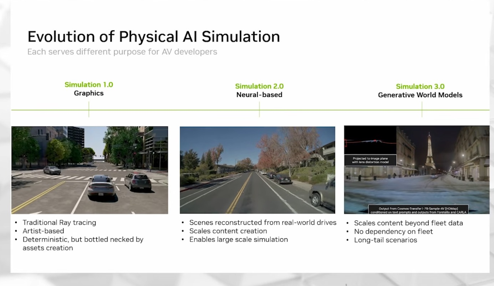 | NuRec deck (Deck C): Simulation 1.0 graphics (artist-built, deterministic, bottlenecked by assets), 2.0 neural (scenes reconstructed from real drives), 3.0 generative world models (beyond fleet data, long tail); the 3.0 frame is captioned "Output from Cosmos-Transfer1-7B-Sample-AV [HDMap]". |
| 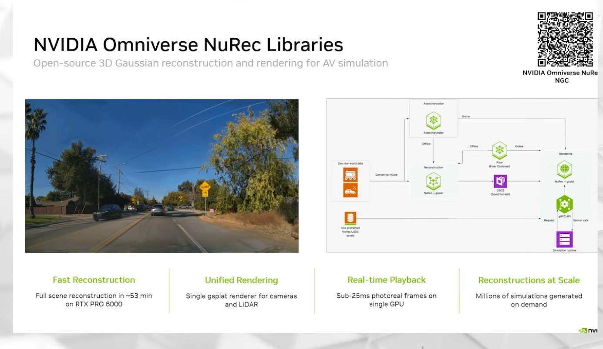 | Deck C: "Open-source 3D Gaussian reconstruction and rendering for AV simulation". Full scene reconstruction in ~53 min on RTX PRO 6000; one gsplat renderer for cameras and LiDAR; sub-25 ms frames on a single GPU. Small diagram labels: "Fixer (Fixer Container)", "USDZ (Saved to Host)", "Use pretrained NuRec USDZ assets". |
| 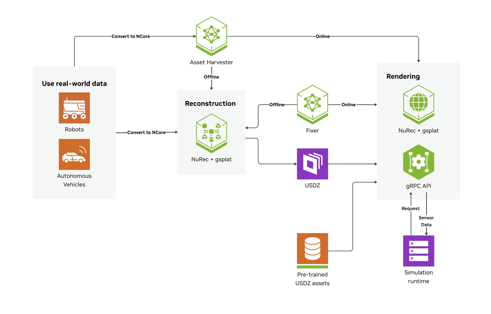 | Deck C: the reference pipeline. Robots and AVs, "Convert to NCore", Reconstruction (NuRec + gsplat), Asset Harvester and Fixer (offline into reconstruction, online into rendering), USDZ, Rendering (NuRec + gsplat, gRPC API), simulation runtime exchanging "Request" and "Sensor Data". |
| 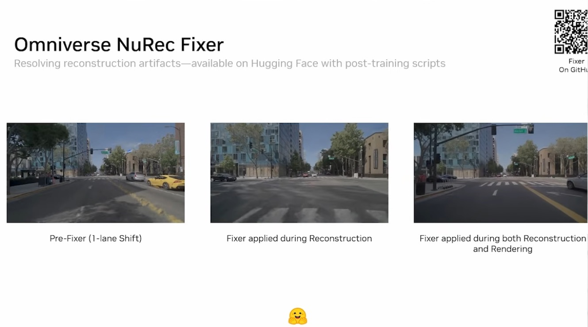 | Deck C: Fixer. Pre-Fixer at a one-lane shift (blurred lane lines), Fixer during reconstruction, Fixer during reconstruction and rendering. "Available on Hugging Face with post-training scripts". |
| 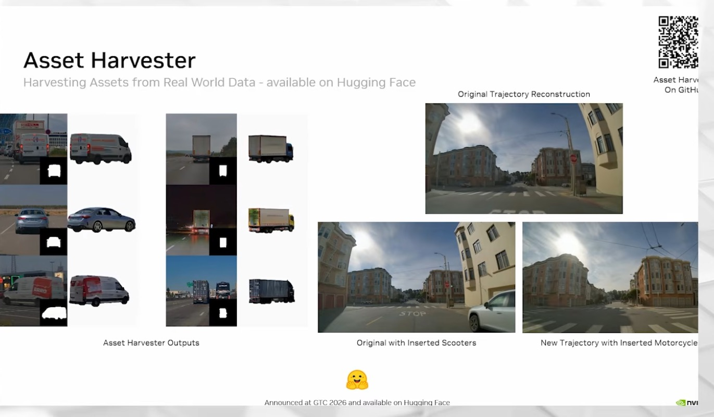 | Deck C: Asset Harvester. Vehicle assets cut from drive frames with masks; scooters inserted into the original trajectory; a motorcycle inserted on a new trajectory. Announced at GTC 2026. |
| 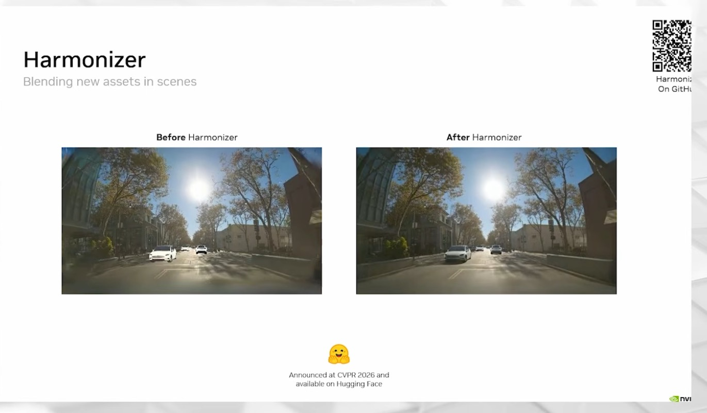 | Deck C: Harmonizer, before and after relighting inserted cars. Announced at CVPR 2026. |
| 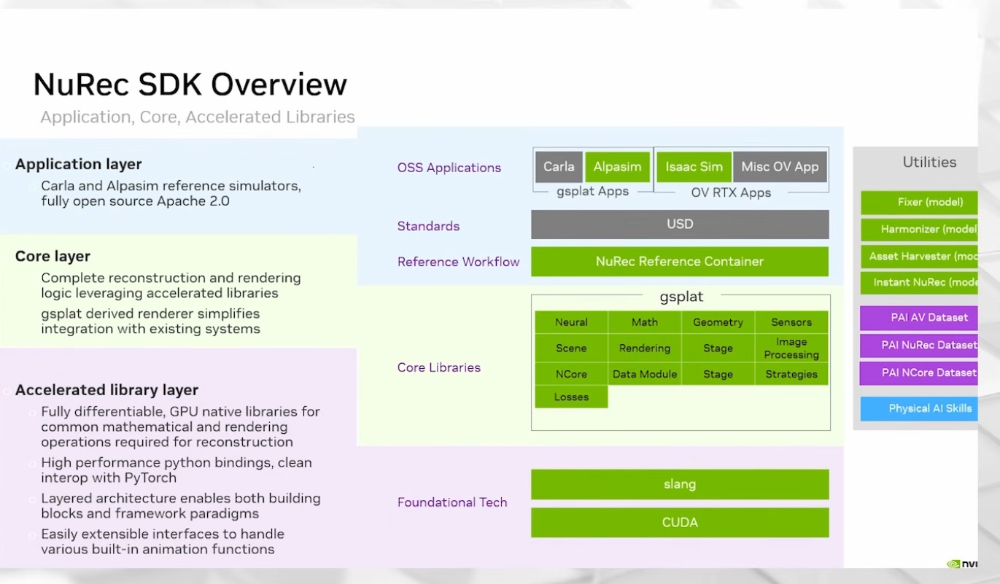 | Deck C: SDK layers. Applications (CARLA, AlpaSim as gsplat apps; Isaac Sim and other Omniverse RTX apps), USD, NuRec Reference Container, gsplat core libraries (incl. NCore, Sensors, Losses), Slang and CUDA; utilities: Fixer, Harmonizer, Asset Harvester, Instant NuRec models, PAI AV/NuRec/NCore datasets, Physical AI Skills. |
| 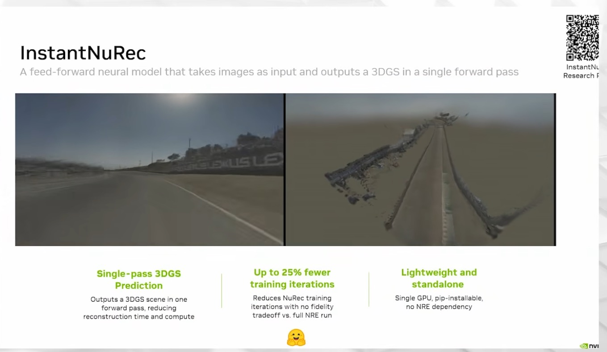 | Deck C: InstantNuRec, "a feed-forward neural model that takes images as input and outputs a 3DGS in a single forward pass"; up to 25% fewer training iterations; single GPU, pip-installable, no NRE dependency. |
| 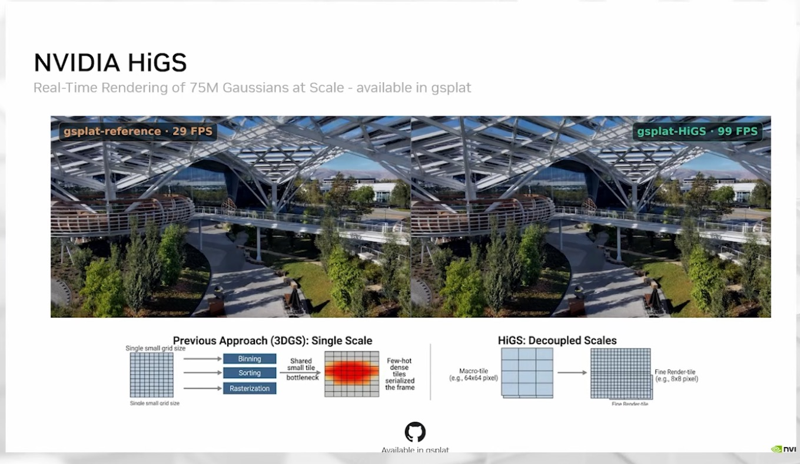 | Deck C: NVIDIA HiGS, 75M Gaussians in real time, available in gsplat; gsplat-reference 29 FPS vs gsplat-HiGS 99 FPS; macro-tiles (e.g. 64x64 px) decoupled from fine render tiles (e.g. 8x8 px). |
| 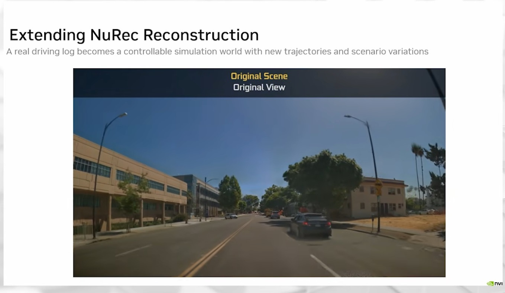 | SIGGRAPH talk: "A real driving log becomes a controllable simulation world with new trajectories and scenario variations"; this frame is the original view. |
| 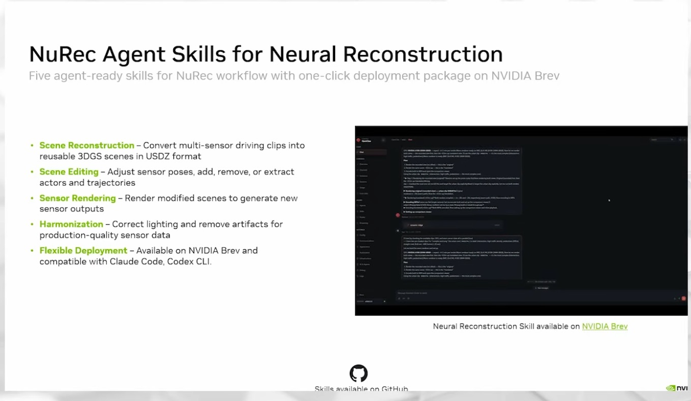 | SIGGRAPH talk: five agent skills (scene reconstruction to USDZ, scene editing, sensor rendering, harmonization, deployment on NVIDIA Brev; "compatible with Claude Code, Codex CLI"). |
| 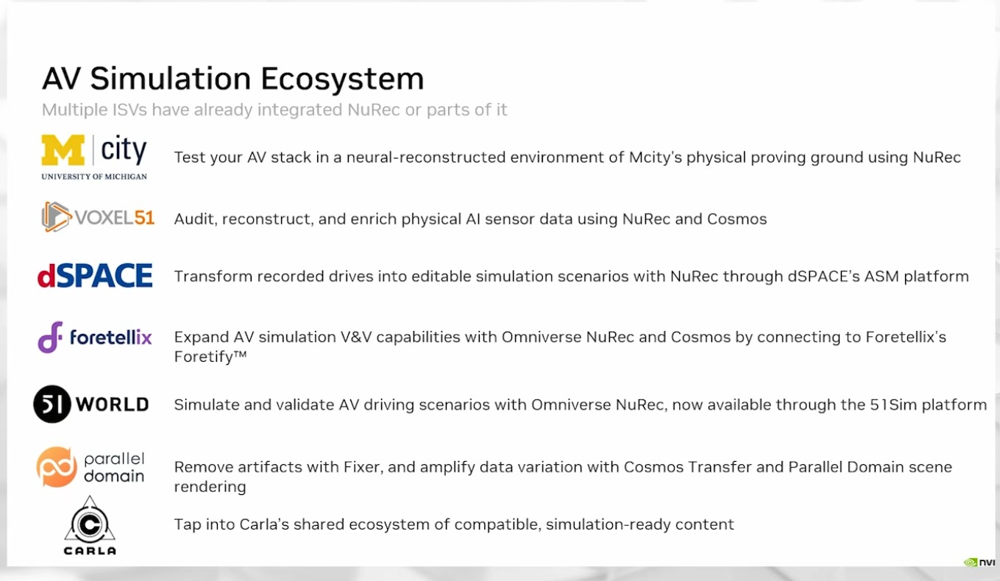 | SIGGRAPH talk: ISVs using NuRec: Mcity, Voxel51, dSPACE, Foretellix, 51WORLD, Parallel Domain, CARLA. |
| 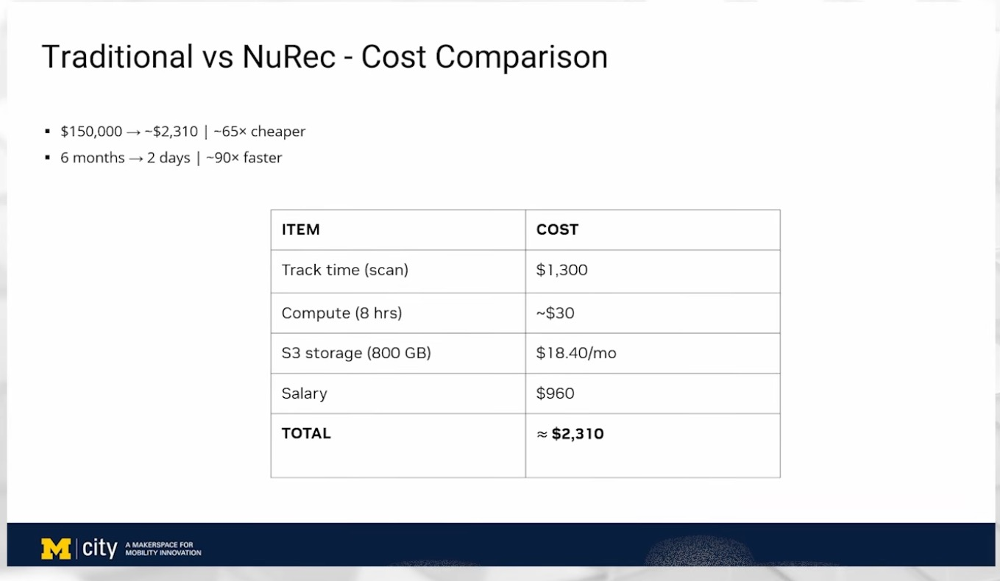 | Mcity slide in the SIGGRAPH talk: traditional vs NuRec cost. $150,000 to ~$2,310 (~65x cheaper), 6 months to 2 days (~90x faster); track time $1,300, compute (8 hrs) ~$30, S3 storage (800 GB) $18.40/mo, salary $960. |
| 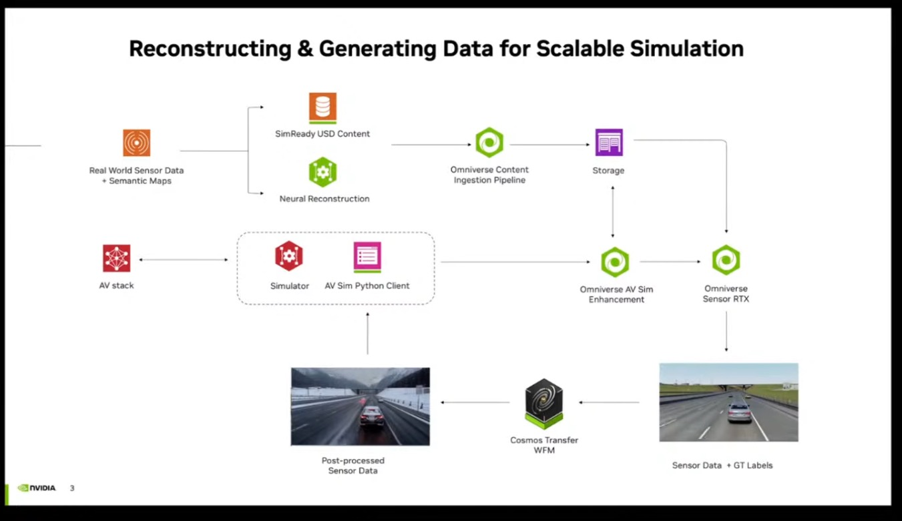 | AV simulation talk, slide 3: real sensor data and semantic maps, SimReady USD content or neural reconstruction, Omniverse content ingestion, storage, AV Sim Enhancement, Sensor RTX (sensor data + GT labels), Cosmos Transfer WFM, post-processed sensor data into the simulator, AV Sim Python client, AV stack. |
| 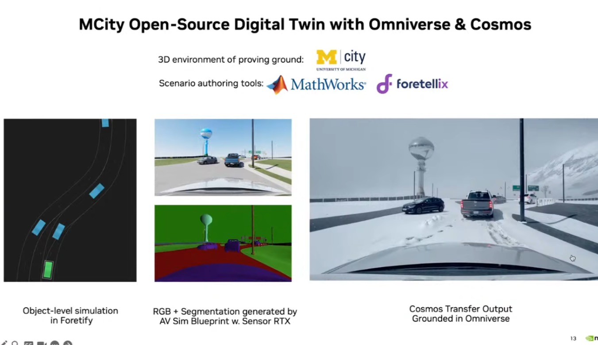 | AV simulation talk, slide 13: Mcity open-source digital twin with Omniverse and Cosmos. Object-level simulation in Foretify, RGB + segmentation from the AV Sim Blueprint with Sensor RTX, Cosmos Transfer output grounded in Omniverse (the same scene in deep snow). |

Transcripts used (file names, and which steps each covers):

- `NVIDIA Physical AI | SIGGRAPH 2026/AV Simulation with NuRec, Cosmos-Dreams, & 3D Gaussian Splatting  Physical AI Day at SIGGRAPH 2026.txt`:
  Simulation 1.0/2.0/3.0 (00:33–01:16), what reconstruction enables and the 1–2 m shifts (01:16–01:56), the NuRec
  family (02:00–02:29), Fixer (02:47–03:33), Asset Harvester and "well over 2 million simulation a day" (03:34–04:57),
  Harmonizer (05:01–05:29), SDK layers and pushing libraries "back to G spot [gsplat]" (05:32–06:32), Instant NuRec
  (06:34–06:58), HiGS (06:58–07:16), extreme novel views (07:24–08:03), agent skills (08:07–08:29), ecosystem
  (08:34–08:57), Mcity: reasons (10:19–12:13), traditional twin and its cost (12:16–15:52), rig and pipeline
  (16:08–18:09), validation (18:12–20:07), cost and timeline (20:10–20:39), next steps (20:42–21:23), NuRec vs
  Cosmos-Dreams with trajectory deviation (36:53–37:46).
- `Developing With Cosmos World Foundation Models/Autonomous Vehicle Simulation With NVIDIA Omniverse and Cosmos.txt`
  (2025 livestream, Cosmos 1 and Predict 2 era): Sensor RTX renders physics-based content or Gaussians, then Cosmos
  amplifies diversity, e.g. a highway turned snowy (17:41–18:58); reconstruction APIs and generative enhancement for
  shifted trajectories (19:18–20:18); a six-metre shift, occlusion artifacts, Fixer in the loop and as post-process
  (29:00–30:38).
- `NVIDIA_Cosmos_World_Foundation_transcript_en-us.txt` (GTC 2025, Cosmos 1 era): reconstruction "can only
  reconstruct what it sees" (22:09–22:33), quality degrading at a six-metre two-lane shift (29:55–30:19).

Digests: `context/sources/05a-screenshots-batch1.md`, kept local #27–#36, `05b-screenshots-batch2.md` #37–#42, #59, #60,
`context/02-applications-and-ecosystem.md` §2.4–§2.6.

## What the workflow does

Neural reconstruction turns one recorded drive into a 3D scene you can render from new places and times. The talk's
summary: change camera intrinsics and extrinsics, and move the ego and the other agents (01:16–01:56). NuRec packages
this as a pipeline:

```
 sensor rig (6 cams, LiDAR, GPS/IMU, PTP + trigger) ─► ROS bag ─► NCore ─► aux data (segmentation, ego mask)
   ─► Instant NuRec preview (PLY) ─► full reconstruction (NuRec + gsplat, optional Fixer) ─► USDZ
   ─► renderer (NuRec + gsplat) ◄─gRPC: request / sensor data─► simulation runtime (CARLA, AlpaSim, Isaac Sim)
```

Why each step exists. Cameras must fire together and share a clock, or moving objects smear across views (Mcity used
PTP and trigger mode). NCore is the common input format for robots and AVs. The ego mask keeps the hood out of the
scene. Instant NuRec predicts Gaussians in one forward pass, so you see in minutes whether the capture is usable
before paying for the full optimization. The full reconstruction optimizes Gaussians against every frame; Fixer, a
Cosmos-based diffusion model, cleans artifacts that appear when you render off the recorded path. USDZ makes the scene
portable to OpenUSD apps. A gRPC renderer lets any simulator request sensor frames from the scene.

The open part underneath is **gsplat**: NuRec's libraries are upstreamed there (talk 05:32–06:00; SDK slide) and
HiGS ships in it. This folder therefore reproduces the generic half of the workflow with open code: prepare and check
a capture (`prepare_capture.py`), then train Gaussians with gsplat (`train_gsplat.py`, GPU). It does not reproduce
NCore, Fixer, or USDZ export.

Two numbers frame the case. Mcity's hand-built twin cost about $150k and 6 months for 30 acres; NuRec cost about
$2,310 and 2 days (slide). And quality depends on how far you leave the recorded path; `novel_view_envelope.md`
explains why with a CPU proxy and lists the fixes the sources describe.

## Code

| File | Purpose | Runs on | Status |
|---|---|---|---|
| `RUNBOOK.md` | The Mcity pipeline, step by step, with only what the talk and slides show; "consult NuRec docs" where they show no command | — | documentation |
| `prepare_capture.py` | Capture folder (frames per camera, pose CSV, intrinsics JSON, optional ego masks and points) to nerfstudio `transforms.json` + COLMAP text model; checks cross-camera skew, dropped frames, poses outside range, pose jumps; reports trajectory coverage; synthetic capture generator with fault injection | CPU | executed here |
| `train_gsplat.py` | gsplat training (rasterization + DefaultStrategy, masked L1); `--dry-run` loads the prepared data and prints the plan | dry run: CPU; training: CUDA + torch + gsplat | dry run executed; training not executed: needs GPU |
| `cost_model.py` | The Mcity cost slide as a model: checks items, totals, and ratios; plug in your own rates | CPU | executed here |
| `novel_view_envelope.py`, `novel_view_envelope.md` | 3D visibility proxy: support for novel views vs lateral offset; explanation and fixes from the sources | CPU | executed here |
| `results/novel_view_envelope.{csv,json,png}` | Proxy output | CPU | executed here |
| `tests/` | 19 tests: rotations, conventions (OpenCV/OpenGL, COLMAP), fault detection, gsplat dataset loading and GPU guard, cost arithmetic, ray casting and occlusion, result reproducibility | CPU | executed here |

## Run it (GPU box)

NuRec: the sources give no install commands, image tags, or versions. Follow the NuRec documentation for NCore
conversion, auxiliary data, Instant NuRec, the Reference Container, Fixer, and the gRPC renderer, in the order of
`RUNBOOK.md`. Mcity reconstructed on RTX PRO 6000 and H100 (an RTX 4090 worked, slowly).

Open gsplat path on the same capture (not executed here). Pinned: Python 3.10+, a CUDA build of torch, `gsplat` from
PyPI (record the version you install; the training loop follows gsplat's `rasterization` and `DefaultStrategy` API).

```bash
# 1. Export frames, poses, intrinsics, ego masks (and LiDAR points if you have them) from your bag into the layout
#    documented in prepare_capture.py, then prepare and check
python prepare_capture.py --capture capture/ --out prepared/ --max-skew-ms 1.0     # exit 1 on sync or pose errors
cat prepared/capture_report.json

# 2. Plan on any machine, then train on the GPU box
python train_gsplat.py --data prepared/ --dry-run
pip install torch gsplat            # CUDA build of torch first; see the gsplat README
python train_gsplat.py --data prepared/ --steps 7000 --out gsplat_out/

# 2b. Or gsplat's own trainer on the COLMAP export (from a gsplat checkout; check --help for your version)
colmap model_converter --input_path prepared/sparse/0 --output_path prepared/sparse/0 --output_type BIN
python examples/simple_trainer.py default --data_dir prepared/ --result_dir results/

# 3. Cost for your own rates
python cost_model.py --gpu-rate 2.5 --gpu-hours 16 --staff-rate 85 --staff-hours 24 --storage-months 12
```

## Source step → code map

| Source step (transcript or screenshot) | Code location |
|---|---|
| Six roof cameras, PTP sync, trigger mode, calibration (talk 16:08–16:44) | `prepare_capture.py: check_sync()`, `Limits.max_skew_ms`, `T_rig_cam` in `intrinsics.json` |
| Record in ROS bag, convert to NCore (talk 16:55–17:11; "Convert to NCore" on the pipeline slide) | not reproduced (NuRec docs); `prepare_capture.py: load_capture()` reads an exported open layout instead |
| Auxiliary data: segmentation, ego masking (talk 17:11–17:24) | ego mask: `prepare_capture.py: write_layout()` (`mask_path`), `train_gsplat.py: train()` masked loss |
| Instant NuRec preview, PLY checked in a browser (talk 17:28–17:49; `instant-nurec.jpg`) | not reproduced; `prepare_capture.py` report is the pre-flight check before spending GPU hours |
| Full reconstruction, NuRec + gsplat (talk 17:49–18:09; `nurec-reference-pipeline.jpg`) | `train_gsplat.py: train()` (open gsplat, not NuRec) |
| Gaussians initialized from points (Instant NuRec "as initialization"; LiDAR on the rig) | `prepare_capture.py` `points.npy` to `points3D.txt`; `train_gsplat.py: load_dataset()` |
| Quality falls off the recorded path; Fixer at a one-lane shift (talk 02:47–03:21; `nurec-fixer.jpg`) | `novel_view_envelope.py`, `novel_view_envelope.md` |
| Trajectory coverage of the capture | `prepare_capture.py: coverage()` (path length, frames per metre, heading span, lateral spread) |
| Cost table and ratios (`mcity-cost-comparison.jpg`; talk 20:10–20:39) | `cost_model.py: SLIDE`, `NuRecCost`, `verify_slide()` |
| USDZ output, gRPC renderer, CARLA / AlpaSim / Isaac Sim (pipeline and SDK slides) | `RUNBOOK.md` steps 7 and 9 (no code: needs NuRec) |

## Gotchas from the sources

- **Sync before anything.** Mcity's rig used PTP sync and camera trigger mode so all cameras fire at once (talk
  16:16–16:28, caption "PT sync"). Unsynced cameras put moving objects in different places in different views.
- **Mask the ego vehicle.** "You don't want your vehicle's hood in the reconstructed scene" (17:14–17:21).
- **Preview first.** Instant NuRec before "the GPU hours to do the full reconstruction" (17:30–17:39).
- **GPU choice.** RTX PRO 6000 and H100 used; an RTX 4090 "worked, took a long time" (17:52–18:09). NVIDIA's figure:
  ~53 min for a full scene on RTX PRO 6000 (slide). Mcity's whole conversion and reconstruction took "a day and a
  half ... depending on how much GPUs you have" (20:30–20:39).
- **Stay near the recorded path, or fix it.** Artifacts start "the moment you start deviate from original trajectory";
  lane lines blur at a one-lane shift (02:56–03:10). Fixer can run during reconstruction, rendering, or both. Extreme
  novel views (turning onto unrecorded roads) were internal and unreleased at the talk (07:24–07:32).
- **Static scenes are easy, cities are not.** Mcity could clear its track of dynamic actors; a city cannot
  (15:04–15:33). Asset Harvester and the extreme-novel-view work remove and re-insert actors for that reason.
- **Inserted assets need relighting.** Harvested assets carry another scene's lighting, shadows, and ISP; Harmonizer
  has temporal and non-temporal variants to fix that (05:01–05:29).
- **Soft edges came from calibration.** Mcity's next step for sharper reconstructions was better calibration
  (20:47–20:52).
- **The cost slide leaves rates implicit.** It shows "Compute (8 hrs) ~$30" and "Salary $960" without GPU type or
  hours; S3 storage is per month. `cost_model.py` makes those inputs explicit.
- **Caption names.** "Nurek", "NeuraC", "Nuerac", "new wreck" mean NuRec; "Encord" means NCore; "G spot" means gsplat;
  "Alpha Sim" means AlpaSim; "Higgs" means HiGS.

## What we verified here

Executed in the cloud container (CPU only, Python 3.11 venv with numpy, Pillow, matplotlib; no NuRec, no gsplat, no
GPU):

- `prepare_capture.py` on a synthetic three-camera, 4 s drive (120 frames, 100 Hz poses): clean capture passes with
  0 ms skew, 31.3 m path, 3.83 frames per metre, 1.60 m lateral camera spread. Tests confirm the front camera's optical
  axis follows the vehicle heading (dot product > 0.999), OpenGL `transform_matrix` and COLMAP `images.txt` agree on
  every camera centre (1e-5 m), and injected faults are caught: a 3 ms camera offset (skew error), two dropped frames,
  a 5 m pose jump.
- `train_gsplat.py --dry-run` loads the prepared data (120 views, 40 masked, 200 init points) and its world-to-camera
  matrices project a point on the optical axis to the principal point. The training loop was not run.
- `cost_model.py`: slide items sum to $2,308.40 (≈ $2,310), $150,000 / $2,308.40 = 64.98 (≈ 65x), 180 / 2 days = 90x
  with 30-day months (91.3x with calendar months). Implied rates: $3.75 per GPU-hour, $0.023 per GB-month.
- `novel_view_envelope.py` (38 s): the table in `novel_view_envelope.md`; support within 10° falls from 100% to 53.6%
  at a one-lane shift and 36.0% at two lanes; road-surface support from 100% to 17.5% and 4.1%.

Not executed (needs GPU or NuRec): NCore conversion, Instant NuRec, NuRec reconstruction, Fixer, USDZ export, gRPC
rendering, gsplat training.

Not confirmed from the sources: any NuRec command, container image tag, or version; the NCore schema; the gRPC service
definition; whether gsplat's example trainer reads COLMAP text models directly (hence the `model_converter` step);
the GPU type behind the slide's "Compute (8 hrs) ~$30".
