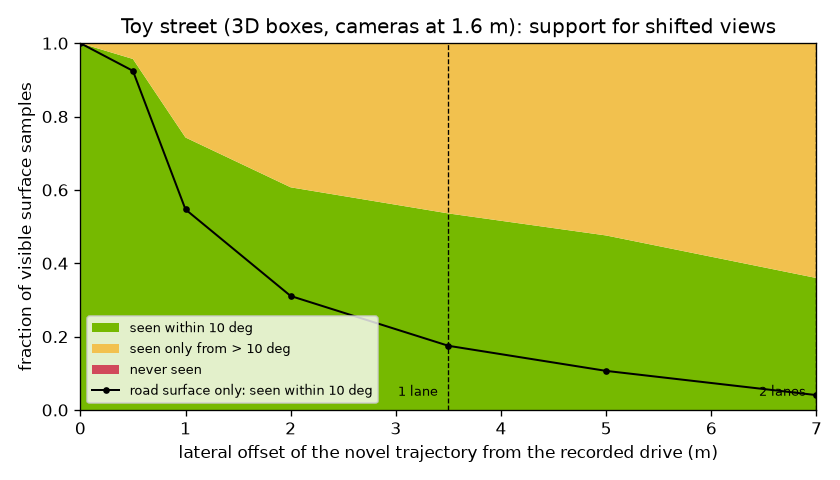

# The novel-view envelope: why NuRec quality falls off the recorded path

A Gaussian reconstruction is fitted to the pixels one drive recorded. Rendered from that drive's camera path, it looks
like the video. Move the camera sideways and two things go wrong:

1. **Viewing angle.** Every surface point was seen from the recorded positions only. A shifted camera looks at it from
   a new direction. Gaussians store appearance as a function of direction (spherical harmonics) and their shapes were
   only constrained from the recorded directions, so errors grow with the angle between the new ray and the nearest
   recorded ray. Flat surfaces seen at grazing angles suffer most, and the road is the flattest surface there is. That
   is why lane lines go first.
2. **Disocclusion.** Surfaces that no camera saw (behind a truck, down a side street, the far side of a parked car) have
   no Gaussians. A renderer shows holes, smears, or floaters there.

The sources describe exactly this. From the 2026 NuRec talk: the shown shifts were "1 m, 2 m to the left", and "the
moment you start deviate from original trajectory, you start to see artifacts ... all of the lane lines start to get
blurry. So, what you see here is a shift of one lane to the left" (02:47–03:10). The Fixer slide's first panel is
labelled "Pre-Fixer (1-lane Shift)" (`../../assets/screens/nurec-fixer.jpg`). A 2025 livestream example uses a six-metre
shift: "shift my car position by like six meters to the left ... you run into artifacts because ... occlusions"
(`Developing With Cosmos World Foundation Models/Autonomous Vehicle Simulation With NVIDIA Omniverse and Cosmos.txt`,
29:10–29:47). A GTC 2025 talk from the Cosmos 1 era says the same of plain reconstruction: "it can only reconstruct
what it sees", and at "six meters ... a two-lane shift ... the quality starts degrading"
(`NVIDIA_Cosmos_World_Foundation_transcript_en-us.txt`, 22:09–22:33, 29:55–30:19).

## A CPU proxy

`novel_view_envelope.py` measures both effects on a toy street built from boxes: facades with a side street, parked
cars, a box truck, a van, and a ground plane. The recorded drive is the right lane, cameras 1.6 m above the road, one
position per metre over 100 m, looking in all directions (like a six-camera roof rig). Novel cameras ride the same
road shifted left. For every surface point a novel camera sees (one ray every 4° in azimuth and 3° in elevation), the
script finds the training cameras with a clear line of sight and the smallest angle between their ray and the novel
ray. Ten degrees is the illustrative threshold for "well supported"; it is not a NuRec parameter. No Gaussians are
trained.

| Lateral shift | Seen within 10° | Seen only from > 10° | Never seen | Median nearest-ray angle | Road surface seen within 10° |
|---|---|---|---|---|---|
| 0 m (recorded path) | 100% | 0% | 0% | 0.0° | 100% |
| 0.5 m | 95.7% | 4.3% | 0% | 2.3° | 92.5% |
| 1 m | 74.3% | 25.7% | 0% | 3.5° | 54.7% |
| 2 m | 60.7% | 39.3% | 0% | 5.5° | 31.1% |
| 3.5 m (one lane) | 53.6% | 46.4% | 0% | 8.3° | 17.5% |
| 5 m | 47.6% | 52.4% | 0% | 11.0° | 10.7% |
| 7 m (two lanes) | 36.0% | 64.0% | 0% | 14.3° | 4.1% |
| turn into the side street | 17.7% | 82.3% | 0% | 33.7° | 4.8% |

Source: `results/novel_view_envelope.csv`, from `python novel_view_envelope.py --out results` (38 s on CPU).

What the toy says:

- **The angle, not missing data, dominates lateral shifts on a straight street.** Even at 7 m every visible sample was
  seen by at least 3 training cameras, because a 100 m drive with all-round cameras sees almost everything from some
  oblique position. What grows steadily is the angle: 2.3° median at half a metre, 8.3° at one lane, 14.3° at two.
- **The road surface goes first.** At one lane only 17.5% of road samples have a recorded ray within 10°; at two lanes
  4.1%. That matches the talk's "lane lines start to get blurry" and the livestream's remark that, after Fixer,
  "all the crosswalk lines look clean and nice" (29:58–30:18).
- **Turning onto a road you never drove is the hard case.** Inside the side street the median angle reaches 33.7°.
  The talk calls this "extreme novel views" and says it was not released: remove dynamic actors, in-paint the holes,
  re-insert assets with Asset Harvester, and relight with Harmonizer "to be able to turn right or left even if we
  never drove there" (07:24–08:03).
- **Limits of the proxy.** Real scenes have far more occlusion (trees, poles, fences, other traffic in the recorded
  frames); the toy's "never seen" stays at zero only because its occluders are few and boxy. No appearance model, no
  exposure or rolling-shutter effects.

## How the sources address it

| Approach | What it does | Generation and status (per the sources) |
|---|---|---|
| **Fixer** (`nurec-fixer.jpg`) | Diffusion model "based on Cosmos" (derived from Difix3D+) that removes reconstruction artifacts. Runs offline during reconstruction (its output improves the training views) and online at render time; the slide's third panel uses both. | Released on Hugging Face and GitHub with post-training scripts; "well over half a million downloads" (talk 03:24–03:33, caption). |
| **Asset Harvester + Harmonizer** (`nurec-asset-harvester.jpg`, `nurec-harmonizer.jpg`) | Build 3D assets from single views of vehicles, insert them into other scenes and new trajectories, then fix lighting, shadows, and ISP mismatch. | Asset Harvester announced at GTC 2026, Harmonizer at CVPR 2026; both on Hugging Face (slides). |
| **Extreme novel views** (`nurec-extending-reconstruction.jpg`) | Remove actors, in-paint, harvest and harmonize assets to render far off the recorded path. | Internal, "not released yet" (talk 07:24–07:32). |
| **Cosmos-Dreams** (`cosmos-dreams-loop.jpg`, workflow 07) | A generative world model renders the next frames from an HD map, agent boxes, and history. It does not depend on a reconstruction, so it "naturally supports generating videos where the trajectory is deviating a lot"; the talk's graph shows NuRec's gap to Dreams growing with deviation. | Built on Cosmos 2.5; the same policy stack ranking held in both simulators (talk 36:53–38:14, caption). |
| **Better capture** | More coverage (more lanes, more passes), tight sync and calibration. Mcity's planned fix for soft edges was better calibration (20:47–20:52). | Practice; `prepare_capture.py` reports trajectory coverage and lateral camera spread. |

Rule of thumb from the table above: keep NuRec renders within about a lane of the recorded path unless Fixer is in the
loop, plan extra passes where you need novel views, and use a generative model for trajectories that leave the
recorded road.
