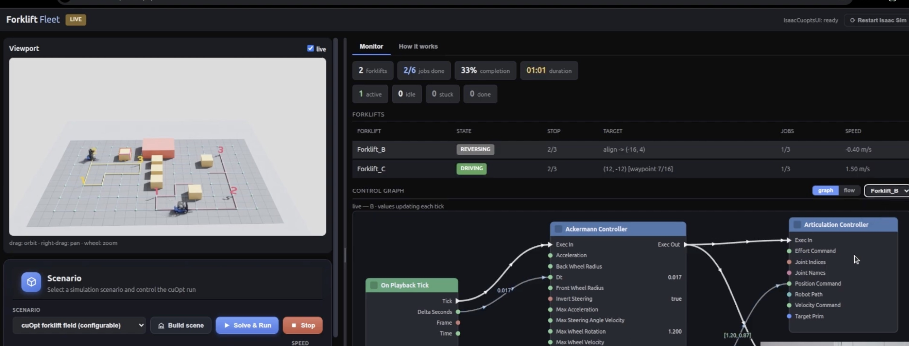
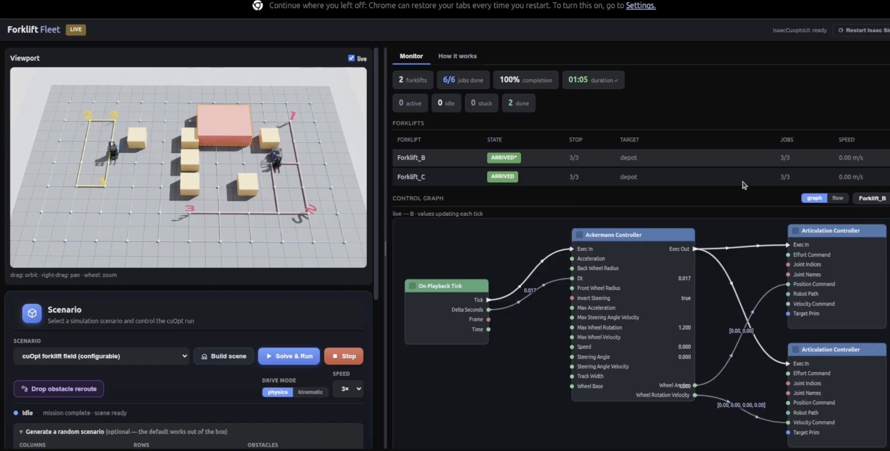

# 09 — cuOpt forklift fleet in Isaac Sim

> NVIDIA cuOpt assigns jobs to a forklift fleet and routes each forklift over a waypoint graph. Isaac Sim then drives
> each forklift along its route with an Ackermann-controller action graph. Reproduced from the "Forklift Fleet" wizard
> (Wizardverse), the Isaac Sim + cuOpt install wizard, and Isaac Sim tutorial #7. Physical AI layer: industrial
> logistics, with fleet optimization feeding a physics-simulated twin.

## Source evidence

| Evidence | What it shows |
|---|---|
|  | Forklift Fleet dashboard mid-run: 2 forklifts, 2/6 jobs done, 33%, 01:01. Forklift_B REVERSING at -0.40 m/s, target "align -> (-16, 4)"; Forklift_C DRIVING at 1.50 m/s toward (12, -12), waypoint 7/16. Control graph: On Playback Tick → Ackermann Controller (Dt 0.017, Invert Steering true, Max Wheel Rotation 1.200) → Articulation Controller; edge value [1.20, 0.87]. Scenario "cuOpt forklift field (configurable)" with Build scene, Solve & Run, Stop. |
|  | Same dashboard, run complete: 6/6 jobs, 100%, duration 01:05, both forklifts ARRIVED at depot with 3/3 jobs. The control graph shows two Articulation Controllers: wheel angles → Position Command, wheel rotation velocity [0.00, 0.00, 0.00, 0.00] → Velocity Command. Drive mode physics / kinematic, speed 3x, "Drop obstacle reroute", random scenario generator (columns, rows, obstacles). |

Transcripts used:
- `NVIDIA OMNIVERSE TUTORIALS/My second wizard is live! It's called Forklift Fleet..txt`: default scene (2 forklifts of
  types B and C, obstacles, a node network, 4 targets), no-entry zone, adding targets, moving boxes to force re-routes,
  invert steering, physics capped at 4x, kinematic mode at 10-20x with real-time estimates, the 30-column / 20-obstacle
  / 20-target random scenario, an idle forklift, below 20 FPS with many forklifts.
- `NVIDIA OMNIVERSE TUTORIALS/Wizard #2 Forklift Fleet— NVIDIA Isaac Sim + cuOpt + forklifts fleet.txt` (promo): 2
  forklifts, 6 targets, 1 min 5 s; 20 targets and 5 forklifts at 20x, about 5 min estimated.
- `NVIDIA OMNIVERSE TUTORIALS/I Built a Wizard to Install NVIDIA Isaac Sim + cuOpt Automatically.txt`: Isaac Sim 6.0.1
  and cuOpt in separate Docker containers; cuOpt extensions in Isaac Sim; the "simple cost matrix" example; port 8000.
- `NVIDIA Isaac Sim & Isaac Lab – Complete Tutorial Series/Tutorial #7 – Ackermann Drive Action Graph + ROS2 Bridge in
  Isaac Sim.txt`: Ackermann graph, position-drive steering vs velocity-drive wheels, joint order, Invert Steering.

## What the workflow does

```
layout (grid, boxes, no-entry zones) ─► waypoint graph (CSR) ─┐
fleet (depots, capacities) + jobs (nodes, service time) ──────┴─► cuOpt request ─► cuOpt :8000 ─► routes per forklift
                                                                        │                          (or greedy_solver on CPU)
                                                                        ▼
            per forklift: waypoint list ─► speed + steering angle each tick ─► Ackermann Controller (invertSteering)
                                         ─► wheel angles → steering joints (position drive)
                                         ─► wheel rotation velocity → drive wheels (velocity drive)
```

The floor is a graph. Every free grid point is a node, and each node connects to its four neighbours. Boxes delete
nodes. A no-entry zone deletes every node inside it, so no route can cross it. That is how the wizard's red box steers
cuOpt. cuOpt gets the graph, the forklifts (start/end node, capacity) and the jobs (node, demand, service time), and
returns one ordered route per forklift. Changing the scene (a dropped box, a new target) means rebuilding the graph
and solving again, which is the wizard's live re-route.

Execution is separate. Each forklift runs one action graph: an Ackermann controller turns a commanded speed and
steering angle into wheel angles (position-controlled steering joints) and wheel spin rates (velocity-controlled drive
wheels). Forklifts steer with the rear wheels, so `invertSteering` is true. In the wizard, the fleet manager sets speed
and steering angle every tick; no ROS node appears in its graph. Kinematic mode skips the graphs and moves the
forklifts along the route at 10-20x while still reporting real-time durations.

We cannot run cuOpt (it needs an NVIDIA GPU), so `greedy_solver.py` solves the same request on CPU. It computes
shortest paths between depots and job nodes, inserts jobs into routes at the cheapest position, then improves the
routes with relocate and 2-opt moves. It answers in a cuOpt-like layout with waypoint-level routes and arrival
times.

## Code

| File | Purpose | Runs on | Status |
|---|---|---|---|
| `warehouse_graph.py` | Grid layout, obstacles, no-entry zones → CSR waypoint graph; Dijkstra; screenshot-like and random scenarios | CPU | executed here |
| `cuopt_payload.py` | Builds the cuOpt routing request (waypoint graph, fleet, tasks, solver config) and checks its structure | CPU | executed here; schema not confirmed |
| `cuopt_client.py` | Standard-library REST client for the cuOpt container on port 8000 (health, submit, poll) | any, plus cuOpt server | not executed: needs a cuOpt server (GPU) |
| `greedy_solver.py` | CPU baseline on the same request: cheapest insertion + local search, `makespan` or `total` objective, brute-force `exact_solve` for small cases | CPU | executed here |
| `run_baseline.py` | Runs both scenarios and a heuristic-vs-optimum gap study; writes `results/` | CPU | executed here |
| `forklift_graph_spec.py` | Per-forklift Ackermann graph as data (dashboard wiring, or tutorial #7's ROS 2 input); Ackermann geometry helpers; `main()` applies it in Isaac Sim | CPU / Isaac Sim | data executed here; `main` not executed: needs GPU |
| `ogspec.py` | Action graphs as data + applier (identical copy of workflow 02's) | CPU / Isaac Sim | as above |
| `results/cpu_baseline.json` | Baseline numbers below | — | committed |
| `results/payload_screenshot.json` | The exact request for the screenshot-like scenario (89 nodes, 292 directed edges) | — | committed |
| `tests/test_fleet.py` | Graph, payload, solver feasibility and optimality, results reproduce, forklift graph | CPU | executed here |

### Results (CPU baseline, our time model)

Time model: edge length / 1.5 m/s (Forklift_C's speed in the screenshot) plus 10 s per job (our assumption for
alignment and fork time). Routes start and end at the depot. These are model times, **not** Isaac Sim physics, and not
comparable to the wizard's 1:05 (physics) or ~5 min (kinematic estimate).

| Scenario | Objective | Makespan (s) | Sum of route times (s) | Jobs per forklift | Idle |
|---|---|---|---|---|---|
| 2 forklifts, 6 jobs, 11×9 grid, 1 no-entry zone, capacity 3 | makespan, insertion + local search | 83.3 | 156.0 | 3, 3 | 0 |
| same | brute-force optimum | 83.3 | 156.0 | 3, 3 | 0 |
| 5 forklifts, 20 targets, 30×20 grid, 20 obstacles, capacity 10 | makespan, insertion only | 226.0 | 1021.3 | 6, 5, 3, 3, 3 | 0 |
| same | makespan, insertion + local search | 216.0 | 1037.3 | 6, 4, 4, 3, 3 | 0 |
| same | total, insertion + local search | 324.7 | 616.0 | 10, 1, 0, 9, 0 | 2 |

Lower bound on makespan for the large case: 164.7 s (the longest single job done alone). Gap study, 20 random 11×9
floors with 7 jobs and 2 forklifts, makespan objective, against brute force: insertion alone averages 4.82% above
optimal (max 20.13%, optimal in 8 of 20); with local search, 1.90% (max 16.11%, optimal in 14 of 20). Solver wall time
on this container: under 25 ms per run (machine-dependent; in the JSON).

What the numbers show: the objective decides fleet behaviour. Minimising the sum of route times sends two forklifts
home unused and makes the last forklift finish 50% later (324.7 s vs 216.0 s) for a 41% smaller sum of route times (616.0 s
vs 1037.3 s). The wizard talk describes cuOpt leaving a forklift idle in its 20-target run because one vehicle could
cover the central targets. That fits a cost-minimising objective. Which objective the wizard configured is not stated.

### Not confirmed by the sources

- The cuOpt request schema (`cost_waypoint_graph_data.waypoint_graph."0".{offsets, edges, weights}`, `fleet_data`,
  `task_data`, `solver_config.time_limit`), the HTTP routes (`/cuopt/health`, `/cuopt/request`,
  `/cuopt/solution/{id}`), and the response fields (`vehicle_data`, `route`, `type`, `arrival_stamp`). The sources show
  only port 8000 and a successful connection test. Verify against your cuOpt server version.
- Type ids `isaacsim.robot.wheeled_robots.AckermannController` and `isaacsim.ros2.bridge.ROS2SubscribeAckermannDrive`.
  The Ackermann port names are the dashboard labels converted to camelCase (`invertSteering`, `maxWheelRotation`,
  `wheelAngles`, `wheelRotationVelocity`, ...).
- Forklift B/C joint names, wheelbase, track width and wheel radius (placeholders in `forklift_graph_spec.py`).
- The grid sizes, box cells, depots and job cells of the screenshot-like scenario are our reading of the screenshots.
  The 4 m spacing is consistent with the printed coordinates (-16, 4) and (12, -12).

## Run it (GPU box)

Pinned: Isaac Sim **6.0.1** and cuOpt each in a Docker container, as Wizard #1 runs them (the tutorial #7 graph was
built on Isaac Sim 5.0.0); Python 3.10+ for the scripts here (standard library only); NVIDIA GPU and driver
per the Isaac Sim and cuOpt requirements. Image tags for cuOpt are not in the sources; take them from NVIDIA's cuOpt
documentation for your version.

```bash
cd physical-ai-project/workflows/09-cuopt-forklift-fleet

# 1. CPU baseline (runs anywhere; this is what we ran)
python run_baseline.py                       # writes results/cpu_baseline.json, results/payload_screenshot.json

# 2. cuOpt container on port 8000 (Wizard #1 step 5). Check it from Isaac Sim: Window > Extensions > "cuOpt",
#    open the "simple cost matrix" example, server port 8000, Test -> success.
python cuopt_client.py --scenario screenshot # same request to cuOpt; prints cuOpt cost vs baseline cost
python cuopt_client.py --scenario large

# 3. Isaac Sim: place forklift B/C assets, then per forklift (in the Script Editor or a standalone script)
#    python forklift_graph_spec.py /World/Forklift_B /World/Forklift_C
#    Set the steering joints to position drives (high stiffness, damping 0) and the drive wheels to velocity drives
#    (stiffness 0, high damping) first (tutorial #7). Each tick, set ackermann_controller.inputs:speed and
#    inputs:steeringAngle from the route (a path follower; not included here).
#    Tutorial #7 variant with ROS 2 input:
#    python forklift_graph_spec.py /World/Leatherback --ros
#    ros2 topic pub /ackermann_cmd ackermann_msgs/msg/AckermannDriveStamped "{drive: {speed: 1.0, steering_angle: 0.2}}"
```

## Source step → code map

| Source step (transcript or screenshot) | Code location |
|---|---|
| "A network of nodes and connections that cuOpt is going to use to calculate the route" (Forklift Fleet talk); white waypoint dots (screenshots) | `warehouse_graph.build_graph()` |
| No-entry zone: "your routes cannot go through this red box" (Forklift Fleet talk) | `warehouse_graph.Rect`, `Layout.no_entry`, `test_no_entry_zone_and_obstacles_have_no_nodes` |
| Move a box into the path → cuOpt finds a different path; drop obstacles mid-run (Forklift Fleet talk) | `Layout.obstacles` + rebuild graph + `build_payload` + solve again |
| Default 2 forklifts (types B, C); 6 targets after adding 2; jobs 3/3 each (talk; `forklift-fleet-complete.jpg`) | `warehouse_graph.screenshot_scenario()` |
| Random scenario: 30 columns, 20 obstacles, 20 targets (talk); 20 targets, 5 forklifts (promo) | `warehouse_graph.large_scenario()` |
| cuOpt microservice container, port 8000, simple cost matrix test (Wizard #1 talk) | `cuopt_client.py` (`DEFAULT_URL`, `health()`) |
| "Solve & Run" sends fleet + targets + network to cuOpt (dashboard screenshot; talk) | `cuopt_payload.build_payload()`, `cuopt_client.CuOptClient.solve()` |
| cuOpt left a forklift unused in the 20-target run (talk) | `greedy_solver` `total` objective; `test_total_cost_objective_can_idle_a_forklift` |
| Per-forklift graph: On Playback Tick → Ackermann Controller (Dt ← Delta Seconds, Invert Steering true, Max Wheel Rotation 1.2) → Articulation Controllers (screenshots) | `forklift_graph_spec.ackermann_graph()` |
| Wheel angles → position command (2 values), wheel rotation velocity → velocity command (4 values) (`forklift-fleet-complete.jpg`; tutorial #7) | `forklift_graph_spec.ackermann_graph()`, `test_forklift_graph_matches_dashboard` |
| "Invert steering to true, which is how NVIDIA uses this Ackermann controller for forklifts" (talk) | `ackermann_controller.values["invertSteering"]` |
| Wheel-angle pair [1.20, 0.87] (`forklift-fleet-live.jpg`) | `forklift_graph_spec.implied_track_ratio()`, `test_ackermann_geometry_reproduces_the_screenshot_pair` |
| Tutorial #7: ROS2 Subscribe AckermannDrive on `ackermann_cmd`; speed, steering angle, acceleration into the controller | `ackermann_graph(..., ros_input=True)` |
| Forklift_C at 1.50 m/s (`forklift-fleet-live.jpg`) | `Scenario.speed_mps`, edge weights in `build_payload` |

## Gotchas from the sources

- Physics mode tops out at 4x; faster, the forklifts tip over in curves (Forklift Fleet talk).
- Set the speed before starting; the author was unsure a change applies mid-run (Forklift Fleet talk).
- Many forklifts under physics fell below 20 FPS, which the author attributes to CPU physics; kinematic mode (no
  colliders or rigid bodies, graphs inactive) runs at 10-20x and still reports real-time durations (Forklift Fleet talk
  and promo).
- Forklifts use `invertSteering = true` (Forklift Fleet talk).
- Steering joints need position drives (stiffness high, damping 0 or low); drive wheels need velocity drives
  (stiffness 0, damping high). Joint-name order in each array must match the controller's output order (tutorial #7).
- cuOpt may leave a forklift idle when that is cheaper (Forklift Fleet talk). If every forklift must work, constrain
  capacity or change the objective (`test_total_cost_objective_can_idle_a_forklift`).
- Local assets make scene loading faster than cloud assets; the optional asset download is over 100 GB (Wizard #1
  talk).

## What we verified here

Ran in the cloud container (CPU only, Python 3.11):

- `ruff check` and `ruff format --check`: clean. `check_workflows.py`: every `.py` file compiles.
- `python run_baseline.py`: produced `results/cpu_baseline.json` and `results/payload_screenshot.json` (numbers above).
- `pytest 09-cuopt-forklift-fleet`: 24 tests pass. They check that the waypoint graph is symmetric with 4 m edges, has
  no nodes in boxes or the no-entry zone, and reaches every depot and target; that the screenshot's coordinates lie on
  the grid; that the payload is structurally valid and the checker catches bad edges, lengths and capacity; that every
  solution serves each job once within capacity, along real edges, with consistent times; that the heuristic equals
  the brute-force optimum on the screenshot case and never beats it; that local search never worsens a solution; that
  the makespan respects the lower bound; that the committed results reproduce; and that the Ackermann graph matches the
  dashboard wiring and the [1.20, 0.87] wheel-angle pair fits Ackermann geometry.

Not run: cuOpt (no server, no GPU), `cuopt_client.py`, Isaac Sim, the forklift graphs in a scene, and any path
follower. cuOpt's answers on these requests are unknown; the baseline is not a stand-in for its quality or speed.
