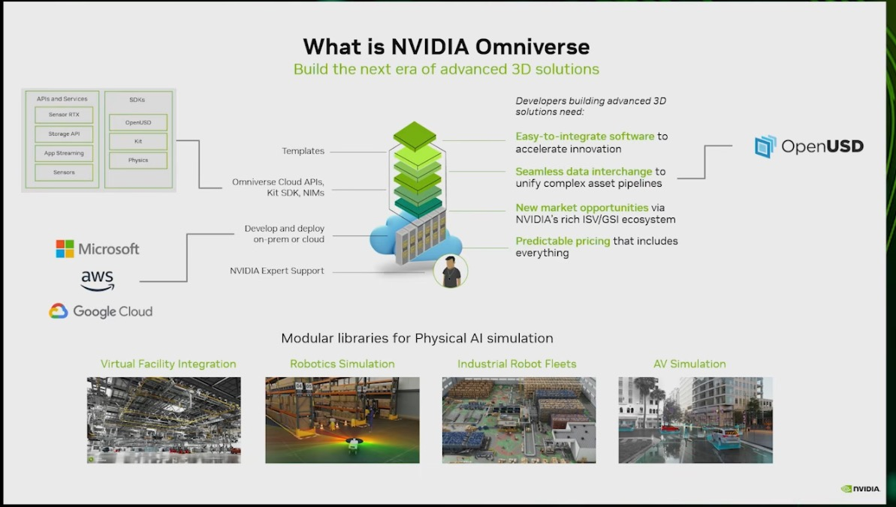
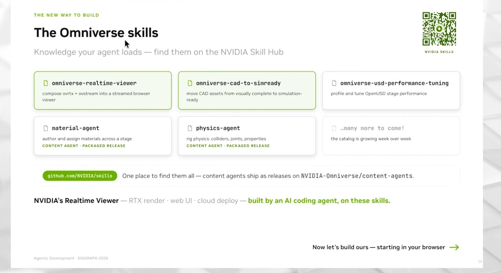
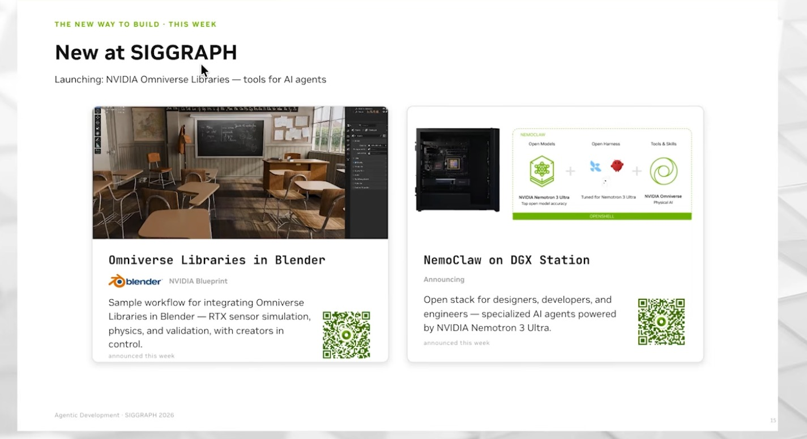

# 10 — Omniverse Kit extension: a robot-scene tool window, streamed to a browser

> Builds a Kit extension the way the Omniverse tutorials do (Introduction 01, 03, 04; Training Series 005): a Kit App
> Template app, an `omni.ext.IExt` with an `omni.ui` window, buttons that edit the USD stage, and the `.kit` change that
> ships it. Then streams the app to a browser (Basic Training 08) and maps it to the SIGGRAPH 2026 Omniverse libraries
> and agent skills. This is the tooling and application layer of Physical AI.

## Source evidence

| Evidence | What it shows |
|---|---|
|  | "What is NVIDIA Omniverse": templates, Omniverse Cloud APIs, Kit SDK and NIMs over OpenUSD, with App Streaming and Kit listed among the APIs and SDKs, and "modular libraries for Physical AI simulation" (facility, robotics, robot fleets, AV). Omniverse/OpenUSD deck (Deck A). |
|  | "The Omniverse skills: knowledge your agent loads": `omniverse-realtime-viewer`, `omniverse-cad-to-simready`, `omniverse-usd-performance-tuning`, `material-agent`, `physics-agent`; NVIDIA's Realtime Viewer "built by an AI coding agent, on these skills". Agentic Development talk, SIGGRAPH 2026. |
|  | "New at SIGGRAPH: Launching NVIDIA Omniverse Libraries, tools for AI agents": Omniverse Libraries in Blender, NemoClaw on DGX Station. Agentic Development talk, SIGGRAPH 2026. |

Transcripts used:
- `NVIDIA OMNIVERSE TUTORIALS/NVIDIA Omniverse Introduction 01 (Deep Learning Institute courses, how to install USDComposer).txt`:
  Launcher deprecated, Kit App Template, `repo template new`, physics bundle in the `.kit` file, build and launch.
- `NVIDIA OMNIVERSE TUTORIALS/NVIDIA Omniverse Introduction 03  (Create an Extension From Template).txt`: extension
  anatomy, renaming, `extension.toml`, the Commands window, VS Code debugging, buttons with lambdas.
- `NVIDIA OMNIVERSE TUTORIALS/NVIDIA Omniverse Introduction 04  (USD Explorer - Create an Extension From VSCODE).txt`:
  Python UI Extension from the template, add it to the `.kit` before building, Window menu entry, spawning assets.
- `NVIDIA OMNIVERSE TUTORIALS/NVIDIA Omniverse Training Series 005 (Import and modify an UI extension).txt`: search
  paths, `omni.ui` layout and models, the vanishing window on a syntax error.
- `NVIDIA OMNIVERSE TUTORIALS/Omniverse B.T. 08 (3D Configurator use case - Stream Omniverse to Browser and React-Web-App).txt`:
  variants, message-bus events, streaming layer, `--no-window`, web viewer and React sample.
- `NVIDIA Physical AI | SIGGRAPH 2026/Physics-Aware RTX Apps with NVIDIA Omniverse Libraries  Physical AI Day at SIGGRAPH 2026.txt`:
  the five Omniverse libraries, OVUI as the successor of Omni UI, skills.

Digests: `context/sources/03-omniverse-openusd-tutorials.md` §7–§10, §18, B2; `context/sources/04-siggraph-2026-physical-ai-day.md` §5;
`context/02-applications-and-ecosystem.md` §4.4 and §9.

## What the workflow does

Since the Omniverse Launcher was deprecated in 2025 (Introduction 01, 02:36–02:56), Omniverse apps are built from
NVIDIA's Kit App Template. An app is a `.kit` file (TOML) listing extensions. An extension is a folder with
`config/extension.toml` and a Python package whose `omni.ext.IExt` subclass Kit starts and stops. UI is `omni.ui`;
stage edits are Kit commands (undoable; the Commands window shows the Python for any click) or plain `pxr` calls.

```
kit-app-template/
  source/apps/my_company.my_usd_composer.kit    [dependencies] ... "physicalai.atlas.tools" = {}   <- before build
  source/extensions/physicalai.atlas.tools/
    config/extension.toml                        title, version, dependencies, [[python.module]]
    physicalai/atlas/tools/extension.py          IExt: window, menu, message-bus listener
                          helpers.py             pure logic (variant choice, lights, names)
                          usd_ops.py             pxr: reference robot, lights, variant switch
./repo.sh build && ./repo.sh launch              (add --no-window with the streaming layer)
```

The window has four buttons:
1. **Load robot** references a robot USD at a fresh prim path, for example the SimReady robot from workflow folder
   `01-openusd-simready`. Variant sets authored in the asset stay selectable through the reference.
2. **Randomize lighting** creates three sphere lights once, then gives them new intensity, colour temperature and
   position on each press: the same domain randomization as folder 05, by hand.
3. **Next variant** and **Random variant** switch a variant set (material look or arm configuration) on the selected
   prim or the last loaded robot. This is Basic Training 08's product configurator, without an Action Graph.

A message-bus listener (`atlas_switch_variant`) lets a browser page streamed from the app press the variant button.
`streaming.md` covers the streaming setup and how SIGGRAPH 2026's libraries (OV Stream, OVUI) and skills change it.

## Code

| File | Purpose | Runs on | Status |
|---|---|---|---|
| `exts/physicalai.atlas.tools/config/extension.toml` | Manifest: title, version, dependencies, Python module, Kit test deps | Kit | parsed with `tomllib` here |
| `exts/physicalai.atlas.tools/physicalai/atlas/tools/extension.py` | `omni.ext.IExt` + `omni.ui` window, Window menu, message-bus listener | Kit 107.x, RTX GPU | not executed: needs GPU (compiles; structure checked with `ast`) |
| `…/tools/helpers.py` | Variant-set choice, next/random variant, light sampling, prim names, event payload parsing | CPU | executed here |
| `…/tools/usd_ops.py` | Reference a robot, create/randomize lights, list and switch variants (`pxr` only) | CPU (usd-core) or Kit | executed here on real USD stages |
| `…/tools/__init__.py` | Guarded import so `helpers`/`usd_ops` load outside Kit | CPU or Kit | executed here |
| `…/tools/tests/test_window.py` | Kit UI test (`omni.kit.test`, `omni.kit.ui_test`) | Kit | not executed: needs GPU; ignored by pytest via `conftest.py` |
| `exts/physicalai.atlas.tools/docs/README.md`, `CHANGELOG.md` | Text the Extension Manager shows | Kit | — |
| `kit/add_to_app.kit` | `[dependencies]` lines (physics bundle, Variant Presenter, this extension) and the optional search path | Kit App Template | parsed with `tomllib` here |
| `streaming.md` | Kit App Streaming (B.T. 08), browser → extension events, the 2026 libraries and skills | docs | — |
| `tests/` | 3 files, 24 tests | CPU | executed here |

## Run it (GPU box)

Pinned versions. The tutorials ran on Windows (`repo.bat`) and do not state a Kit version; Linux uses `repo.sh`.

| Component | Version |
|---|---|
| OS / GPU | Ubuntu 22.04 x86_64, NVIDIA RTX GPU and driver per the Kit App Template README |
| Kit | Kit App Template tag for Kit SDK 107.x (verify: the tag current when you clone), USD Composer template |
| Python | the Kit-bundled interpreter, 3.11 for Kit 107 (verify) |
| Also loads in | Isaac Sim 5.0.0 (Kit-based), through the extension search path |
| Browser streaming | Node.js LTS, NVIDIA `web-viewer-sample` (see `streaming.md`) |

```bash
# A. Build an app that ships the extension (Introduction 01 and 04)
git clone https://github.com/NVIDIA-Omniverse/kit-app-template && cd kit-app-template
./repo.sh template new            # Application -> USD Composer -> my_company.my_usd_composer
cp -r <repo>/physical-ai-project/workflows/10-omniverse-kit-extension/exts/physicalai.atlas.tools source/extensions/
#   merge <repo>/physical-ai-project/workflows/10-omniverse-kit-extension/kit/add_to_app.kit into
#   source/apps/my_company.my_usd_composer.kit  ([dependencies] only; the search path is not needed here)
./repo.sh build                   # after editing the .kit file, not before
ATLAS_ROBOT_USD=/path/to/robot.usd ./repo.sh launch   # Window > Physical AI Atlas

# B. Or load it into an existing Kit app without building (Introduction 03, Training Series 005)
#   Developer > Extensions > gear (Settings) > Extension Search Paths > add
#   <repo>/physical-ai-project/workflows/10-omniverse-kit-extension/exts, search "Physical AI Atlas", enable.

# C. Kit-side test
./repo.sh test                    # runs physicalai.atlas.tools.tests (verify: repo test target name)
```

## Source step → code map

| Source step (transcript or screenshot) | Code location |
|---|---|
| Launcher deprecated in 2025; build apps from the Kit App Template (Intro 01, 02:36–03:05) | `Run it` A |
| `repo template new` → Application → USD Composer → name (Intro 01, 05:15–06:20) | `Run it` A |
| "add a dependency which is for physics because by default it is not added… physics bundle" (Intro 01, 07:37–08:38) | `kit/add_to_app.kit: "omni.physx.bundle"` |
| Clone the extension template, add its `exts` path to the app (Intro 03, 02:56–04:23) | `exts/` layout; `Run it` B |
| Rename: update the Python module in the `extension.toml`, rename package folders, drop `__pycache__` (Intro 03, 07:18–08:27) | `config/extension.toml [[python.module]]`, `physicalai/atlas/tools/` |
| `title` is the visible name; the docs MD file is the Extension Manager text (Intro 03, 10:27–12:28) | `extension.toml [package]`, `docs/README.md` |
| One button, VStack/HStack layout (Intro 03, 16:38–17:38) | `extension.py: _build_window` |
| "commands are actions… anything that you do… will be saved as a command"; copy the cube command into the click (Intro 03, 19:06–21:00) | `extension.py: _on_load_robot` (`CreateReferenceCommand`) |
| Debug with VS Code Link and `launch.json` (Intro 03, 22:14–23:05) | not reproduced (needs Kit); noted in Gotchas |
| Parameterize buttons with a lambda (Intro 03, 32:50) | `ui.Button("Next variant", clicked_fn=lambda: self._on_switch_variant("next"))` |
| Template new → Extension → Python UI Extension (Intro 04, 03:37–04:33) | `exts/physicalai.atlas.tools/` |
| "add the extension before building otherwise the extension will not be available" (Intro 04, 04:51–05:19) | `kit/add_to_app.kit` header |
| Closed window cannot be reopened → add a Window menu entry (Intro 04, 06:34–08:53) | `extension.py: _add_menu`, `_show_window` |
| Spawn an asset with the command copied from the Commands window; lambda passes name and path (Intro 04, 09:51–14:20) | `_on_load_robot`, `usd_ops.add_robot_reference` |
| Third-party extension: clone, add to Extension Search Path (TS005, 06:27–06:46) | `Run it` B |
| `CollapsableFrame` → `VStack` → `HStack`; `SimpleStringModel` defaults (TS005, 15:06–18:13) | `extension.py` models and layout |
| Saving a file with an error makes the extension disappear; re-enable after fixing (TS005, 19:23–19:59, 27:03) | logic moved to `helpers.py`/`usd_ops.py`, tested outside Kit |
| `_on_get_selection(self, model)` called through a lambda per row (TS005, 22:05–25:14) | `_on_switch_variant(mode)`; `usd_ops.selected_or_default` |
| Variant Editor, `Set Variant Selection` from an `On Message Bus Event`; "These names are case sensitive" (B.T. 08, 10:04–12:48) | `usd_ops.switch_variant`; `_subscribe_browser_events`; `helpers.parse_variant_event` |
| `npm install`, `npm run dev`; streaming application layer; `--no-window`; "Application is ready and RTX is ready" (B.T. 08, 15:58–22:36) | `streaming.md` §1 |
| React sample: event name and attribute must match; console shows the event but nothing switches (B.T. 08, 27:49–30:43) | `streaming.md` §1; `parse_variant_event` reports bad payloads |
| Five libraries; OVUI "an evolution of… Omni UI. Still the same API" (SIGGRAPH talk, 09:47–10:59) | `streaming.md` §2 |
| Skills slide; real-time viewer skill combines OVRTX, OV Stream, OV Physics (SIGGRAPH talk, 12:37–12:50) | `streaming.md` §2 |

## Gotchas from the sources

- Add the extension to the `.kit` `[dependencies]` before `repo build`, or it is missing from the app
  (Introduction 04, 04:51–05:19).
- Closing the terminal that launched the app closes the app; the first launch is slow (Introduction 01, 13:51–14:55).
- The Extensions window moved under the Developer tab (Introduction 01, 15:08–15:18).
- If you close an extension window there is no way back without a menu entry; register one (Introduction 04, 06:34).
- Saving a Python file with an error unloads the extension and its window vanishes; fix and re-enable. Save small
  changes often (Training Series 005, 19:23–19:59). Layout > Default restores lost panes (28:58).
- The extension template lacked `launch.json` for VS Code debugging; host and port must match the VS Code Link
  extension (Introduction 03, 22:45–23:21).
- Renaming an extension means changing the folder, the `[[python.module]]` name, the package folders and imports, and
  sometimes a rebuild (Introduction 03, 07:18–09:54).
- Event and variant names are case-sensitive; uncheck "only during play" on event nodes to test without Play
  (B.T. 08, 10:04–12:48).
- The React button sent the event but the variant did not change; the author left it unresolved (B.T. 08, 30:21–30:43).
- Fabric scene delegate and the physics bundle conflict in USD Explorer: set `app.useFabricSceneDelegate = false` if you
  add `omni.physx.bundle` there (digest 03, §12).

## What we verified here

Ran in the cloud container (CPU only, Python 3.11, `pxr` from the venv's usd-core):

- `pytest 10-omniverse-kit-extension`: 24 tests pass.
  - `test_extension_static.py` (6): `extension.toml` parses with `tomllib` and has `version`, `title`, `description`,
    `category`, `keywords`, dependencies and a `[[python.module]]` that maps to existing package folders; the readme and
    changelog it names exist; every Python file compiles; `AtlasToolsExtension` subclasses `omni.ext.IExt` and defines
    the startup, shutdown and button handlers; the package imports without Kit (guard returns `None`); the `.kit`
    snippet parses.
  - `test_helpers.py` (13): asset-name sanitizing, unique prim paths, variant-set choice, next/random variant, light
    sampling ranges and determinism, browser event payload validation.
  - `test_usd_ops.py` (5): on real USD stages, a robot asset with `material` and `config` variant sets is referenced
    twice at unique paths; its variant sets compose through the reference and switching `material` changes the
    composed `displayColor`; lights are created once and re-randomized in place; selection fallback.
- `ruff check`, `ruff format --check`, and `check_workflows.py` pass.

Not executed: Kit itself (the extension's `on_startup`, the window, the menu, `CreateReferenceCommand`, the message-bus
subscription), the Kit UI test, `repo build`/`launch`, and any streaming.
