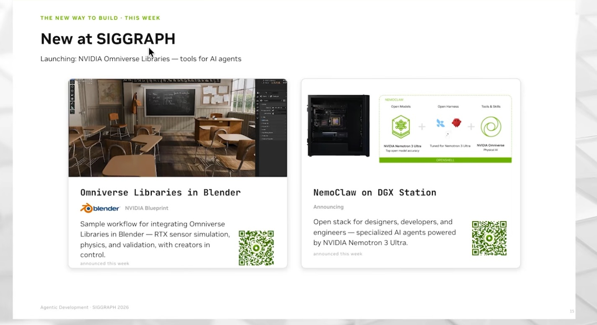
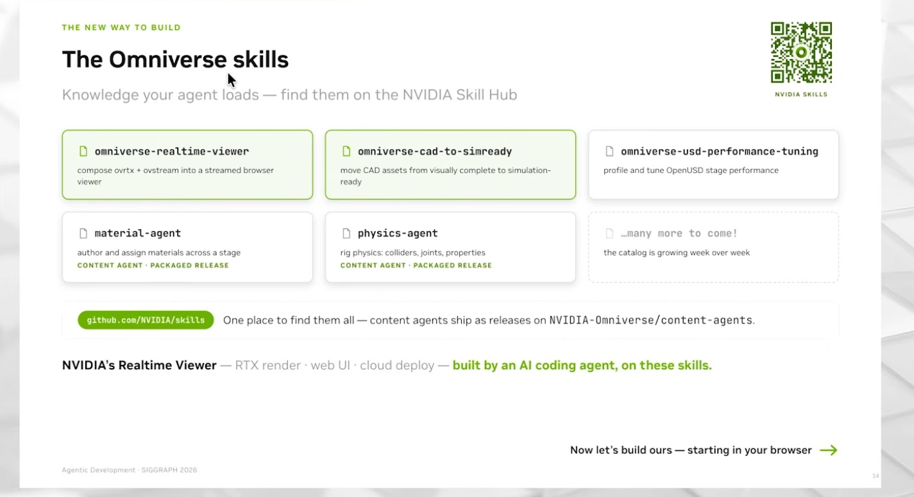

# Streaming a Kit app to a browser, and the 2026 shift to Omniverse libraries

Two ways to put an RTX-rendered USD scene in a browser. The first is what Omniverse Basic Training 08 does with a Kit
app. The second is what NVIDIA showed at SIGGRAPH 2026: smaller libraries plus agent skills.

## 1. Kit App Streaming (Basic Training 08)

What the tutorial does, in order (`NVIDIA OMNIVERSE TUTORIALS/Omniverse B.T. 08 (3D Configurator use case - Stream
Omniverse to Browser and React-Web-App).txt`):

1. Install Node.js and check the versions the sample asks for.
2. Clone NVIDIA's `web-viewer-sample`, then `npm install` and `npm run dev`; the page waits at `localhost:5173` for a
   stream.
3. In the Kit App Template, `./repo.sh template new` → Application → USD Composer → "do you want to add application
   layers?" → **yes**, select the streaming layer. Then `./repo.sh build`.
4. Launch headless: `./repo.sh launch -- --no-window`. Wait for "app ready" and "RTX ready" in the log, then reload the
   page. The USD Composer viewport appears in the browser, and Action Graphs in the stage still run.
5. React sample: `npm install`, `npm run dev`, point the stream server at localhost, and set the event name and
   attribute in the message helper to match the Action Graph listener (`set_colors`, attribute `colors`). A new
   "blue" button sends the event.

The author's React button sent the right event (visible in the browser console) but the variant did not change on
camera; he left the fix for later. Names are case-sensitive on both ends.

```bash
# GPU box, Linux. Kit App Template tag matching your Kit SDK (107.x; verify), Node.js LTS.
git clone https://github.com/NVIDIA-Omniverse/kit-app-template && cd kit-app-template
./repo.sh template new          # Application -> USD Composer -> add application layers: yes -> streaming
#   then add "physicalai.atlas.tools" = {} to the new .kit file (kit/add_to_app.kit) BEFORE building
./repo.sh build
./repo.sh launch -- --no-window # pick the streaming app; wait for "RTX ready"

git clone https://github.com/NVIDIA-Omniverse/web-viewer-sample && cd web-viewer-sample
npm install && npm run dev      # open http://localhost:5173
```

### Pressing this extension's buttons from the browser

Basic Training 08 routes browser buttons through the Kit message bus to an OmniGraph `On Message Bus Event` node. The
Atlas Tools extension listens on the same bus, so no graph is needed:

| Side | What to send or handle |
|---|---|
| Browser (web-viewer-sample or the React sample) | a custom message with event type `atlas_switch_variant` and payload `{"mode": "next" \| "random", "variant_set": "material"}` (verify: the sample's message format, e.g. `AppStreamer.sendMessage(JSON.stringify({event_type, payload}))`) |
| Kit (`extension.py`) | `create_subscription_to_pop_by_type(type_from_string("atlas_switch_variant"), ...)` on `get_message_bus_event_stream()`; `helpers.parse_variant_event` validates the payload and rejects bad names with a status message instead of failing silently |

That second row is the fix for the tutorial's silent failure: when the event name or a payload key is wrong, the window
says so.

## 2. SIGGRAPH 2026: Omniverse libraries and skills

Source: `NVIDIA Physical AI | SIGGRAPH 2026/Physics-Aware RTX Apps with NVIDIA Omniverse Libraries  Physical AI Day at
SIGGRAPH 2026.txt` (auto-captioned; quotes are as reported in the talk) and digest
`context/sources/04-siggraph-2026-physical-ai-day.md` §5.



*"New at SIGGRAPH: NVIDIA Omniverse Libraries, tools for AI agents": Omniverse Libraries in Blender (NVIDIA Blueprint)
and NemoClaw on DGX Station. Agentic Development talk, SIGGRAPH 2026.*

The talk presents five libraries as building blocks instead of one application (09:47–10:59):

| Library | Job, as described in the talk | Kit-era counterpart in this folder |
|---|---|---|
| OV Stage | Brings USD content "into a sort of accelerated space where you can run simulations" | `omni.usd` stage in Kit |
| OVRTX | Sensor rendering: beauty passes plus non-visual sensors such as lidar and radar | Kit's RTX renderer |
| OV Physics | GPU physics for robots and large factories | `omni.physx.bundle` in the `.kit` file |
| OV Stream | Decouples client from server rendering; WebRTC to the browser (20:53–20:56) | Kit App Streaming layer + web-viewer-sample |
| OVUI | "An evolution of what we had in Omniverse Kit called Omni UI. Still the same API" (10:40–10:46) | `omni.ui` window in `extension.py` |

The last row matters for this folder: the `omni.ui` layout code in `extension.py` is the API OVUI keeps, so the
window should port with little change (not tested; no OVUI build here).



*"The Omniverse skills: knowledge your agent loads", from the NVIDIA Skill Hub (`github.com/NVIDIA/skills`); content
agents ship as releases on `NVIDIA-Omniverse/content-agents`. Agentic Development talk, SIGGRAPH 2026.*

The skills on the slide: `omniverse-realtime-viewer` (compose ovrtx and ovstream into a streamed browser viewer),
`omniverse-cad-to-simready`, `omniverse-usd-performance-tuning`, `material-agent` (author and assign materials across a
stage) and `physics-agent` (rig colliders, joints, properties). The speaker describes the real-time viewer skill as
teaching an agent to combine OVRTX, OV Stream and OV Physics into a viewer "using best practice" (12:37–12:50), and the
co-host calls skills "the agent's playbook" (11:47–11:50). The slide says NVIDIA's own Realtime Viewer was "built by an
AI coding agent, on these skills."

### What changes for a workflow like this one

| Step | Kit extension (2025 tutorials) | Libraries + skills (SIGGRAPH 2026) |
|---|---|---|
| Start | `repo.sh template new`, pick an app template | An agent loads `omniverse-realtime-viewer` and scaffolds a viewer |
| UI | `omni.ui` in an extension, hot-reloaded in Kit | OVUI, same API, outside Kit |
| Stream | Streaming application layer, `--no-window`, web-viewer-sample | OV Stream (WebRTC) |
| Materials and physics on a new asset | By hand in USD Composer (Basic Training 01) | `material-agent`, `physics-agent` |
| Verification | Click through it | The talk's loop: "Plan, change, test, verify" (05:30–05:36); tests and reports the agent writes |

The 2026 path is announced, not something this repo ran. The Kit path is what the tutorials show working end to end,
apart from the React button.

## Not executed here

Nothing on this page ran in the cloud container: no Kit, no RTX, no Node.js streaming. The payload parser
(`helpers.parse_variant_event`) is unit-tested on CPU.
