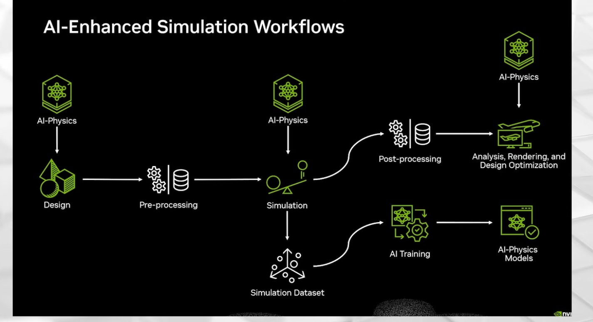
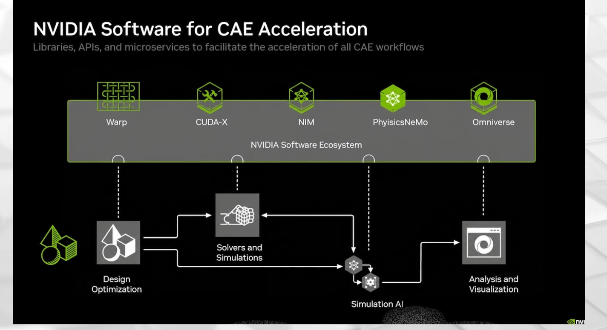
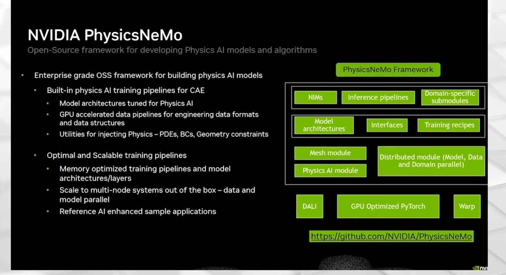
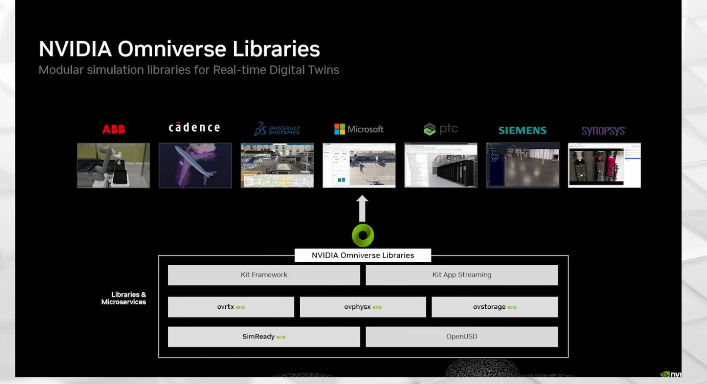
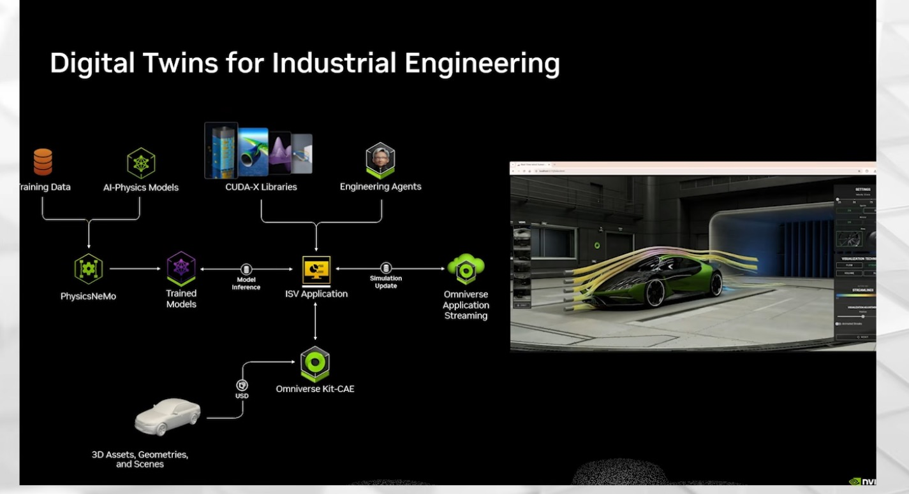

# 11 — Real-time engineering twin: AI-physics surrogate for heat-sink design

> Reproduces the pattern of the SIGGRAPH 2026 real-time digital twin talk: train an AI surrogate on a trusted
> solver, explore thousands of designs in milliseconds, verify the winner with the solver. Here the solver is a
> Warp finite-volume heat-sink model and the surrogate a numpy MLP, both run on CPU. The search is for the optimal
> fin channel spacing, the problem of the talk's agent demo.

## Source evidence

| Evidence | What it shows |
|---|---|
|  | "AI-Enhanced Simulation Workflows": design, pre-processing, simulation, post-processing, then analysis and design optimization; simulation feeds a simulation dataset, AI training, and AI-physics models, which feed back into design and simulation. SIGGRAPH 2026 real-time twin talk. |
|  | "NVIDIA Software for CAE Acceleration": Warp, CUDA-X, NIM, PhysicsNeMo and Omniverse under design optimization, solvers and simulations, simulation AI, and analysis and visualization. Same talk. |
|  | "NVIDIA PhysicsNeMo": open-source framework for physics AI models; model architectures, training recipes, mesh and distributed modules on DALI, GPU-optimized PyTorch and Warp; `github.com/NVIDIA/PhysicsNeMo`. Same talk. |
|  | "NVIDIA Omniverse Libraries — modular simulation libraries for real-time digital twins": Kit Framework, Kit App Streaming, ovrtx, ovphysx, ovstorage, SimReady, OpenUSD; partner apps from ABB, Cadence, Dassault Systèmes, Microsoft, PTC, Siemens, Synopsys. Same talk. |
|  | "Digital Twins for Industrial Engineering": training data and AI-physics models into PhysicsNeMo, trained models served by inference to an ISV application with CUDA-X libraries and engineering agents, 3D assets by USD into Omniverse Kit-CAE, Omniverse application streaming; a car wind-tunnel twin with streamlines. Same talk. |

Transcript used: `NVIDIA Physical AI | SIGGRAPH 2026/How to Build a Real-Time 3D Digital Twin  Physical AI Day at SIGGRAPH 2026.txt`
(auto-captioned; quotes are as reported in the talk):
- 01:54-03:05: a real-time engineering twin is interactive, physically accurate and in context.
- 03:16-04:39: from physical testing, to CAE, to accelerated computing, to AI physics, where "we can interrogate
  thousands, literally thousands, of designs in a day".
- 05:04-05:28: Warp, CUDA-X, PhysicsNeMo and Omniverse across the CAE design cycle (the CAE acceleration slide).
- 05:42-07:07: the AI-enhanced workflow. Train on "many, many, many different simulation results of a
  high-fidelity CFD simulation. So, it's results that we trust", then use the surrogate "in lieu of or in addition
  to your simulation".
- 07:12-07:52: an aircraft wing surrogate with flap, slat and angle-of-attack inputs, queried in real time.
- 08:04-09:03: Warp, Python with CUDA-class speed; the XLB lattice-Boltzmann code reported at "I think eight times
  faster than JAX".
- 09:15-09:51: PhysicsNeMo as "a recipe book" for training AI models per simulation type.
- 10:52-11:54: Kit-CAE, USD layers for multiple physics in one scene, Flow and IndeX for visualization.
- 12:14-13:09: agents for error-prone CAE chores; a demo where "the agent goes through and finds the optimal ...
  channel spacing for a heat ... transfer dissipation".
- 13:42-14:28: a downloadable blueprint with a pre-trained external-aerodynamics model, Omniverse and CUDA-X.

## What the workflow does

```
  design (n fins, fin height H, load Q)
        |                                                            trusted, slow (0.4 s/design on CPU)
        v
  heat_solver.py  -- Warp kernels: assemble FV system, Jacobi-PCG (device-side scalars, captured graph)
        | 400 designs (stratified samples)                            fixed point on h(dT) for natural convection
        v
  results/dataset.csv  --> surrogate.py: numpy MLP 3-64-64-1 on log(T_max)   (+ quadratic baseline)
                                   | 2 microseconds/design batched
                                   v
                     sweep: 21 fin counts x 61 heights x 4 loads = 5,124 designs in 13 ms
                                   v
                     best spacing per (H, Q)  --> solver re-check of the winners  --> twin.png
```

**The physical model** (`heat_solver.py`). A 50 mm wide aluminium sink (k = 167 W/m K), 4 mm base, 1 mm fins of
height H, 100 mm long in the airflow direction, with a 20 mm chip under the base centre. The 2D cross-section is
solved with cell-centred finite volumes on a 0.5 mm grid. Every exposed surface loses heat by natural convection
to 25 °C air. Channel walls use the Bar-Cohen & Rohsenow correlation for vertical parallel plates, in which h
drops sharply once the channel is narrower than the boundary layers. Outer surfaces use the isolated-plate
correlation. Both depend on surface temperature through the Rayleigh number, so each design is a fixed-point loop
on h. That loop is solved with a secant step in log(ΔT), 4-7 outer iterations (mostly 5-6). More fins add area but choke the
channels, which creates the optimum the talk's agent searched for. Radiation is ignored and air properties are
constant (325 K), so the absolute temperatures are a model, not a product datasheet.

**The solver in Warp.** Assembly, matrix-vector product, vector updates and dot products are Warp kernels. The CG
scalars (alpha, beta, residual) never leave the device. 25 iterations at a time are captured with
`wp.ScopedCapture` and replayed with `wp.capture_launch`, so the host only checks convergence. The same code
selects `cpu` or `cuda:0`.

**The surrogate** (`surrogate.py`). Inputs (channel spacing, fin height, load), target log of the peak temperature
rise. A 3-64-64-1 tanh MLP is trained full-batch with Adam and cosine decay, in plain numpy. A
quadratic least-squares fit is the baseline that justifies the MLP: it is 11x worse on held-out designs.

**The loop** (`run_twin.py`). Build the dataset. Hold out 20 %. Train. Time the solver against the surrogate. Sweep
every fin count at 61 fin heights and 4 loads. Then re-check: at H = 30 mm the solver runs at every fin count for
each load; at H = 15 and 40 mm it runs at the surrogate's winner and its two neighbours.

## Code

| File | Purpose | Runs on | Status |
|---|---|---|---|
| `heat_solver.py` | Warp FV solver, natural-convection correlations, PCG with captured graphs | Warp CPU (executed); CUDA (`--device cuda:0`) | executed here on CPU; CUDA not executed: needs GPU |
| `surrogate.py` | numpy MLP (Adam), quadratic baseline, error metrics | CPU | executed here |
| `run_twin.py` | Dataset, training, timing, sweep, verification, plot, reports | CPU | executed here (400 designs) |
| `train_physicsnemo.py` | Same surrogate with PhysicsNeMo `FullyConnected` and PyTorch | GPU, `nvidia-physicsnemo` | not executed: needs GPU; API names flagged as unverified in the docstring |
| `results/dataset.csv` | 400 solver runs (design, spacing, T_max, R_th, h, iterations, wall time) | — | generated here |
| `results/sweep_optima.csv` | Surrogate-optimal fin count and spacing for each of 244 (H, Q) pairs | — | generated here |
| `results/surrogate_report.json` | Error metrics, timing, verification table | — | generated here |
| `results/twin.png` | Sweep vs solver, held-out parity, temperature field of the winner | — | generated here |
| `tests/test_twin.py` | Analytic slab check, correlation limit, energy balance and optimum shape, MLP fit, sweep shapes, PhysicsNeMo script import | CPU | executed here |

## Run it (GPU box)

Pinned versions as run here: Python 3.11, Warp 1.17.0, numpy 2.4.6, matplotlib 3.11.2. For the GPU parts: a CUDA 12
driver, PyTorch with CUDA, and `nvidia-physicsnemo` (version not pinned here, because it was not installed).

```bash
source .venv/bin/activate
cd physical-ai-project/workflows/11-industrial-twins
python heat_solver.py                         # four designs, prints T_max and solver stats (CPU)
python run_twin.py                            # the full loop on CPU, about 4 minutes, writes results/
python run_twin.py --device cuda:0            # same loop with the Warp solver on a GPU (not executed: needs GPU)
pip install nvidia-physicsnemo                # GPU box only
python train_physicsnemo.py --data results/dataset.csv --out out/physicsnemo   # not executed: needs GPU
```

## Source step → code map

| Source step (transcript or screenshot) | Code location |
|---|---|
| AI-enhanced workflow slide: Design | `heat_solver.Design`, `run_twin.sample_designs()` |
| Slide: Simulation ("results that we trust", 05:42-07:07) | `heat_solver.solve()` (Warp kernels `assemble`, `cg_*`) |
| Slide: Simulation Dataset | `run_twin.build_dataset()` → `results/dataset.csv` |
| Slide: AI Training → AI-Physics Models | `surrogate.MLP.fit()`, `run_twin.train()` |
| Slide: Analysis, Rendering and Design Optimization ("thousands of designs", 04:30) | `run_twin.sweep()` (5,124 designs) and `plot()` |
| Use the surrogate "in lieu of or in addition to your simulation" (06:44-06:51) | `run_twin.verify()` re-runs the solver at the winners |
| Agent demo: optimal channel spacing for heat dissipation (12:57-13:09) | `sweep()` picks the fin count per (H, Q); `results/sweep_optima.csv` |
| CAE slide: Warp under design optimization, solvers and simulations | `heat_solver.py` (Warp kernels, captured graph) |
| CAE slide: PhysicsNeMo under simulation AI; PhysicsNeMo slide | `train_physicsnemo.py` |
| Industrial-twins slide: trained models → model inference → ISV application | `surrogate.MLP.predict()` (26 µs per single query) |

## Gotchas from the sources

- **The surrogate is only as trustworthy as its training data.** The talk insists on training from "high-fidelity
  ... results that we trust" (06:34-06:41). Here the solver is checked first: an analytic slab case to 1e-8,
  energy balance better than 1e-8 on all 400 designs, and a 0.25 mm vs 0.5 mm grid comparison within 0.02 %.
- **Use the surrogate "in lieu of or in addition to" the solver** (06:44-06:51). The sweep winners are re-checked
  with the solver. That caught one off-by-one-fin pick (below), invisible from the surrogate alone.
- **Each simulation type needs its own training recipe.** That is the talk's reason for PhysicsNeMo as a "recipe
  book" (09:29-09:51). In this case the choices that mattered: a log target (peak temperature rises span 17-247 K), inputs
  scaled to [-1, 1], and enough data. With 40 designs instead of 400 the same MLP overfit: test MAPE 9.7 %, train
  0.02 %.
- **Found while building: in narrow channels h is almost proportional to ΔT.** Plain fixed-point substitution of h
  then oscillates and needed 15-20 outer iterations. A secant step in log(ΔT) needs 4-7.
- **Found while building: per-launch host overhead dominates a CG loop on the Warp CPU device.** Moving alpha and
  beta onto the device and replaying 25 iterations per captured graph made the 0.5 mm solves 0.2-1.0 s each.
- **Found while building: averaging surface temperature over all cells** includes the air cells, which hold zero,
  and gives h values 10x too low. The face counts must be masked to solid cells.

## What we verified here

Executed in the cloud container (4 CPU cores, no GPU) on 2026-10-03; versions in `results/run_metadata.json`.

- **Solver checks.** The analytic slab (uniform flux in, convection out) matches q(1/h + (tb - dx/2)/k) to a
  relative 1e-8 (`test_slab_matches_analytic`). The largest energy-balance error over the 400 designs is 8.8e-9.
  Grid check on 4 designs, 0.5 mm vs 0.25 mm grid: 87.600 vs 87.613 K, 63.446 vs 63.444 K, 53.834 vs 53.838 K,
  83.932 vs 83.925 K. The Bar-Cohen correlation reduces to the isolated-plate law for wide channels (within 0.1 %).
- **Dataset.** 400 designs in 171 s of solver time; median 0.40 s per design, 90th percentile 0.76 s.
- **Surrogate, 80 held-out designs.** MLP: MAE 0.44 K, RMSE 0.76 K, max error 5.2 K (9.3 %, one design), MAPE
  0.66 %, R² 0.9997. Training took 4.3 s. Quadratic baseline: MAPE 7.6 %, max error 30.2 K, R² 0.974.
- **Speed.** The surrogate evaluates all 5,124 sweep designs in 10.6 ms (2.1 µs each). A single query takes 26 µs.
  Against the 0.40 s median solve that is about 190,000x batched and 15,000x per single query. The same sweep with
  the solver would take about 34 minutes on this CPU (estimate from the median, not run).
- **Design result.** The surrogate's optimal spacing is 6.0-8.8 mm (6 to 8 fins on 50 mm) and narrows as the load
  rises. A hotter sink drives faster convection with thinner boundary layers, which is the qualitative trend of the
  Bar-Cohen & Rohsenow optimum-spacing result.
- **Verification of winners (12 cases).** At H = 30 mm the solver swept all 21 fin counts for Q = 5, 10, 15 and
  20 W. The surrogate's optimum equals the solver's in 4 of 4 cases (6, 7, 7, 8 fins), with prediction errors of
  0.04-0.31 K at the winner. At H = 15 and 40 mm (winner and ±1 fin checked), 7 of 8 match. For H = 15 mm and
  Q = 5 W the surrogate chose 6 fins and the solver prefers 7: a regret of 0.37 K, about 1 %.
- `pytest 11-industrial-twins`: 6 tests pass.

Not executed: `train_physicsnemo.py` (no PhysicsNeMo or CUDA PyTorch here), the solver on CUDA, any Omniverse or
Kit-CAE visualization, and any comparison with a commercial CFD/CHT code or measurement. The convection model is a
textbook correlation, so the twin is only as accurate as that correlation.
