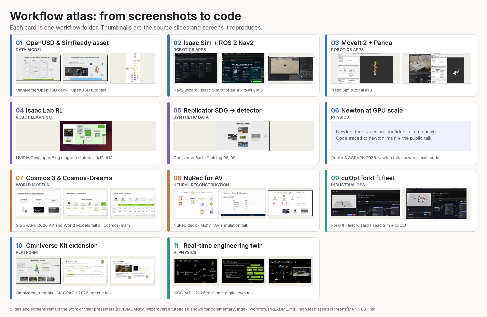
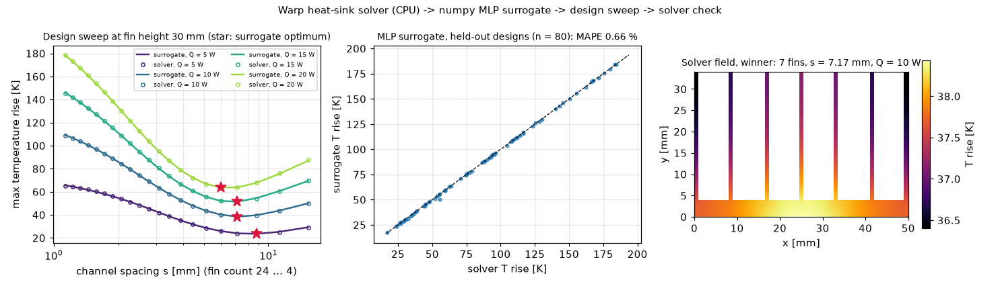

# Workflow atlas: from screenshots and transcripts to code

The screenshots in this repo record NVIDIA's Physical AI workflows as they were taught: slides from SIGGRAPH 2026 and
GTC talks, an OmniGraph inspector, Nav2 and forklift-fleet wizards, Isaac Sim and RViz windows. The transcripts record
what each speaker and tutorial author said, step by step. This atlas turns each documented workflow into code.

Every folder does four things:

1. **Shows the evidence**: the source screenshots, embedded from `../assets/screens/` (vetted copies; the
   confidential Newton deck is never used), and the transcripts it follows.
2. **Explains the mechanism** in an engineer's words.
3. **Maps every source step to code**, in a "Source step → code map" table.
4. **Runs what a CPU can run** and ships the GPU code marked "not executed: needs GPU" (decision D-10: no rented
   GPU). "What we verified here" says exactly what ran.



## The folders

| # | Workflow | Physical AI layer | Ran here (CPU) | GPU code, not executed |
|---|---|---|---|---|
| [01](01-openusd-simready/) | OpenUSD SimReady asset | Data model | 10-layer asset built from the SimReady slide; validator 13/13; loads in Newton with the same mass and DOFs as the URDF; LIVERPS demo | — |
| [02](02-isaac-sim-ros2-nav2/) | Isaac Sim + ROS 2 Nav2 | Robot software in the loop | The 11-node drive graph checked value by value against the inspector screenshot; TF tree, DDS settings, Nav2 order | Isaac Sim graph builder, Docker Compose stack, Nav2 bring-up |
| [03](03-moveit2-panda/) | MoveIt 2 + Franka Panda | Motion planning | Joint-topic graph, the `moveit_controllers.yaml` fix, the 4-line xacro patch | Isaac Sim script, MoveIt launch |
| [04](04-isaac-lab-rl/) | Isaac Lab RL | Robot learning | Reward and termination math; Isaac Lab ↔ MuJoCo joint maps equal Newton's; the shipped ANYmal policy walks 2.71 m in 3 s in Newton | Custom G1 task, PPO config, train / play / ONNX export |
| [05](05-replicator-sdg/) | Replicator SDG → detector | Synthetic data, perception | KITTI parsing, statistics, 14% split, AP@0.5; semantics filter on real USD stages | Replicator script, TAO DetectNet_v2 specs, torchvision trainer |
| [06](06-newton-gpu-scale/) | Newton at GPU scale | Physics | Worlds N = 1–64 with and without CUDA-style graph capture on CPU; tiled camera renders color, depth, and semantic clips plus ground truth | 256 → 16,384-world sweep, 1280×720 renders |
| [07](07-cosmos-world-models/) | Cosmos 3 and Cosmos-Dreams | World models | 25 transfer specs; 20 Reasoner prompts with parsers; incident agent on mock replies; toy closed loop with a ranking test | Live Reasoner and Generator calls |
| [08](08-nurec-av/) | NuRec for AV | Neural reconstruction | Capture prep (sync, dropped frames, pose jumps, COLMAP and nerfstudio output); Mcity cost model; novel-view envelope | gsplat training |
| [09](09-cuopt-forklift-fleet/) | cuOpt forklift fleet | Industrial operations | Waypoint graph, cuOpt request, CPU solver (optimal on the 2-forklift case; 1.9% mean gap on random cases) | cuOpt REST client, Ackermann graph in Isaac Sim |
| [10](10-omniverse-kit-extension/) | Omniverse Kit extension | Platform | Extension manifest and `.kit` parse; USD reference and variant operations on real stages | The `omni.ui` window inside Kit |
| [11](11-industrial-twins/) | Real-time engineering twin | AI physics | Warp heat-sink solver; numpy MLP surrogate (0.66% error on held-out designs, about 15,000× faster per query); design sweep checked by the solver | PhysicsNeMo training |

## How the workflows connect

The folders follow the data flywheel from the SIGGRAPH and GTC talks:

```
 01 describe the robot (OpenUSD)  ──►  02/03 run its software against a virtual body (Isaac Sim + ROS 2)
        │                                         │
        ▼                                         ▼
 06 simulate thousands of worlds (Newton)  ──►  04 train a policy (Isaac Lab), test it in a second simulator
        │
        ▼
 05 render labeled data (Replicator)  ──►  07 make it photoreal and judge it (Cosmos 3)
                                                  │
 08 rebuild a real place from logs (NuRec)  ◄─────┘  evaluate somewhere other than where you generated
        │
        ▼
 09 / 11 operate the facility (cuOpt routing, AI-physics twins)  ──►  failures feed back to 01
```

The flagship project (`../project/`) runs the physics end of this loop with measured results: the Phase 0 solver
bake-off, the terrain study, and the Cosmos judge protocol.

## Measured highlights



| Folder | Result |
|---|---|
| 01 | USD-loaded robot settles at 0.4585 m vs 0.4587 m from the URDF after 1 s |
| 04 | The PhysX-trained ANYmal policy walks 2.714 m in 3.0 s in Newton with no fall |
| 06 | Graph replay is bit-identical to plain stepping; 3 worlds render 121 frames at 16.8 ms per frame |
| 07 | Ranking preservation (Kendall tau) drops from 1.0 to 0.2 as the toy renderer degrades |
| 08 | The Mcity slide's items sum to $2,308.40: about 65× cheaper and 90× faster than a hand-built twin |
| 09 | 5 forklifts, 20 targets: 216 s makespan, against a 164.7 s lower bound |
| 11 | Surrogate MAPE 0.66% on 80 held-out designs; optimum confirmed by the solver in 4 of 4 sweeps |

All numbers are CPU measurements in a 4-core cloud container. Talk numbers inside the READMEs are hedged as reported
in the talk.

## What was not run, and how it is marked

- GPU, Isaac Sim, Isaac Lab, Kit, TAO, cuOpt, and Cosmos model paths carry "not executed: needs GPU" in their docstrings
  and READMEs. Their imports are guarded so the CPU tests can import the modules.
- API ids the sources do not show are marked `# verify:` in the code (folders 02–05, 09, 10), or listed under
  "Not confirmed" in the README (folders 07, 08). Confirming them is backlog item B-17.
- The Cosmos incident agent's scores come from hand-written mock replies. They test the harness, not the model.

## Check everything

```bash
cd physical-ai-project/workflows
ruff check . && ruff format --check .
pytest                                  # 209 tests, about 35 s on 4 CPU cores
python check_workflows.py               # README contract, links, every .py compiles
python3 ../../scripts/check_screens.py  # no confidential screenshot copied anywhere
```

`TEMPLATE.md` is the folder contract. `../assets/screens/MANIFEST.md` lists every screenshot with its source.
